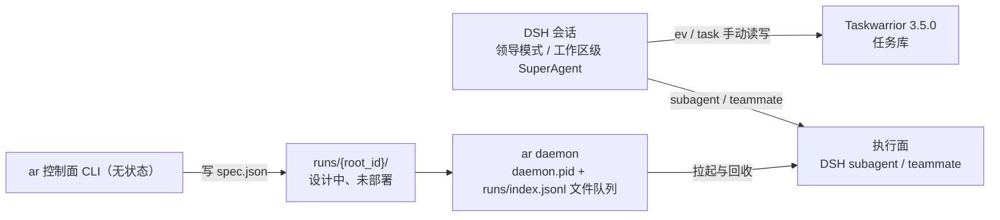

# `ar` 控制面 CLI 与运行目录

> 状态：设计中、未部署 · 上位文档：[ADR 0008](adr/0008-local-agent-runtime.md)、[多 Agent 运行时](multi-agent-runtime.md)、[ADR 0010](adr/0010-retire-dsbot-native-ui.md) · 关联：[系统拓扑](system-topology.md)、[控制面契约](control-plane-api.md)、[Worker 适配器](worker-adapters.md)
>
> 本文定义 `ar` 控制面 CLI（0.1.0，19 个动词）与运行目录 `runs/<root_id>/` 的职责边界、协议细节与演进路径。编排与交互由 DSH 承担（会话内领导模式，工作区级 SuperAgent），执行落在 DSH subagent / teammate；`ar` 只做控制面，不做编排，也不做执行。[多 Agent 运行时](multi-agent-runtime.md) 是协议规格（信封、节点树、程序化约束），本文是落地形态。

## 1. 三层：会话、任务库、执行面

任务库与执行面之间当前没有自动链路：任务库由人 / Agent 通过 `ev` / `task` 手动读写，没有进程自动消费它。`ar daemon` 只读运行目录里的派发意图，走 `daemon.pid` 与 `runs/index.jsonl` 文件队列，不监听 TCP。

| 组件 | 运行位置 | 职责 | 不负责 |
|---|---|---|---|
| **`ar` CLI** | 任意调用方（受限入口脚本、DSH 会话、人工） | 无状态命令：读写运行目录、查询状态、投递派发意图 | 不常驻、不持有执行单元、不做编排 |
| **`ar daemon`** | 用户交互式会话（登录计划任务拉起） | 消费运行目录中的派发意图，拉起 / 监控 / 回收执行单元 | 不做路由决策、不写任务库 |
| **执行单元** | DSH subagent / teammate，或 `agent` 字段指定的适配器 | 在节点目录或 Worktree 内执行 `spec.json` | 不知道兄弟节点，只写自己的结果 |

`ar` CLI 0.1.0 已在本机就位（`%USERPROFILE%\.local\bin\ar.cmd`）；`ar daemon` 与运行目录设计中、未部署。

两个接缝的理由不同。**控制面与执行面分开**，是因为执行单元的生命周期由执行方管（DSH subagent 会话、CLI 进程或远端节点），`ar` 只留无状态命令与磁盘上的意图，崩溃后按目录恢复。**daemon 放在用户会话**，是因为 Windows 的会话边界：Session 0 的服务看不到交互式桌面，而 `agent-desktop`、ego(lite) 与所有 GUI 自动化只能在已登录用户会话里工作。长远看 daemon 换成远程节点（常驻机、云、Tailscale 对端）时，这个接缝不用动——意图本就是落在磁盘上的文件。

## 2. 执行面：进程隔离与工具面裁剪

每个节点由执行方拉起一个执行单元，工作目录为节点目录或其 Worktree。默认执行面是 DSH subagent / teammate：会话内由领导模式派发，工作区级由 SuperAgent 派发；`agent` 字段声明走哪个适配器（见 §3）。

- **故障边界即进程边界**：执行单元崩溃只死一个节点，`stdout.log` 天然落盘；重试重跑一个节点，不影响整棵树。
- **技能与提示词可组合**：DSH subagent 直接继承会话的技能与工具白名单；pi 适配器复用 `%USERPROFILE%\.agents\skills\` 的技能仓，不另造一套 Skill 装载机制。
- **编排不在节点内**：编排归 DSH 会话，节点只执行 `spec.json`，不自己派生兄弟节点。

pi 适配器的工具面由名为 **`aica-pi`** 的 pi package 提供：`ev`（写回状态）、`kn`（知识检索）、`agent-desktop`（UIA 操作）、`ego-browser`（网页）、`ar`（子节点派发）。DSH 侧的工具面由 subagent 的工具白名单裁剪。工具清单随 `spec.json` 声明裁剪——普通执行单元不给 `ar` 就无法自行派发，编排会话不给执行工具就无法「顺手自己做完」。约束来自能力不存在，不来自提示词叮嘱。

## 3. 信封扩展：`agent` 字段

`spec.json` 增加一个 `agent` 字段，声明该节点由哪类执行单元执行：

| `agent` 值 | 底层实现 | 适用 |
|---|---|---|
| `dsh`（默认） | DSH subagent / teammate | 会话内多步任务、需要继承会话上下文的工作 |
| `pi` | daemon 拉起 pi 进程 | 本机 GUI 自动化、Provider 编排 |
| `claude` / `codex` | 对应 CLI 的非交互模式进程 | 跨厂商交叉实现与评审 |
| 未来：`ssh:*` | Tailscale SSH 拉起远端 daemon | 常驻节点落地后的远程执行单元 |

同一信封、不同 spawn 适配器——执行单元对编排透明，新增执行后端只加适配器不改协议。这是「执行单元可替换」原则在进程层的落地。

## 4. 数据面唯一新增：`events.jsonl`

[多 Agent 运行时 §4.3](multi-agent-runtime.md#43-运行目录) 的目录结构之外，每个节点增加 **`events.jsonl`**：执行过程中的结构化事件流（tool_call / file_edit / message / checkpoint 一行一条）。

理由：运行目录是控制面与运行状态的唯一数据面（设计中、未部署）。没有它，客户端只能解析 stdout 文本或事后读 result——进度展示、Run 树视图、diff 预览全都退化为猜测。事件流由执行单元的扩展写入，daemon 与客户端只读。整个运行目录保持纯文件：restic / Litestream 备份、`runs.py` 知识库接入、崩溃后按目录恢复，全部沿用既有链路。

事件格式刻意对齐 **Obelisk**（开源 coding agent session 检索，支持 Pi / Claude Code / Codex 会话，SQLite FTS5 + agent 主动查询）的索引 schema：`events.jsonl` 落盘即被其直接召回，Worker 可查询"上个任务进行到哪、某段代码当初为什么这么写"的原始证据——原始历史全留、不做预判式提炼（RAW-RAG 思路），见 [开源复用清单](open-source-reuse.md#3-模型路由与知识检索) 待验证条目。

## 5. 控制面不做调度

调度（ready 集计算、串行边界、并发通道）、幂等（`ev_id`）、租约与 `+stalled` 看门狗、失败重试与升级，在设计中属运行目录协议的一部分，由执行方持有（设计中、未部署）；当前由 DSH 会话内的编排与 subagent 承担。`ar` 不做第二套调度器——它只回答三件事：**这个 Run 现在长什么样（`check`）、给它一个节点（派发意图）、替我向它说话（`reply`）**。协议层的状态机与七态返回码完全复用，不新增枚举。

## 6. 演进路径

| 阶段 | 落地内容 | 验收标志 |
|---|---|---|
| **v0 主干** | `ar run-create` → 单 execute 节点 → 执行单元 → `result.json` → `ev done` | 一个任务从 `ev add` 端到端走通并写回执行摘要 |
| **v1 协同** | DAG 依赖（`node-create --deps`）、`wait`、`gate`（升级卡片）、`events.jsonl` | 含依赖的多节点 Run 按顺序完成；升级卡片可回复 |
| **v2 分工** | 节点级 `agent` 适配器（`dsh` / `pi` / `claude` / `codex`）、`fork` 与 `resume` | 同一 Run 内跨适配器分工，分叉留版本历史 |
| **v3 客户端** | DSH 会话与手机端消费 `runs/` 与 `events.jsonl`；可选 ACP 导出对接第三方控制面 | 工作站与手机可查看并接管 Run，无需开终端 |

客户端渲染的是运行产物（进度卡片、Run 树、diff 预览），**不渲染 DAG 本身**——图是执行数据不是界面形态，用户面前只有被渲染过的结果。

前置条件：Node.js ≥ 22.19（本机已装 Node v26）；`pi` ≥ 1.5（npm 全局，仅 pi 适配器需要）。源码仓：`C:\Repos\agent-local-runtime`（GitHub `ShizkMoon/agent-local-runtime`，私有），`ar` 经 `%USERPROFILE%\.local\bin\ar.cmd` 进入 `PATH`。

## 7. 技术选型

| 层 | 选型 | 理由 |
|---|---|---|
| `ar` CLI + `ar daemon` | **TypeScript / ESM / Node 22，`node:` 标准库为主** | `aica-pi` 扩展、信封类型、客户端三处已是 TS，全栈单语言避免两套 schema |
| 信封 Schema | **TypeBox** | `pi-ai` 已 re-export，一次定义、CLI / daemon / 扩展 / 客户端四处复用 |
| 执行单元工具面 | **DSH subagent 工具白名单 + `aica-pi` pi package** | 原生扩展点，复用 `%USERPROFILE%\.agents\skills\` 装载机制 |
| 依赖纪律 | **v0 零三方依赖** | `node:util parseArgs` 命令行、`node:child_process` 进程、`node:fs` 信封 |
| Python 存量 | **不动** | `kn` / `hc` 保持 Python，与 TS 侧经命令行与文件隔离 |

## 8. 进程内上下文：记忆环、噪音防火墙与前缀缓存

执行单元的上下文按"重建而非继承"组装，分三个记忆环：

| 环 | 内容 | 进入方式 |
|---|---|---|
| **session** | 本节点会话（思考 + 工具调用） | in-context，唯一自动携带 |
| **run** | 兄弟节点 `result.json` 摘要 + 产物引用 | `ar events <node>` 按需取，只给摘要行 |
| **kb** | 任务库摘要、历史 runs、文档、Obelisk 会话召回 | `kn recall` 查询时进入（RAW-RAG，不预判提炼） |

**噪音防火墙**（WebSearch 等大输出场景）按量级分三档：工具契约默认"全文写 `artifacts/` 落盘、回 ref + 预览片段"；检索返回 top-k 分块限量；本身是脏活的下沉一次性子节点——上下文随进程销毁，父级只见蒸馏摘要。

**前缀缓存保持**：提示词按"不变量在前、变量在后"排序——`[系统角色 + 工具契约 + profile]`（全树稳定可缓存）→ `[kind 级能力说明]`（同类任务复用）→ `[spec.json 变量部分]`（每次必变，放最后）。运行中不增删工具、不改写已发出的前缀；动态信息（进度、新输入）一律追加在尾部。这条直接决定供应商侧 prompt caching 命中率，写 `aica-pi` 的 prompt 模板时按此顺序组织。

## 9. 明确不做

- **不做第二调度器**：ready 集、串行、并发配额归 DSH 会话的编排与运行目录协议，`ar` 不复制。
- **不做会话状态数据库**：`runs/` 目录即状态，可重建、可备份、可审计。
- **不发明 Skill 机制**：直接复用 DSH 技能目录与 pi packages（`%USERPROFILE%\.agents\skills\`）。
- **不给执行单元全量工具**：工具面随 `spec.json` 声明裁剪。
- **不在 v0 引入远程执行单元**：`agent` 字段与 daemon 接缝已预留，但常驻节点落地前不实现。

## 10. dsh-superagent 对照吸收

> DeepSeek 开源的主动 coding agent 原型（`deepseek-ai/dsh-superagent-prototype`，2026-10）经逐文档核对。我们已独立收敛的部分：异步派发、租约看门狗、thread 串行、收件箱界面、accept 信封、祖先升级。值得吸收的增量：

- **`waits_on` 等待对象代数**（最高性价比）：dsh 的 stage 不由生命周期枚举，由"它在等什么"派生——`person:answer|review|delivery` / `dependency` / `trigger` / `working` / `queued`。给节点状态加派生字段 `waits_on`，收件箱即 `person/*` 投影。
- **派发决策可审计 + observe 模式**：派发点目前只留结果；把每次语义准入决策记成 `{candidate, decision, reason, rule_version}` 落到 `runs/`，规则可加 `observe` 标志——只记录不派发，用于安全试错新自动化。
- **完成即事件**：长任务/后台作业完成=注入节点的一条新 trigger，不是轮询返回值。与 [多 Agent 运行时](multi-agent-runtime.md) 的异步派发模型同构，统一语义。
- **单调性派发校验**（MCDT 唯一可计算部分）：`split` 时校验子节点 `accept` 合取覆盖父节点 `accept`，不满足即档 2 拒绝——分解的"覆盖性"从隐含约定升级为显式不变量。
- **看门狗诚实版**：dsh 的语义进度看门狗连他们自己都未实现；我们的计时看门狗是行业常态非短板。廉价升级：`events.jsonl` 连续 N 次同参失败工具调用→标记疑似死循环（80% 效果，0 token）。

## 11. 已验证的协议点（2026-11-04 真机）

> 本节只记「已经能在真机上看到」的协议行为；实现仓 `C:\Repos\agent-local-runtime`（以原生文件为准）。切片清单与界面规范不在本文维护。

| 协议点 | 已验证内容 | commit |
|---|---|---|
| 事件面 | `tool_call` / `file_edit` / `message` 投影成 step；按 `call_id` 折叠流式增量；turn 结局闭集 + reason | `c8ef2f5` |
| 审批 | 决策闭集（`allowed-once` / `rejected` / `cancelled` / `unavailable`）+ fail-closed + 危险路径硬拒（`rm -rf ~` 任何档都放不过） | `62c1a77` |
| 用量与上下文 | turn 级 tokens、预算前置拦截（超 `budget.tokens` 在超之前被拦，拦截事件可审计）、压缩三事件、spill + 诚实截断 | `7c083c0` |
| 恢复与分叉 | 事件 `seq` 连续、孤儿节点有归宿、续跑预算、checkpoint、`fork` 出新 run 不污染旧 run | `f71cab5` |
| 派发与提案 | `spawn` 命名 / 寻址 / 隔离 + 并发策略；回复投递三态（`queue` 落地）；`ev_propose` + `ar propose` 提案目录、路径白名单、stale 保护、字节级回滚 | `fbf9934` |
| 状态聚合 | run 行聚合取最紧急、四态六值、等待态与断线态可区分 | `bdafb81` |
| 验收脚手架 | e2e 夹具（录制回放 + 故障注入）、六道验收门 | `9621bf4` |

**提案验收六条**（逐条跑过）：low 提案落盘生效 / high 无 `--force` 拒绝 / 禁止级直接拒 / verify 失败字节级回滚 / 同 slug 第 4 次 apply 标 stale / 坏 patch 不崩。

### 11.1 未完成

- **MCP 客户端**：执行单元现在显式 `--no-mcp`；接入前要先做工具来源校验与审批三件套的映射。
- **`steer` 真插话**：回复只有「下一轮生效（`queue`）」与「打断重来（`interrupt`）」两态；真插话需要 pi RPC，未开始。
- **提案自动应用（auto-apply）**：`ar propose apply` 一律人审；`risk=low` 由 daemon 直接应用的接缝已留，未合入。
- **运行目录未部署**：`%LOCALAPPDATA%\aica\state\runs\` 本机不存在，`ar daemon` 未运行。

判据：每条都要有"真机可看到的证据"，没有证据不算落地。
