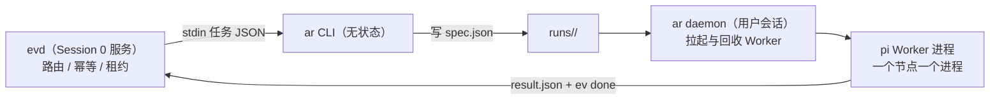

# agent:local 运行时设计

> 状态：设计中 · 上位文档：[ADR 0008](adr/0008-local-agent-runtime.md)、[多 Agent 运行时](multi-agent-runtime.md)、[ADR 0009](adr/0009-dsbot-as-control-interface.md) · 关联：[系统拓扑](system-topology.md)、[事件运行时与派发器](event-runtime.md)、[控制面契约](control-plane-api.md)、[Worker 适配器](worker-adapters.md)
>
> 本文定义 `agent:local` 运行时（`ar` CLI + `ar daemon`）的组件划分、职责边界与演进路径。[多 Agent 运行时](multi-agent-runtime.md)是协议规格（信封、节点树、程序化约束），本文是落地形态。

## 1. 一个运行时，两个进程

| 组件 | 运行位置 | 职责 | 不负责 |
|---|---|---|---|
| **`ar` CLI** | 任意调用方（evd 适配器、受限入口脚本、人工） | 无状态命令：读写运行目录、查询状态、投递派发意图 | 不常驻、不持有 Worker |
| **`ar daemon`** | 用户交互式会话（登录计划任务拉起） | 消费运行目录中的派发意图，拉起 / 监控 / 回收 Worker 进程 | 不做路由决策、不写任务库 |
| **pi Worker** | daemon 拉起的独立进程，每节点一个 | 在节点目录或 Worktree 内执行 `spec.json` | 不知道兄弟节点，只写自己的结果 |

拆成两个进程的原因不是进程洁癖，是 **Windows 的会话边界**：`evd` 作为 WinSW 服务运行在 Session 0，看不到交互式桌面；而 `agent-desktop`、ego(lite) 与所有 GUI 自动化只能在已登录用户会话里工作。daemon 放在用户会话，「派发器不直接 spawn 长活」和「GUI 任务可达」两个问题同时解决。长远看 daemon 换成远程节点（常驻机、云、Tailscale 对端）时，这个接缝不用动——意图本就是落在磁盘上的文件。

## 2. Worker：进程隔离的 pi，而非内嵌 SDK

每个节点由 daemon 拉起一个 `pi` 进程（JSON / RPC 模式），工作目录为节点目录或其 Worktree：

- **故障边界即进程边界**：Worker 崩溃只死一个节点，`stdout.log` 天然落盘；重试重跑一个节点，不影响整棵树。
- **技能与提示词可组合**：pi-coding-agent 原生支持 packages / skills / prompt templates / extensions，直接复用 `%USERPROFILE%\.agents\skills\` 的技能仓，不再发明一套 Skill 装载机制。
- **编排者节点例外**：按协议编排者没有任何执行工具（档 3 约束），其 agent loop 用 `pi-agent-core` 内嵌进 daemon 实现，工具面只暴露「写 `spec.json` / 读 `result.json`」。

Worker 的工具面由名为 **`aica-pi`** 的 pi package 统一提供：`ev`（写回状态）、`kn`（知识检索）、`agent-desktop`（UIA 操作）、`ego-browser`（网页）、`ar`（子节点派发）。工具清单随 `spec.json` 声明裁剪——普通 Worker 不给 `ar` 就无法自行派发，编排者不给执行工具就无法「顺手自己做完」。约束来自能力不存在，不来自提示词叮嘱。

## 3. 信封扩展：`agent` 字段

`spec.json` 增加一个 `agent` 字段，声明该节点由哪类 Worker 执行：

| `agent` 值 | 底层实现 | 适用 |
|---|---|---|
| `pi`（默认） | daemon 拉起 pi 进程 | 本机多步任务、GUI 自动化、Provider 编排 |
| `claude` / `codex` / `dsh` | 对应 CLI 的非交互模式进程 | 跨厂商交叉实现与评审 |
| 未来：`ssh:*` | Tailscale SSH 拉起远端 daemon | 常驻节点落地后的远程 Worker |

同一信封、不同 spawn 适配器——Worker 对编排透明，新增执行后端只加适配器不改协议。这是「Worker 可替换」原则在进程层的落地。

## 4. 数据面唯一新增：`events.jsonl`

[多 Agent 运行时 §4.3](multi-agent-runtime.md#43-运行目录) 的目录结构之外，每个节点增加 **`events.jsonl`**：Worker 执行过程中的结构化事件流（tool_call / file_edit / message / checkpoint 一行一条）。

理由：这是生成式 UI 工作台与 DS-Bot 进度卡片的唯一数据面。没有它，UI 只能解析 stdout 文本或事后读 result——进度展示、Run 树视图、diff 预览全都退化为猜测。事件流由 Worker 的 aica-pi 扩展写入，daemon 与 UI 只读。整个运行目录保持纯文件：restic / Litestream 备份、`runs.py` 知识库接入、崩溃后按目录恢复，全部沿用既有链路。

事件格式刻意对齐 **Obelisk**（开源 coding agent session 检索，支持 Pi / Claude Code / Codex 会话，SQLite FTS5 + agent 主动查询）的索引 schema：`events.jsonl` 落盘即被其直接召回，Worker 可查询"上个任务进行到哪、某段代码当初为什么这么写"的原始证据——原始历史全留、不做预判式提炼（RAW-RAG 思路），见 [开源复用清单](open-source-reuse.md#3-模型路由与知识检索) 待验证条目。

## 5. 不重复 evd 的职责

调度（ready 集计算、串行边界、并发通道）、幂等（`ev_id`）、租约与 `+stalled` 看门狗、失败重试与升级，全部留在 `evd`。`ar` 不做第二套调度器——它只回答三件事：**这个 Run 现在长什么样（`check`）、给它一个节点（派发意图）、替我向它说话（`reply`）**。协议层的状态机与七态返回码完全复用，不新增枚举。

## 6. 演进路径

| 阶段 | 落地内容 | 验收标志 |
|---|---|---|
| **v0 主干** | `ar run-create` → 单 execute 节点 → pi Worker → `result.json` → `ev done` | 一个任务从 `ev add` 端到端走通并写回执行摘要 |
| **v1 协同** | DAG 依赖（`task-create --deps`）、`terminal wait`、`gate-create`（升级卡片）、`events.jsonl` | 含依赖的多节点 Run 按顺序完成；升级卡片可回复 |
| **v2 编排者** | `pi-agent-core` 内嵌编排节点、diverge / converge、plan.v(k) 重规划 | 发散收敛节点按 spec 运行，重规划留版本历史 |
| **v3 界面** | 生成式 UI 消费 `runs/` 与 `events.jsonl`；可选 ACP 导出对接第三方控制面 | 工作站桌面可查看并接管 Run，无需开终端 |

UI 渲染的是运行产物（进度卡片、Run 树、diff 预览），**不渲染 DAG 本身**——图是执行数据不是界面形态，用户面前只有被渲染过的结果。

前置条件：Node.js ≥ 22.19（已安装 Node v26，纳入 `%ProgramData%\aica\managed.list`）；`pi` ≥ 1.5（npm 全局）。源码仓：`C:\Repos\agent-local-runtime`（GitHub `ShizkMoon/agent-local-runtime`，私有），`ar` 经 `%USERPROFILE%\.local\bin\ar.cmd` 进入 `PATH`。

## 7. 技术选型

| 层 | 选型 | 理由 |
|---|---|---|
| `ar` CLI + `ar daemon` | **TypeScript / ESM / Node 22，`node:` 标准库为主** | `aica-pi` 扩展、编排者内嵌 `pi-agent-core`、生成式 UI 共享信封类型三处已是 TS，全栈单语言避免两套 schema |
| 信封 Schema | **TypeBox** | `pi-ai` 已 re-export，一次定义、CLI / daemon / 扩展 / UI 四处复用 |
| Worker 工具面 | **`aica-pi` pi package**（extensions + skills） | 原生扩展点，复用 `%USERPROFILE%\.agents\skills\` 装载机制 |
| 依赖纪律 | **v0 零三方运行时依赖** | `node:util parseArgs` 命令行、`node:child_process` 进程、`node:fs` 信封；与 `evd` 纯标准库取向一致 |
| Python 存量 | **不动** | `evd` / `kn` / `hc` 保持 Python；`evd → ar` 走 stdin/stdout JSON，语言天然隔离 |

## 8. 进程内上下文：记忆环、噪音防火墙与前缀缓存

Worker 进程的上下文按"重建而非继承"组装，分三个记忆环：

| 环 | 内容 | 进入方式 |
|---|---|---|
| **session** | 本节点 pi 会话（思考 + 工具调用） | in-context，唯一自动携带 |
| **run** | 兄弟节点 `result.json` 摘要 + 产物引用 | `ar read <node>` 按需读，只给摘要行 |
| **kb** | 任务库摘要、历史 runs、文档、Obelisk 会话召回 | `kn recall` 查询时进入（RAW-RAG，不预判提炼） |

**噪音防火墙**（WebSearch 等大输出场景）按量级分三档：工具契约默认"全文写 `artifacts/` 落盘、回 ref + 预览片段"；检索返回 top-k 分块限量；本身是脏活的下沉一次性子节点——上下文随进程销毁，父级只见蒸馏摘要。

**前缀缓存保持**：worker 提示词按"不变量在前、变量在后"排序——`[系统角色 + 工具契约 + profile]`（全树稳定可缓存）→ `[kind 级能力说明]`（同类任务复用）→ `[spec.json 变量部分]`（每次必变，放最后）。运行中不增删工具、不改写已发出的前缀；动态信息（进度、新输入）一律追加在尾部。这条直接决定供应商侧 prompt caching 命中率，写 `aica-pi` 的 prompt 模板时按此顺序组织。

## 9. 明确不做

- **不做第二调度器**：ready 集、串行、并发配额归 `evd`。
- **不做会话状态数据库**：`runs/` 目录即状态，可重建、可备份、可审计。
- **不发明 Skill 机制**：直接复用 pi packages 与 `%USERPROFILE%\.agents\skills\`。
- **不给 Worker 全量工具**：工具面随 `spec.json` 声明裁剪，编排者零执行工具。
- **不在 v0 引入远程 Worker**：`agent` 字段与 daemon 接缝已预留，但常驻节点落地前不实现。

## 10. dsh-superagent 对照吸收

> DeepSeek 开源的主动 coding agent 原型（`deepseek-ai/dsh-superagent-prototype`，2026-10）经逐文档核对。我们已独立收敛的部分：异步派发、租约看门狗、thread 串行、收件箱界面、accept 信封、祖先升级。值得吸收的增量：

- **`waits_on` 等待对象代数**（最高性价比）：dsh 的 stage 不由生命周期枚举，由"它在等什么"派生——`person:answer|review|delivery` / `dependency` / `trigger` / `working` / `queued`。给节点状态加派生字段 `waits_on`，收件箱即 `person/*` 投影（界面侧见 [workbench §8.5](workbench-ui.md#85-内容面再定位验收事实节点为中心)）。
- **派发决策可审计 + observe 模式**：`evd` 的 `decide()` 目前只留结果；把每次语义准入决策记成 `{candidate, decision, reason, rule_version}` 落到 `runs/`，规则可加 `observe` 标志——只记录不派发，用于安全试错新自动化。
- **完成即事件**：长任务/后台作业完成=注入节点的一条新 trigger，不是轮询返回值。与 §3.5 异步派发模型同构，统一语义。
- **单调性派发校验**（MCDT 唯一可计算部分）：`split` 时校验子节点 `accept` 合取覆盖父节点 `accept`，不满足即档 2 拒绝——分解的"覆盖性"从隐含约定升级为显式不变量。
- **看门狗诚实版**：dsh 的语义进度看门狗连他们自己都未实现；我们的计时看门狗是行业常态非短板。廉价升级：`events.jsonl` 连续 N 次同参失败工具调用→标记疑似死循环（80% 效果，0 token）。

## 11. v3 落地状态（2026-11-04 真机）

> 本节只记「已经能在真机上看到」的东西；设计与验收口径在 [prd-workbench-v3.md](prd-workbench-v3.md) §6（S16–S28）
> 与 §9（自进化），界面规范在 [workbench-ui.md](workbench-ui.md) §9/§10。
> 实现与测试仓：`C:\Repos\agent-local-runtime`；研究证据：本仓 [research/](research/)。

### 11.1 R2 切片 S16–S28 全部落地

| 片 | 做了什么 | commit |
|---|---|---|
| S16 | 视图契约化：把 `apiView` 的投影抽成纯函数 `workbench/view.ts` + 类型 + 3 个真机 run 的快照测试 | `c8ef2f5` |
| S17 | 工具时间线：`tool_call/tool_update/file_edit` 投影成 step；补流式投影（`message_update→agent_delta`、按 `call_id` 折叠）；turn 结局闭集 + reason | `c8ef2f5` |
| S18 / S23 / S24 / S26 | diff 聚合（文件级 `+N −M` + 展开前 40 行）、计划条与 reviewer 三档、命令面板与键盘最小集、健康页 + 审计面 + 断线黄条与全量校准 | `b8487f7` |
| S19 | 审批重做：决策闭集（`allowed-once/rejected/cancelled/unavailable`）+ fail-closed + 三件套分离 + 危险路径硬拒 + 卡上动作由 `opts[]` 生成 | `62c1a77` |
| S20 | 用量与上下文：turn 级 tokens、预算前置拦截、压缩三事件、spill + 诚实截断 | `7c083c0` |
| S21 | 恢复与分叉：事件 `seq`、孤儿归宿、续跑预算、checkpoint、`fork` | `f71cab5` |
| S22 / S28 | `spawn` 子代理（命名/寻址/隔离 + 并发策略）、回复投递三态（`queue` 落地）；`ev_propose` + `ar propose` 提案目录、路径白名单、stale 保护、字节级回滚 | `fbf9934` |
| S25 | 状态体系：run 行聚合取最紧急、四态/六值、等待态 shimmer、两档密度、断线态 | `bdafb81` |
| S27 | 验收脚手架：e2e 夹具（录制回放 + 故障注入）、UI 断言、六道验收门 | `9621bf4` |

**R3 追加（真机在用）**：提案页签、inbox 提案卡、左栏「测试」分组归档、plan mode（只读规划）、`@file` 引用、
`profile` 闭集（orchestrator/advisor/worker/reviewer/plan）、gate 只读分档、桥启动传 `AICA_REPO_ROOT`
（`cb34235` / `ed072de` / `41e17ec` / `be01871` / `df2be66`；记录见 `d64742f`）。

### 11.2 测试读数

`node --test workbench/test` → **172 tests / 167 pass / 5 skipped / 0 fail**
（skip 均为显式原因：夹具无 stdout、严格态尚未实现——不是"跑绿了"的修辞）。

> 复跑注意：工作树里若有未合并的 R4 改动给 `RunView` 加了字段（`profile`/`parallel` 等），
> 3 个真机快照会因**字段新增**而失配，需 `UPDATE_SNAPSHOTS=1` 重生成；属记录滞后，不是功能回归。

### 11.3 真机证据（2026-11-04 逐条看过）

- **壳无控制台启动**：`workbench.cmd` 起 MyGo 外壳，无黑窗、单实例唤醒、日志落 `state/`；
- **审批卡三动作**：允许一次 / 本会话都允许（记住 `工具 × tier × 目标`）/ 拒绝并说明原因；卡片出现 500ms 内 `Enter` 不生效；`rm -rf ~` 直接硬拒，任何档都放不过；
- **预算拦截**：mock 一个超 `budget.tokens` 的节点 → 在超之前被拦，拦截事件在审计面可见；
- **fork**：从任一节点 fork 出新 run，`seq` 连续、孤儿节点有归宿、旧 run 不被污染；
- **`ev_propose` 六条验收**：low 提案落盘生效 / high 无 `--force` 拒绝 / 禁止级直接拒 / verify 失败字节级回滚 / 同 slug 第 4 次 apply 标 stale / 坏 patch 不崩；
- **plan 模式真跑**：`profile=plan` 的 worker 只读源码（gate 只读分档放行读取），产出计划条而不是改动。

### 11.4 剩下的 R4（未开工 / 在途）

- **MCP 客户端**（七家里 5 家有）：worker 现在显式 `--no-mcp`；接入前要先做工具来源校验与审批三件套的映射（T3 A5 的教训）。
- **`steer` 真插话**：回复目前只有「下一轮生效（`queue`）」与「打断重来（`interrupt`）」；「插话」在 UI 里显式置灰并写明"需 pi RPC"。
- **提案自动应用（auto-apply）**：现在 `ar propose apply` 一律人审；设置面板里已有「低风险提案自动应用」开关的接缝（`risk=low` 由 daemon 直接应用），未合入。
- 另有：设置面板本身（并发上限 / 主题 / 闸门默认值，贴右栏 sheet）在途。

**R4 的判据与 R2 相同**：每条都要有"真机可看到的证据"，没有证据不算落地。

## 12. 交互层回调：DS-Bot 前端 + 控制面契约（ADR 0009）

> 2026-11-04 起，交互层不再以 [§11](#11-v3-落地状态2026-11-04-真机) 所述工作台为主界面（[ADR 0009](adr/0009-dsbot-as-control-interface.md)）；2026-11-06 起 DS-Bot 前端亦撤回，交互层回到 DSH 原生会话（[ADR 0010](adr/0010-retire-dsbot-native-ui.md)）。**执行层结论全部不变**：`runs/` 仍是唯一权威，`events.jsonl` 仍是唯一数据面。

**三处变化**：

- **主界面换成 DS-Bot**。§4 的 `events.jsonl` 消费者从"工作台投影"改为"控制面 `ar watch` → 任意前端"；DS-Bot 只缓存 `root_id` 与摘要行，不持有 Run 状态（[控制面契约 §5](control-plane-api.md#5-状态权威)）。
- **工作台降为可选旁路**。`workbench/` 保留（Run 树、diff、fork 的图形查看），不再作为交付目标扩展；§11.1 的 R2/R3 切片与 172 个测试转为回归基线，不再有新增切片。
- **命令面冻结**。`src/cli.ts` 的子命令分两类：契约内（`run-create` / `node-create` / `check` / `wait` / `reply` / `gate` / `events` / `read` / `done` / `fail` / `abort` / `fork` / `propose`，外加新增 `list` 与 `watch`）与内部（`dispatch` / `spawn` / `cmd` / `daemon` / `version`）。内部子命令不进契约，可自由演进。

**仍然有效、不要误读为被推翻的部分**：§2 的 Worker 进程隔离与 `aica-pi` 工具面、§3 的信封 `agent` 字段、§5「不重复 evd 职责」、§8 的三环上下文与前缀缓存纪律、§9 的全部"明确不做"。

**唯一需要重写实现的一处**：`aica-pi` 的 `gate.ts` 是 pi 扩展形态的工具面闸门；Codex 与 Claude Code 没有等价扩展点，其工具面收窄只能靠各自 flags，审批因此前移到派发点（见 [控制面契约 §4](control-plane-api.md#4-卡片语义与审批) 与 [Worker 适配器 §4](worker-adapters.md)）。
