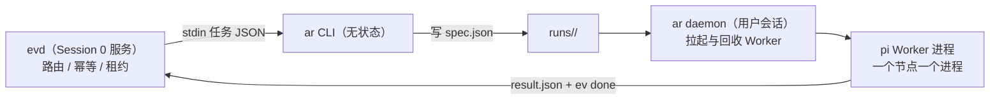

# agent:local 运行时设计

> 状态：设计中 · 上位文档：[ADR 0008](adr/0008-local-agent-runtime.md)、[多 Agent 运行时](multi-agent-runtime.md) · 关联：[系统拓扑](system-topology.md)、[事件运行时与派发器](event-runtime.md)
>
> 本文定义 `agent:local` 运行时（`ar` CLI + `ar daemon`）的组件划分、职责边界与演进路径。[多 Agent 运行时](multi-agent-runtime.md)是协议规格（信封、节点树、程序化约束），本文是落地形态。

## 1. 一个运行时，两个进程

| 组件 | 运行位置 | 职责 | 不负责 |
|---|---|---|---|
| **`ar` CLI** | 任意调用方（evd 适配器、受限入口脚本、人工） | 无状态命令：读写运行目录、查询状态、投递派发意图 | 不常驻、不持有 Worker |
| **`ar daemon`** | 用户交互式会话（登录计划任务拉起） | 消费运行目录中的派发意图，拉起 / 监控 / 回收 Worker 进程 | 不做路由决策、不写任务库 |
| **pi Worker** | daemon 拉起的独立进程，每节点一个 | 在节点目录或 Worktree 内执行 `spec.json` | 不知道兄弟节点，只写自己的结果 |

拆成两个进程的原因不是进程洁癖，是 **Windows 的会话边界**：`evd` 作为 WinSW 服务运行在 Session 0，看不到交互式桌面；而 `agent-desktop`、ego(lite) 与所有 GUI 自动化只能在已登录用户会话里工作。daemon 放在用户会话，「派发器不直接 spawn 长活」和「GUI 任务可达」两个问题同时解决。长远看 daemon 换成远程节点（常驻机、云、Tailscale 对端）时，这个接缝不用动——意图本就是落在磁盘上的文件。

## 2. Worker：进程隔离的 pi，而非内嵌 SDK

每个节点由 daemon 拉起一个 `pi` 进程（JSON / RPC 模式），工作目录为节点目录或其 Worktree：

- **故障边界即进程边界**：Worker 崩溃只死一个节点，`stdout.log` 天然落盘；重试重跑一个节点，不影响整棵树。
- **技能与提示词可组合**：pi-coding-agent 原生支持 packages / skills / prompt templates / extensions，直接复用 `%USERPROFILE%\.agents\skills\` 的技能仓，不再发明一套 Skill 装载机制。
- **编排者节点例外**：按协议编排者没有任何执行工具（档 3 约束），其 agent loop 用 `pi-agent-core` 内嵌进 daemon 实现，工具面只暴露「写 `spec.json` / 读 `result.json`」。

Worker 的工具面由名为 **`aica-pi`** 的 pi package 统一提供：`ev`（写回状态）、`kn`（知识检索）、`agent-desktop`（UIA 操作）、`ego-browser`（网页）、`ar`（子节点派发）。工具清单随 `spec.json` 声明裁剪——普通 Worker 不给 `ar` 就无法自行派发，编排者不给执行工具就无法「顺手自己做完」。约束来自能力不存在，不来自提示词叮嘱。

## 3. 信封扩展：`agent` 字段

`spec.json` 增加一个 `agent` 字段，声明该节点由哪类 Worker 执行：

| `agent` 值 | 底层实现 | 适用 |
|---|---|---|
| `pi`（默认） | daemon 拉起 pi 进程 | 本机多步任务、GUI 自动化、Provider 编排 |
| `claude` / `codex` / `dsh` | 对应 CLI 的非交互模式进程 | 跨厂商交叉实现与评审 |
| 未来：`ssh:*` | Tailscale SSH 拉起远端 daemon | 常驻节点落地后的远程 Worker |

同一信封、不同 spawn 适配器——Worker 对编排透明，新增执行后端只加适配器不改协议。这是「Worker 可替换」原则在进程层的落地。

## 4. 数据面唯一新增：`events.jsonl`

[多 Agent 运行时 §4.3](multi-agent-runtime.md#43-运行目录) 的目录结构之外，每个节点增加 **`events.jsonl`**：Worker 执行过程中的结构化事件流（tool_call / file_edit / message / checkpoint 一行一条）。

理由：这是生成式 UI 工作台与 DS-Bot 进度卡片的唯一数据面。没有它，UI 只能解析 stdout 文本或事后读 result——进度展示、Run 树视图、diff 预览全都退化为猜测。事件流由 Worker 的 aica-pi 扩展写入，daemon 与 UI 只读。整个运行目录保持纯文件：restic / Litestream 备份、`runs.py` 知识库接入、崩溃后按目录恢复，全部沿用既有链路。

事件格式刻意对齐 **Obelisk**（开源 coding agent session 检索，支持 Pi / Claude Code / Codex 会话，SQLite FTS5 + agent 主动查询）的索引 schema：`events.jsonl` 落盘即被其直接召回，Worker 可查询"上个任务进行到哪、某段代码当初为什么这么写"的原始证据——原始历史全留、不做预判式提炼（RAW-RAG 思路），见 [开源复用清单](open-source-reuse.md#3-模型路由与知识检索) 待验证条目。

## 5. 不重复 evd 的职责

调度（ready 集计算、串行边界、并发通道）、幂等（`ev_id`）、租约与 `+stalled` 看门狗、失败重试与升级，全部留在 `evd`。`ar` 不做第二套调度器——它只回答三件事：**这个 Run 现在长什么样（`check`）、给它一个节点（派发意图）、替我向它说话（`reply`）**。协议层的状态机与七态返回码完全复用，不新增枚举。

## 6. 演进路径

| 阶段 | 落地内容 | 验收标志 |
|---|---|---|
| **v0 主干** | `ar run-create` → 单 execute 节点 → pi Worker → `result.json` → `ev done` | 一个任务从 `ev add` 端到端走通并写回执行摘要 |
| **v1 协同** | DAG 依赖（`task-create --deps`）、`terminal wait`、`gate-create`（升级卡片）、`events.jsonl` | 含依赖的多节点 Run 按顺序完成；升级卡片可回复 |
| **v2 编排者** | `pi-agent-core` 内嵌编排节点、diverge / converge、plan.v(k) 重规划 | 发散收敛节点按 spec 运行，重规划留版本历史 |
| **v3 界面** | 生成式 UI 消费 `runs/` 与 `events.jsonl`；可选 ACP 导出对接第三方控制面 | 工作站桌面可查看并接管 Run，无需开终端 |

UI 渲染的是运行产物（进度卡片、Run 树、diff 预览），**不渲染 DAG 本身**——图是执行数据不是界面形态，用户面前只有被渲染过的结果。

前置条件：Node.js ≥ 22.19（`winget install OpenJS.NodeJS.LTS`，纳入 `%ProgramData%\aica\managed.list`）；`ar` 源码放 `%USERPROFILE%\agent-src\tools\ar\`。

## 7. 技术选型

| 层 | 选型 | 理由 |
|---|---|---|
| `ar` CLI + `ar daemon` | **TypeScript / ESM / Node 22，`node:` 标准库为主** | `aica-pi` 扩展、编排者内嵌 `pi-agent-core`、生成式 UI 共享信封类型三处已是 TS，全栈单语言避免两套 schema |
| 信封 Schema | **TypeBox** | `pi-ai` 已 re-export，一次定义、CLI / daemon / 扩展 / UI 四处复用 |
| Worker 工具面 | **`aica-pi` pi package**（extensions + skills） | 原生扩展点，复用 `%USERPROFILE%\.agents\skills\` 装载机制 |
| 依赖纪律 | **v0 零三方运行时依赖** | `node:util parseArgs` 命令行、`node:child_process` 进程、`node:fs` 信封；与 `evd` 纯标准库取向一致 |
| Python 存量 | **不动** | `evd` / `kn` / `hc` 保持 Python；`evd → ar` 走 stdin/stdout JSON，语言天然隔离 |

## 8. 明确不做

- **不做第二调度器**：ready 集、串行、并发配额归 `evd`。
- **不做会话状态数据库**：`runs/` 目录即状态，可重建、可备份、可审计。
- **不发明 Skill 机制**：直接复用 pi packages 与 `%USERPROFILE%\.agents\skills\`。
- **不给 Worker 全量工具**：工具面随 `spec.json` 声明裁剪，编排者零执行工具。
- **不在 v0 引入远程 Worker**：`agent` 字段与 daemon 接缝已预留，但常驻节点落地前不实现。
