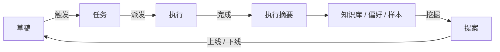

# 总体架构设计

> 状态：设计中 · 上位文档：[设计原则](principles.md) · 术语定义见 [术语表](../GLOSSARY.md)
>
> 本文定义系统的核心处理闭环、执行边界、故障降级策略与文档结构，各领域的实施细节见对应专题文档。

## 0. 核心主干

全系统围绕一条主干运转：**草稿 → 触发 → 任务 → 执行 → 完成 → 复盘 → 上线**。能力、执行器、显示端和推理模型均作为插件挂载在这条主干上，增删插件不影响主干结构。

## 1. 背景与目标

早期设计完成了基础骨架（任务库、规则表、执行器与显示端分配），但在长期运行中还需要解决三个问题：

1. **反馈与演进**：任务库记录了执行历史，但需要将人工返工和撤销转化为规则、能力与提示词的改进。
2. **周期性调度**：事件驱动主要处理外部触发，日常、周度、月度与年度例行事务需要统一的定时节奏。
3. **故障降级**：工作站关机、云服务器离线或外网中断时，系统需要明确的降级路径，避免单点故障导致整体不可用。

## 2. 核心数据流



七个阶段各自的输入、输出与存储落点：

| 阶段 | 输入 | 输出 | 存储落点 |
|---|---|---|---|
| **草稿** | 会话中的临时想法、半成品方案 | 待确认的任务或能力提案 | 独立草稿层；超过 24h 未转正自动清理 |
| **触发** | 自然语言 / 传感器 / CI / 定时 / 邮件 | 原始触发信号 | 内存 |
| **任务** | 触发信号 + `kind` + 参数 | Taskwarrior 任务记录 | 任务库 |
| **执行** | 任务 + 任务说明 | 具体操作 + 执行摘要 | 执行器 + 任务库 |
| **完成** | 执行摘要 | 状态迁移至 `done` / `waiting` / `escalated` | 任务库 |
| **复盘** | 周/月/年的任务记录 | 统计报表、候选规则、候选能力 | 周报、提案库 |
| **上线** | 提案 | 启用新规则 / 新能力 / 新提示词 | Git（TOML、配置、提示词） |

草稿层用于承接尚未决定是否执行的临时想法，默认保留 24 小时，过期自动清理，避免未定型的想法直接写入任务库或散落在聊天记录中。

## 3. 五类工作流

复杂任务均可拆解为以下五类工作流或其组合。五类工作流共用同一套任务模型，仅在阶段划分和验收条件上有所区别。

| 工作流 | 阶段划分 | 验收条件 | 专题文档 |
|---|---|---|---|
| **创作流** | 摄入 → 草稿 → 多候选比选 → 成品 → 发布草稿 | 成品可播放/可读 + 执行摘要 | [内容创作流水线](creative-studio.md) |
| **维护流** | 巡检 → 诊断 → 修复 → 验证 | 指标恢复基线 + 具备回滚路径 | [系统运维](platform-ops.md) |
| **研究流** | 目标 → 解包 → 静态分析 → 动态分析 → 仿真 → 报告 | 报告可复现 + 原始证据落盘 | [开发与逆向工程](work-devsec.md) |
| **日常流** | 事件 → 规则匹配 → 执行 → 归档 | 状态更新为完成即可 | [日常事务管理](life-operations.md) |
| **学习流** | 计划 → 练习 → 复习 → 复盘 | 生成间隔重复的下次到期时间 | [日常事务管理](life-operations.md) |

工作流通过**任务的 `kind` 命名与子任务归属（`parent`）**来组织，不引入独立的工作流引擎。例如一个视频任务会派生出一串子任务（素材筛选、粗剪、配乐、字幕、封面、投稿草稿），通过 `parent` 关联；所有子任务完成后，父任务才可标记完成。

## 4. 执行边界与确认点

系统运行在单人、单机与私有网络环境下，不设多租户隔离与复杂审批流：

- **默认放行**：Agent 可直接读取被授权目录的文件并执行常规命令，不设工具白名单或逐参数校验。
- **三类人工确认点**：仅对**付款、删除、对外发布**三类不可逆操作要求人工确认（[ADR 0002](adr/0002-three-confirmation-points.md)）。
- **可逆操作带撤销窗口**：常规变更默认提供 5 分钟撤销窗口，窗口期内可一键回退，超时后视为正式完成。
- **配置与软件包变更靠版本回滚**：修改系统配置、安装软件包或调整路由策略直接执行，出现问题通过系统还原点、VSS 卷影副本或 Git 回滚（[ADR 0006](adr/0006-workstation-windows.md)）。
- **输入按端口声明信任级别**：每条外部消息先归属一个 `source` 端口，端口声明的 `trust` 决定派生任务的自治上限（[输入端口与输出路由 §1](output-routing.md#1-三个正交轴)）。
- **安全告警直达人工**：水浸、功率过载、门窗异常等高危事件绕过摘要队列与 Agent 筛选，直接推送给用户。
- **凭据留存原生位置**：密钥与 Cookie 保存在 Windows 凭据管理器 / DPAPI 加密或各应用原生配置目录中，Agent 通过封装好的 CLI 调用能力，不将明文凭据读入模型上下文。

因此，系统不引入 RBAC/ABAC 策略引擎或分级授权框架，而是通过控制爆炸半径与提供回滚手段（系统还原点、卷影副本、`restic` 备份、Git、撤销窗口）保障安全。

## 5. 自治等级

每项能力在 TOML 配置文件中声明自治等级上限 `autonomy`，运行时不可超越该上限。

| 等级 | 行为约束 | 典型能力 |
|---|---|---|
| **L0 仅观察** | 只记录和展示，不执行外部操作 | `info.feed.digest`、`meta.review.*` |
| **L1 仅建议** | 生成方案或草稿，等待人工选择或确认 | 多候选比选、`meta.capability.propose`、所有对外发布操作 |
| **L2 可撤销执行** | 直接执行，保留撤销窗口 | 智能家居场景、文件整理、安装软件包 |
| **L3 无人值守** | 执行完毕后汇报一句话摘要 | 夜间渲染、CI 修复、任务库备份、`meta.system.update` |
| **L4 规则演进** | 提出规则、提示词或能力定义变更，先进入影子测试 | `meta.rule.propose`、提示词优化 |

**硬性约束**：无论能力声明何种等级，涉及付款、删除、对外发布的步骤上限固定为 L1。高危告警类任务（水浸、过载、门磁异常）仅推送通知，不交由 Agent 自动处理；智能门锁仅上报状态，开锁操作必须由人工执行。

## 6. 故障域与降级策略

常驻节点尚未落地（[ADR 0007](adr/0007-deferred-resident-node.md)），当前故障域如下：

| 故障域 | 失效影响 | 降级路径 | 恢复方式 |
|---|---|---|---|
| **工作站** | GPU、本机文件、`agent:local` 编排、桌面环境与全部常驻服务不可用 | 云服务器只接收消息并写入等待队列，不处理；其余能力暂停 | 开工作站后消费队列 |
| **云服务器** | 外部消息接收与等待队列不可用 | 本机 CLI 与 PowerToys Run 直接录入任务；外网来源的端口游标停在原位，恢复后回补 | 服务重启后按 `cursor` 回补 |
| **AX6000** | 校园网出口与 Wi-Fi 不可用 | 工作站通过有线局域网维持本地闭环 | 重启路由器 |
| **外网** | 云端模型、B 站投稿、外部订阅拉取失败 | 切换工作站本地 7–14B 模型；对外发布与网络请求进入等待队列；B 站投稿保存为本地草稿 | 网络恢复后重放队列 |
| **云端模型** | 模型 API 不可用 | 本地模型接管意图分类与文本生成；长文任务分段处理 | 健康检查通过后恢复 |

设计原则是**消息不丢优先，处理可以延后**。工作站离线期间，唯一必须保住的是输入事件已经落库；执行能力可以整体不可用。这一取舍是单机方案的核心代价，写在这里而不是假装有降级。

## 7. 定时与周期节奏

除实时事件触发外，日常例行事务由定时任务驱动：

| 周期 | 时间 | 内容 | 输出落点 |
|---|---|---|---|
| 实时 | 事件发生时 | 安全告警推送、撤销窗口通知、交互卡片 | 手机推送 / IM |
| 每小时 | 整点 | 批处理队列检查、失败任务重试 | 任务库注解 |
| 每日 | 07:00 / 22:30 | 早报（3 项必办 + 订阅摘要）/ 晚报（今日完成 + 遗留事项） | IM + 墨水屏 |
| 每日 | 03:00 | 夜间批处理：视频渲染、转码、知识库增量索引、数据备份 | 产物文件 + 执行摘要 |
| 每周 | 周日 21:00 | 周度复盘：完成率、返工统计、高频重复任务、候选规则 | 周报 + 提案库 |
| 每月 | 1 日 | 月度预算核算、订阅扣费预告、耗材盘点、证件到期检查 | 任务库 |
| 每季 | 季初 | 能力调用评估、下线候选清理、模型选型复查 | 提案库 |
| 每年 | 生日前后 | 年度总结、档案归档、年度照片精选 | 长期文档 |

周期调度直接复用任务计划程序与 Taskwarrior 的 `recur` 机制，不引入额外的调度框架。

## 8. 规则与能力的演进闭环

系统规则与能力的调整统一走**提案与影子测试**流程：

```
观察（任务记录、返工、撤销） → 挖掘（高频序列） → 提案（草案 + 证据）
      → 影子测试（真实触发、旁路输出） → 评估（7 天） → 上线（启用）/ 归档（退回）
```

- **提案库**：存放在 `docs/proposals/`，每项提案对应一个独立文件，记录支撑证据与预期收益。
- **影子测试**：新能力在真实触发下旁路运行，结果仅写入隔离目录而不执行外部操作，运行一周后统计采纳率。
- **上线条件**：影子测试期间采纳率 > 60% 且无异常回退即可启用（`enabled = true`），否则退回归档。
- **下线机制**：连续 8 周零调用或连续 5 次执行失败的能力进入下线候选；下线时保留历史定义，仅从入口路由表中移除并将旧 `kind` 映射到替代能力。

具体实现见 [系统运维](platform-ops.md) 与 [知识库与记忆分层](knowledge-memory.md)。

## 9. 状态归属表

每类数据仅在单一权威位置维护：

| 数据类别 | 权威存储 | 格式 | 备份策略 |
|---|---|---|---|
| 任务状态与历史 | Taskwarrior | `taskchampion.sqlite3` | Litestream 同步至云服务器 + 每日快照 |
| 家居设备状态 | Home Assistant Recorder | SQLite | 每周导出备份 |
| 多 Agent 运行目录 | `%LOCALAPPDATA%\aica\state\runs/<root_id>/` | JSON + 产物文件 | 随任务库同步备份；`plan.v(k)` 不覆盖 |
| Agent 执行过程 | `agent:local` 运行目录（`runs/` 信封 + 产物） | JSON + 文件 | 与任务库同步备份 |
| 输入事件与线索 | `%LOCALAPPDATA%\aica\state\events.sqlite3` | Event 追加表 + Thread 成员关系 | 每日快照；`ThreadCtx` 不入备份 |
| 创作与构建产物 | 文件系统 + `manifest.json` | 文件路径 + 元数据 | 按领域分库备份（书库/视频/代码仓） |
| 知识库索引 | 本地 SQLite（`kb.sqlite`） | FTS5 + sqlite-vec | 可从源数据重建，每日快照 |
| 能力偏好 | 能力目录旁 `prefs.toml` | TOML | Git 版本控制 |
| 规则、能力、场景、端口定义 | `%ProgramData%\aica\` 下 TOML | TOML | Git 版本控制 |
| 演进提案 | `docs/proposals/` | Markdown | Git 版本控制 |
| 全局与项目规则 | 本仓 + `%USERPROFILE%\.claude\CLAUDE.md` + `%USERPROFILE%\.agents\` | Markdown | Git（`.agents` 待初始化仓库） |
| 密钥与凭据 | 各应用原生位置（Windows 凭据管理器 / DPAPI 等） | — | 加密副本独立备份，不进本仓 |

任务库属于不可重建的原始状态，备份优先级最高；知识库索引可从源文件重建。

## 10. 仓库与目录布局

```
C:\Repos\ai-collab-assistant\     # 架构与设计文档（本仓）
  docs\                          # 专题设计文档
  docs\proposals\                # 演进提案库
  docs\adr\                      # 架构决策记录（ADR）
  GLOSSARY.md                    # 统一术语表
%ProgramData%\aica\              # 规则表、能力与场景 TOML、端口定义、服务与任务 XML
%LOCALAPPDATA%\aica\state\       # 运行时状态：Spool、队列、运行目录、游标、校准参数、任务库
%LOCALAPPDATA%\aica\data\        # 导出数据、模型权重缓存、知识库索引
D:\aica\                         # 大体积文件：成片、书库、固件镜像、备份暂存
C:\Repos\                          # 个人项目仓库（视频/音乐/代码/游戏）
C:\Repos\video\                    # 视频工程目录
%USERPROFILE%\agent-src\tools\   # Provider 源码仓（re-toolkit 等）
%USERPROFILE%\.agents\            # Skill、规则、笔记（待纳入 Git 管理）
  %USERPROFILE%\.agents\vendor\   # 第三方大型技能库（gamedev / music）
<书库路径>                       # Calibre 书库（以本机实际路径为准）
```

目录分工：**设计文档进本仓，可执行工具进 `%USERPROFILE%\agent-src\tools\`，运行时状态进 `%LOCALAPPDATA%\aica\`，大体积文件进 `D:\aica\`**。完整路径表见 [工作站配置 §3](workstation-windows.md#3-目录布局)。

本机实测（2026-10-31）：数据盘 `D:` 为 4TB NTFS 单分区（原 NixOS 分区，重装时抹掉重建），旧文档中的 `/data/Agent/`、`/data/EBook/`、`~/.local/state/aica` 等 Linux 路径一律作废。

## 11. 文档地图

全仓文档按模块职责划分如下：

| 模块 | 文档 | 覆盖范围 |
|---|---|---|
| 核心机制 | [术语表](../GLOSSARY.md) | 核心概念与统一用词规范 |
| 核心机制 | [设计原则](principles.md) | 功能优先、开源复用、单一数据源与可回滚 |
| 核心机制 | [架构总览](architecture.md) | 五层架构与规则路由速览 |
| 核心机制 | **总体架构设计（本文）** | 闭环主干、自治等级、故障降级与实施顺序 |
| 核心机制 | [事件运行时与派发器](event-runtime.md) | 九态状态机、派发器守护进程、规则匹配与幂等机制 |
| 核心机制 | [事件与任务规格](event-spec.md) | 任务字段定义与 `ev` CLI 规范 |
| 核心机制 | [多 Agent 运行时](multi-agent-runtime.md) | 树与依赖 DAG、`spec` / `result` 信封、发散与收敛、程序化约束 |
| 核心机制 | [`agent:local` 运行时设计](agent-local-runtime.md) | `ar` CLI + daemon + pi Worker 组件划分、信封扩展与演进路径 |
| 核心机制 | [知识库与记忆分层](knowledge-memory.md) | 三路混合检索、记忆分层与偏好提炼 |
| 核心机制 | [IM 采集](im-ingest.md) | 主账号只读采集、双账号分工、会话切分与检索参数 |
| 核心机制 | [提案库](proposals/README.md) | 候选规则、能力与场景的评审流程 |
| 决策记录 | [ADR](adr/) | 0001 任务库；0002 三类确认点；0003 入口与循环分离；0004 草稿 TTL；0005 提案与影子测试；0006 工作站改用 Windows 11 原生；0007 常驻节点延后；0008 自建 `agent:local` 运行时与生成式 UI；0009 交互层改用 DS-Bot，`ar` 收敛为控制面；0010 撤回 0009，交互层回到 DSH 原生会话 |
| 能力与选型 | [能力目录](capabilities.md) | `kind` 全集的唯一权威来源 |
| 能力与选型 | [开源复用清单](open-source-reuse.md) | 各模块复用的开源项目与自建边界 |
| 执行域 | [系统拓扑](system-topology.md) | 常驻入口、`agent:local` 编排与 Worker 分工 |
| 执行域 | [Worker 适配器](worker-adapters.md) | pi / Claude Code / Codex 的命令契约、事件映射、审批语义与路由 |
| 执行域 | [以 dsh-superagent 作执行侧运行时](superagent-runtime.md) | 多 Source 结构、`task` Source 接入、与 `agent:local` 的取舍 |
| 执行域 | [多 Agent 协作规范](agent-collaboration.md) | 规则统一、协作模式与流水线分工 |
| 执行域 | [内容创作流水线](creative-studio.md) | 视频、音乐、写作、电子书与播客管线 |
| 执行域 | [开发与逆向工程](work-devsec.md) | 代码开发、逆向分析、游戏构建与设计工具链 |
| 执行域 | [日常事务管理](life-operations.md) | 日程、健康、财务、物品、社交与学习 |
| 执行域 | [自动化场景](ritual-scenes.md) | 14 个跨设备场景、触发方式与部分完成处理 |
| 交互 | [Personal Agent 设计](personal-agent.md) | 交互约定、通知模式与记忆分层 |
| 交互 | [控制面契约](control-plane-api.md) | 前端 ↔ `ar` 的命令面、事件订阅、卡片审批与状态权威 |
| 交互 | [生成式 UI 工作台](workbench-ui.md) | Tauri 壳 + UI spec 渲染层；ADR 0009 起为可选旁路 |
| 交互 | [常驻服务分布](assistant-system.md) | 服务部署位置与凭据管理 |
| 交互 | [DS-Bot 入口](ds-bot-entry.md) | 常驻宿主、IM 接入与迁移方案；ADR 0010 起已撤回，仅存记录 |
| 交互 | [Super-agent 参考架构](super-agent-architecture.md) | 外部参考架构摘要与本仓取舍 |
| 平台运维 | [系统运维](platform-ops.md) | 规则挖掘、影子测试、监控告警与备份恢复 |
| 平台运维 | [模型路由与本地推理](model-fleet.md) | 模型注册表、路由降级、显存分配与置信度校准 |
| 基础设施 | [输入端口与输出路由](output-routing.md) | `sources` / `surfaces`、效果分类、可打扰性门控、投递回执与去重 |
| 基础设施 | [网络与设备组网](network-fabric.md) | Tailscale 组网、出口感知与外设接入 |
| 基础设施 | [工作站：Windows 11 原生](workstation-windows.md) | 工作站软硬件配置、还原点与备份回滚、桌面自动化接口 |
| 基础设施 | [本机工具链选型](local-toolchain.md) | 本地软件选型与 CLI 调用优先级 |
| 基础设施 | [AX6000 校园网路由](ax6000-router.md) | 多出口认证、分流与透明代理拓扑 |
| 基础设施 | [智能家居技术栈](home-automation-stack.md) | HA、Zigbee2MQTT 与 ESPHome 的部署细节 |
| 显示终端 | [多端显示仲裁](surface-arbiter.md) | 多显示端的内容优先级与刷新预算分配 |
| 显示终端 | [统一渲染管线](render-pipeline.md) | HTML/CSS 模板到墨水屏位图的渲染服务 |
| 显示终端 | [墨水屏硬件选型](eink-display-modules.md) / [墨水屏交互设计](eink-modules-ux.md) | 电子价签与桌面墨水屏选型及版面规范 |
| 显示终端 | [墨水屏改造方案](eink-devkit-plan.md) / [E-Ink 技术术语表](eink-tech-glossary.md) | 硬件改造路径与厂商术语对照 |
| 显示终端 | [OEPL 内部机制](oepl-internals.md) / [epdiy 内部机制](epdiy-internals.md) / [电子价签刷机](esl-tag-ops.md) | 协议、驱动与烧录验收 |
| 显示终端 | [ThinkSmart View 桌面主控台](thinksmart-view-console.md) / [宿舍智能家居方案](dorm-smart.md) | 桌面触控面板改造与宿舍传感器布局 |
| 能力专题 | [电子书精修流水线](book-polish-pipeline.md) | 图书校对、排版与导出 |
| 历史 | [路线图](roadmap.md) | 早期 P0–P4 划分，已被本文 §13 取代 |

## 12. 架构演进记录

| 模块 | 演进内容 | 原因 |
|---|---|---|
| 系统分层 | 在能力、状态、执行、设施四层基础上增加知识层 | 历史任务与文档检索是高频基础能力 |
| 规则表 `[[rule]]` | 补充匹配谓词、优先级顺序与 `thread` 聚合语义 | 详见 [事件运行时与派发器](event-runtime.md) |
| 派发器 | 明晰守护进程模块划分、Spool 队列与幂等重放机制 | 避免在 Taskwarrior Hook 内同步阻塞 |
| 实施阶段 | 调整原 P0–P4 顺序，先打通主干闭环再横向扩展领域能力 | 尽早积累任务样本以支持后续规则挖掘 |
| `decide()` 接口 | 补充受限解码（Guided Decoding）与温度缩放校准 | 详见 [模型路由与本地推理](model-fleet.md) |
| 确认点 | 维持付款、删除、对外发布三类确认点 | 不增加日常操作摩擦 |
| 规则与能力迭代 | 从周报口头建议升级为"提案 → 影子测试 → 上线"流程 | 确保规则变更可追溯、可回退 |
| 交互层 | 由自建生成式 UI 工作台回调为 DS-Bot 前端 + `ar` 控制面契约（[ADR 0009](adr/0009-dsbot-as-control-interface.md)） | 工作台是最贵且最不设防的自建块；控制面契约自有即可换前端 |
| 交互层 | DS-Bot 前端撤回，交互层回到 DSH 原生会话，`ds-bot` 插件与其状态目录一并移除（[ADR 0010](adr/0010-retire-dsbot-native-ui.md)） | 回复含 `dsh-ui` 围栏时 DS-Bot 界面失去响应；它只提供界面却与 DSH 版本强耦合，维护双份记忆与状态目录不划算 |

## 13. 实施阶段

实施顺序遵循**先跑通端到端主干，再逐步扩充领域能力**的原则：

| 阶段 | 目标 | 核心内容 | 验收标志 |
|---|---|---|---|
| **S0** | 主干骨架 | Taskwarrior + `ev` CLI + 状态机 + 派发器守护进程 + 日志 | 单条任务可从录入完整流转至完成 |
| **S1** | 日常交互 | PowerToys Run 任务录入 + 每日早晚报 + 交互卡片 + 撤销窗口 | 连续一周日常实际使用 |
| **S2** | 显示终端闭环 | WLED 状态灯 + 1 块墨水屏 + 显示仲裁器 v0 | 不看手机即可获知当日核心待办 |
| **S3** | 首条领域流水线 | 跑通视频或电子书精修的端到端创作流水线 | 单个作品从原始素材自动推进至发布草稿 |
| **S4** | 演进闭环 | 周度复盘统计 + 提案库 + 影子测试机制 | 周报可根据历史任务自动生成一条候选规则 |
| **S5** | 故障演练与备份 | 故障域降级切换 + Restic / Litestream 备份恢复演练 + 系统还原点回滚演练 | 从还原点回滚后系统与配置均恢复至已知良好状态 |
| **S6** | 领域扩展 | 日常事务、逆向研究、游戏构建等能力逐步接入 | 按周报统计的高频需求优先级依次扩充 |

早期 P0–P4 路线图保留在 [roadmap.md](roadmap.md) 供参考，当前实施计划以本节为准。

## 14. 明确不做的事项

- **不引入权限策略引擎**：不设 RBAC、ABAC、审批流或合规审计链，固定三类人工确认点。
- **不做多租户设计**：不为团队或多用户场景预留架构扩展点。
- **不自建重型消息队列**：直接复用文件系统 Spool 队列、Taskwarrior 的 `thread` 字段与 `agent:local` 运行目录。
- **不暴露会话管理概念**：用户直接面向任务与结果，无需手动管理 Agent Session；跨设备的上下文由线索上下文按需重建（[输入端口与输出路由 §3](output-routing.md#3-事件线索与线索上下文)）。
- **不做过早水平分片**：单用户并发规模下保持单实例路由。
- **不设逐步前置校验**：通过执行摘要与周度复盘发现问题，不在执行链路上堆叠前置拦截器。
