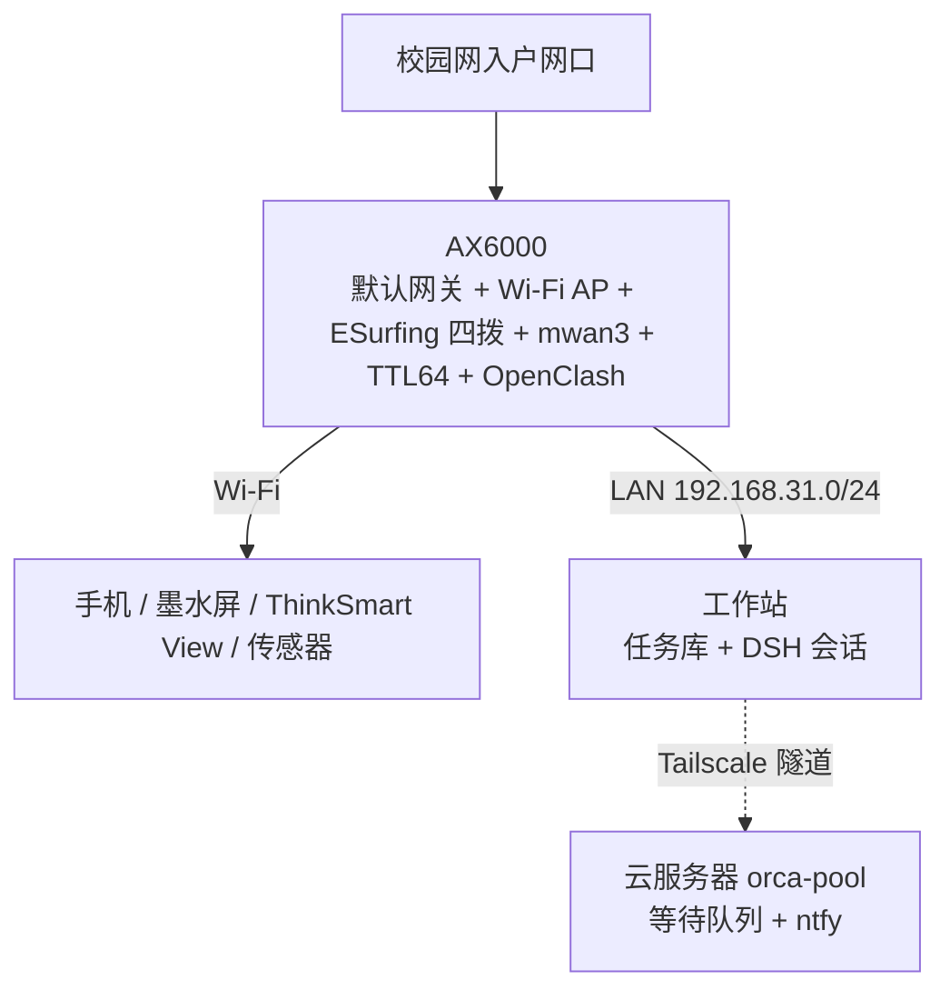

# AX6000 校园网路由架构

> 选型结论：Redmi AX6000 继续承担局域网默认网关、Wi-Fi AP 与校园网多账号认证职责，不改为软路由。局域网内的应用服务由工作站承担，不另设常驻应用服务器。
>
> 核对基线（2026-10-31）：对应实验归档子树 `ax6000-campus-records/` 提交 `77dae62`。底层调优细节、实测 JSON 与救砖恢复流程以子树内记录为准，本文仅提炼与助理系统相关的网络拓扑与接口约定。

## 1. 路由器在事件系统中的角色

路由器作为全系统的网络底座，其连接状态直接决定外部事件源（IM、邮件、RSS、GitHub）能否到达：

- **外部数据源静默检测**：当外网中断时，外部事件源不会主动报错，只会停止产生新事件。为此，看门狗（`ev-watchdog.timer`，见 [事件运行时与派发 §5.2](event-runtime.md#52-看门狗巡检项ev-watchdogtimer每-5-分钟执行)）会定期检查各数据源最后一次录入任务的时间戳，一旦超过该数据源声明的 `max_silence` 阈值，立即生成 `system.source.silent` 告警任务。
- **出口状态边沿上报**：路由器自身的拨号连接、mwan3 分流与 OpenClash 代理状态在发生变化（`ifup` / `ifdown`）时，通过 `hotplug` 脚本向 MQTT 发送一条 `system.net.egress` 事件，用于触发依赖特定网络环境的任务自动挂起（`parked`）或恢复（`unpark`）。

## 2. 当前软硬件与网络状态

设备型号为 Redmi AX6000（RB06，原厂分区布局），运行 OpenWrt SNAPSHOT `r37185-f29dfe25ba`（Linux `6.18.55`），搭载 MediaTek MT7986A（4 核 Cortex-A53 @ 2.0GHz）与 512MB 内存。

| 功能模块 | 当前部署状态 |
| --- | --- |
| 校园网多账号认证 | `ESurfingClient` `2.1.5-r6`，运行 4 个独立实例（`account 1~4`），4 个逻辑 WAN 口通过 macvlan 复用单根入户网线 |
| 多出口负载均衡 | `mwan3-nft` `3.6.12-1`，新建连接按权重随机分配出口，同一连接内保持出口固定 |
| 防共享检测处理 | 四个逻辑出口统一通过 `nftables` 将出站 IPv4 数据包 TTL 固定改写为 64 |
| 局域网透明代理 | `OpenClash` `0.48.002`（固定内核版本），已于 2026-10-30 从工作站迁回路由器运行 |
| 无线网络调优 | 5GHz 频段开启 HE160（160MHz 频宽），已启用硬件无线以太网调度（WED）并完成 AQL 对照测试 |
| 实测吞吐性能 | 同端点裸三路并发实测 902.30 / 908.67 Mbps（CPU 平均占用 33.7%，单核峰值 52.5%）；受控三路聚合峰值达 921.67 Mbps |

注：四通道冷启动恢复、四路并发聚合吞吐重测以及工作站长连接稳定 900 Mbps 三项指标尚待进一步验证。

## 3. 不改为 x86 软路由的原因

| 对比维度 | 保持 AX6000 作为主路由 | 改由 x86 软路由接管主路由 |
| --- | --- | --- |
| 校园网多账号认证 | 四个 `ESurfingClient` 实例配合 GID 绑定、`SO_MARK`、`macvlan` 与 `netifd` 已在 OpenWrt 上完整跑通 | `ESurfingClient` 在非 OpenWrt 环境下默认仅加载首个配置，迁移至 x86 Linux 需从头改造整套多拨脚本 |
| 无线网络加速 | MT7986A 原生支持硬件 WED 卸载与 AQL 调优 | x86 小主机无内置无线网卡，若将 AX6000 降为纯 AP 会改变转发路径，需重新验证无线吞吐 |
| 校园网端口 MAC 绑定风险 | 保持原网关 MAC 不变 | 更换主路由设备会改变外网口 MAC，可能触发校园网接入交换机端口阻断 |
| 故障隔离边界 | 应用服务重启不影响宿舍日常上网 | 若主路由与 Agent 入口同机，维护重启会导致全屋断网 |

当前网络吞吐的主要限制在于上游限速整形（CAKE）、无线单流软中断以及远端 CDN 节点限速，换用更强的 x86 主机并不能提升实际下载速率。

## 4. 与路由器相邻的网络拓扑

各节点网络职责边界：

- **AX6000**：作为局域网唯一默认网关，统一负责校园网认证、多 WAN 负载均衡、TTL 改写、DNS 分流与局域网透明代理。
- **工作站**：运行任务库与会话内的 DSH Agent（派发方），执行由 DSH subagent / teammate 承担；通过有线网口接入局域网，是局域网内唯一的应用服务节点。
- **云服务器**：只通过 Tailscale 与工作站互联，不接入宿舍局域网，也不承担子网路由或 Exit Node（[网络与设备组网 §3](network-fabric.md#3-子网路由与-exit-node)）。

## 5. 应用服务节点的硬件规格（延后采购）

N100 迷你主机因成本原因暂不采购。以下规格保留为落地方案参考，届时应优先比较二手瘦客户机：

| 硬件项 | 推荐规格 | 选型说明 |
| --- | --- | --- |
| 主机 | 单网口 Intel N100 迷你主机，或二手 Dell Wyse 5070 / HP t630（约 ¥200–400） | 无需四口 i226 软路由机型，单根网线接入 AX6000 LAN 口即可 |
| 内存 | 8GB 起 | 常驻服务约占 4GB，剩余供按需拉起的无头 Chromium 使用 |
| 存储 | 256GB NVMe 或 SATA SSD | 容纳系统、Home Assistant 数据库、Loki 日志与 Restic 备份仓库 |
| 操作系统 | 待定 | 常驻节点落地时按当时的选型决定 |

## 6. 关键网络配置约束

1. **Tailscale 流量必须加入 OpenClash 直连绕过列表**：路由器开启局域网透明代理后，需将工作站的 Tailscale 端口（`41641/udp` 与 STUN `3478/udp`）设为直连，防止 WireGuard 流量被透明代理劫持至境外节点导致内网延迟飙升至数百毫秒。
2. **容器权限隔离**：任何对话入口容器不挂载宿主机根目录、不挂载容器运行时 Socket、也不存放明文私钥。
3. **跨机 SSH 命令限制**：云端脚本访问工作站的专用 SSH 公钥在 `authorized_keys` 中通过 `command="..."` 限制为仅允许调用 `%USERPROFILE%\.local\bin\` 下的受限入口脚本（仅含创建任务、查询状态、读取输出、发送跟进四项操作）。

## 7. 关联文档

- 对话入口已回到 DSH 原生会话，容器部署与 IM 接入见 [Personal Agent 设计](personal-agent.md)
- 跨机任务派发与 GUI 自动化：[系统拓扑](system-topology.md)
- 路由器底层实测数据与恢复手册：[`ax6000-campus-records/`](../ax6000-campus-records/README.md)
