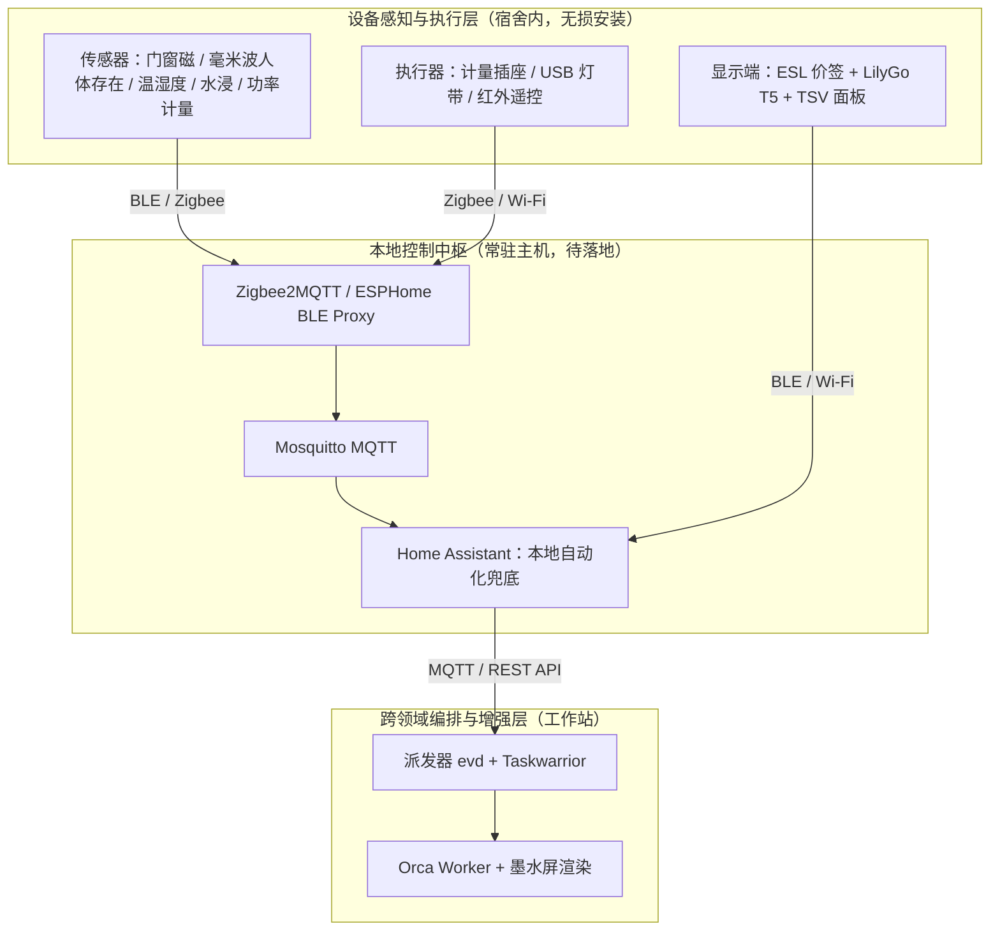

# 宿舍智能家居方案

> 状态：设计定稿 · 所属域：`home` · 上位文档：[架构总览](architecture.md)、[智能家居技术栈](home-automation-stack.md)

本方案针对学生宿舍或租房环境设计一套**免改电路、可随时无损拆装、以本地自动化兜底、由 Agent 提供信息增强**的环境感知与控制体系。

## 1. 宿舍环境约束与设计边界

| 现实约束 | 工程设计对策 |
|---|---|
| 禁止改动市电线路或墙面打孔 | 全部采用纽扣电池或 5V USB 供电，使用无痕胶或磁吸固定 |
| 毕业或换房时需整体搬迁 | 所有硬件均可在 15 分钟内拆卸打包；设备清单与自动化配置全部纳入 Git 仓库管理 |
| 存在校园网断网与拉闸限电时段 | 核心感知与开关控制全部在本地闭环（Zigbee + Home Assistant），不依赖云端服务器 |
| 多人共用空间的隐私边界 | **不部署常驻摄像头，不开启全天候麦克风监听**；采用门磁、毫米波雷达与温湿度等非侵入式传感器 |
| 预算控制 | 首发最小闭环控制在 ¥400–600 内，全套传感器配齐控制在 ¥1000 以内 |

## 2. 交互体验原则

1. **常规动作无感化**：回宿亮灯、入睡关灯、离宿断电均根据门磁与人体存在传感器自动完成，无需每次掏手机或喊语音指令。
2. **环境信息常显化**：待办事项、日程提醒与设备状态通过墙面和桌面的墨水屏常驻展示，路过一瞥即可获取信息，无背光不刺眼（见 [墨水屏交互设计](eink-modules-ux.md)）。
3. **本地自动化兜底，Agent 仅做增强**：当工作站休眠或大模型不可用时，灯光、插座与安全告警全部由常驻主机上的 Home Assistant 与 Zigbee 直连保障。该能力依赖一台 24 小时在线的机器，当前随 [ADR 0007](adr/0007-deferred-resident-node.md) 延后。
4. **状态随时可查**：在手机或桌面询问"宿舍现在什么状态"，系统直接汇总当前温湿度、在宿状态、高功率用电器与今日事件摘要。
5. **仅在异常时主动打扰**：仅当检测到漏水、非正常开门或插座功率过载时才发送高优推送，日常自动操作保持静默。

## 3. 硬件与网络分层拓扑

## 4. 硬件选型清单（国内现货，开源固件优先）

| 设备类别 | 选用型号 | 单价参考 | 选型理由 |
|---|---|---|---|
| 温湿度传感器 | **小米温湿度计 2（LYWSD03MMC）** | ¥15–25 | 网页蓝牙即可刷入 `pvvx` / `ATC` 开源固件，支持 BTHome 广播，续航约 1 年 |
| 门窗传感器 | Zigbee 门磁传感器（接入 Z2M） | ¥15–30 | 纽扣电池续航 1 年以上，响应延迟低 |
| 人体存在传感器 | **HLK-LD2410C + ESP32**（或米家存在传感器） | ¥35–60 | 24GHz 毫米波雷达，可准确检测书桌前久坐静止状态，避免普通 PIR 红外传感器误判无人而关灯 |
| 智能计量插座 | Zigbee 计量插座 / Sonoff S31（刷 ESPHome） | ¥25–50 | 支持实时功率与电量统计，用于"离宿忘关高功率电器"检测 |
| 环境照明 | USB 供电 Zigbee / WLED 灯带 | ¥30–80 | 粘贴于书桌后沿或床架下方，5V 供电免改电路 |
| 空调控制 | **ESP32 红外收发模块**（运行 ESPHome `remote_transmitter`） | ¥20–40 | 为存量老式壁挂空调提供本地无云控制接口 |
| 水浸传感器 | Zigbee 水浸传感器 | ¥20 | 放置于阳台或饮水机/空调排水管下方，触发高危漏水告警 |
| 墨水屏显示端 | 汉朔拆机 ESL 电子价签 + LilyGo T5 4.7" | ¥300–500 | 详见 [墨水屏硬件选型](eink-display-modules.md) |
| 接入网关 | SONOFF ZBDongle-E（Zigbee）+ ESP32-S3（OEPL AP 兼 BLE 代理） | ¥100–160 | 插在常驻主机上统一管理全屋低功耗设备 |

**无线协议分工**：传感器与计量插座优先选用 **Zigbee**（功耗低、网状网络稳定、不占路由器 Wi-Fi 带机量）；温湿度计与电子价签采用 **BLE**（由 ESP32 节点代理接入）；仅红外遥控与桌面彩屏面板使用 **Wi-Fi**。

## 5. 核心场景与事件处理规则

传感器状态在跨过设定阈值或发生状态边沿跳变时转化为 `home.<对象>.<信号>` 事件：

| 场景名称 | 触发条件 | 处理方式 | 完成结果 |
|---|---|---|---|
| 回到宿舍 | `home.door.opened` 且 30 秒内检测到 `home.bedroom.occupied` | HA 本地自动化：点亮桌面与床头暖光灯带，恢复常用插座供电 | 灯光与插座已开启 |
| 夜间入睡 | 22:30 后或持续静止，触发睡眠场景 | HA 本地自动化：关闭照明，仅保留路由器、常驻主机与手机充电器插座，刷新床头墨水屏 | 睡眠模式已就绪 |
| 离开宿舍 | `home.presence.absent` 持续满 10 分钟 | HA 本地自动化关闭非必要插座；派发器记录离宿快照并清空门口屏隐私内容 | 非必要电源已切断 |
| 忘关高功率电器 | 离宿状态下或开启超过 30 分钟，`home.plug.power` 持续高于阈值（带 6h 冷却时间） | 推送交互卡片询问是否远程断电 | 人工确认或自动断电 |
| 晨间唤醒 | 工作日闹钟时间到达且检测到在宿 | 灯光缓慢渐亮，触发桌面墨水屏刷新当日核心待办 | 晨间场景执行完毕 |
| 水浸或异常开门 | `home.bedroom.water` 或离宿期间 `home.door.forced` | **绕过 Agent**，直接通过 `ntfy:critical` 发送最高优先级告警推送 | 等待人工处理确认 |

安全与免打扰边界：

- **高危告警直通人工**：水浸、功率过载等 `critical` 事件不经过语言模型判断、不进入摘要合并队列，直接穿透免打扰推送至手机。
- **操作可逆性分级**：开关灯与控制普通插座属于可逆操作，可直接自动执行；红外开启空调附带状态通知；涉及物理门锁的操作仅允许读取门磁状态，不接入自动开锁执行器。
- **高频事件防抖抑制**：每个传感器规则均配置 `cooldown` 或 `rate` 门控（见 [事件运行时与派发器 §1.5](event-runtime.md#15-流量门控gate)），超限触发自动合并为单条计数记录，避免故障传感器刷屏轰炸。

## 6. 与任务库和显示端的对接

- **事件过滤与录入**：温湿度、功率等连续采样数据留在 Home Assistant Recorder 中；仅当发生跨阈值边沿事件且需要跨工具协同或人工确认时，才通过 MQTT 桥调用 `ev add` 写入 Taskwarrior 任务库。
- **墨水屏按需刷新**：门口 2.9" 电子价签（出门携物清单）、插座旁 2.13" 标签与书桌 4.7" T5 看板全部由工作站渲染服务统一生成 PNG 下发（见 [统一渲染管线](render-pipeline.md)），并由 [显示仲裁器](surface-arbiter.md) 统一管理刷新预算。
- **复用已有自动化**："回宿""入睡""离宿"三个高频设备动作在 Home Assistant 中作为本地 Automation 维护，上层 [自动化场景](ritual-scenes.md) 直接调用它们，避免在两处重复编写开关逻辑。

## 7. 分阶段落地步骤

1. **第一阶段（墨水屏最小闭环，约 ¥300–500）**：部署 ESP32-S3 OEPL AP 网关 + 3 块汉朔 ESL 电子价签 + LilyGo T5 4.7" 桌面屏，跑通"任务库变更 → 渲染 PNG → 墨水屏刷新"。
2. **第二阶段（基础传感与开关环，约 +¥150）**：在常驻主机上启用 Home Assistant、Mosquitto 与 Zigbee2MQTT，接入 ZBDongle-E 协调器、2 个 LYWSD03MMC 温湿度计、1 个门磁与 1 个 Zigbee 计量插座。
3. **第三阶段（跨设备场景接入）**：打通 MQTT → `ev add` 桥接与 `rules/20-home.toml` 规则表，上线回宿、离宿、忘关电器提醒与睡前清单场景。
4. **第四阶段（按需扩展）**：逐步补充 LD2410C 毫米波存在传感器、WLED 状态灯带、ESP32 红外空调遥控与水浸传感器。
