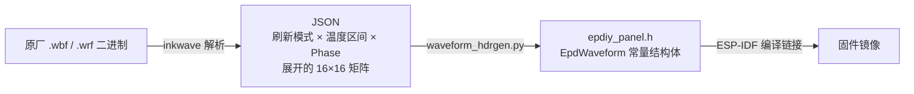

# epdiy 内部机制解析

> 状态：技术参考档案 · 关联文档：[墨水屏硬件选型](eink-display-modules.md)、[墨水屏改造方案](eink-devkit-plan.md)、[E-Ink 技术术语表](eink-tech-glossary.md)
>
> 本文梳理开源并行墨水屏驱动栈 **epdiy**（利用 ESP32 / ESP32-S3 直接驱动商用并口 EPD 裸屏的软硬件方案）的硬件演进、波形查找表（Waveform LUT）结构、温度补偿、ESP32-S3 `LCD_CAM` 并口 DMA 通路以及支持面板清单。
>
> **资料来源**：[`vroland/epdiy`](https://github.com/vroland/epdiy) 主仓库源码与 Wiki、[`fread-ink/inkwave`](https://github.com/fread-ink/inkwave) 波形解析工具，以及本机 KPW5 固件逆向笔记（`~/Repo/kpw5-analysis`）。

## 0. 技术定位：并行 TTL 直驱与 SPI 模组的区别

常见的微雪/佳显小尺寸 SPI 墨水屏模组在面板排线上集成了时序控制器（TCON），将波形表封装在芯片内部，外部 MCU 只能通过低速 SPI 发送整帧黑白图像。

**epdiy** 则面向 Kindle、M5Paper、LilyGo T5 等中大尺寸阅读器面板，**由 ESP32-S3 通过 8 位或 16 位并行 TTL 总线加行选通信号直接驱动玻璃基板上的源极/栅极驱动器（Source / Gate Driver）**，由软件直接控制每一个波形相位（Phase）的 2-bit 电压脉冲。因此它能够实现 SPI 模组无法做到的 **16 级灰度渲染、毫秒级无闪烁局部刷新（~10fps）与自定义 Regal 抗残影算法**。

## 1. 两代硬件与外设架构演进（I2S → LCD_CAM）

| 硬件代际 | 主控 MCU | 并行总线外设通路 | 高压电源管理（PMIC） | 代表硬件产品 |
|---|---|---|---|---|
| **v1–v6** | ESP32（PICO-D4 / WROVER） | 借用 **I2S 外设的并行 LCD 模式** + DMA 输出像素数据，RMT 外设生成 `CKV` 时钟（`src/output_i2s/`） | 早期分立升压或 TPS65185 | M5Paper、LilyGo T5 v2.3（旧版） |
| **v7（当前主线）** | **ESP32-S3**（带 8MB 八线 PSRAM） | 使用独立的 **`LCD_CAM` 外设 RGB 并口模式** + GDMA 链式传输 + RMT（`src/output_lcd/`），并利用 S3 向量指令加速帧间差分与 LUT 查表 | **TI TPS65185 EPD PMIC** + PCA9555 I²C IO 扩展 | epdiy v7 官方板、LilyGo T5 4.7" ESP32-S3 版 |

v6 与 v7 的底层差异全部隔离在 `output_*` 驱动层，上层应用调用的 `epd_hl_*`（High-level API）完全保持兼容。

## 2. 波形系统（Waveform LUT）内部结构

### 2.1 离线波形转换流水线

E Ink 原厂波形以二进制 `.wbf`（面板 Flash 烧录格式）或 `.wrf`（Kindle 固件格式）分发。`epdiy` 不在 ESP32 运行时动态解析二进制文件，而是通过离线工具链将其转换为 C 结构体数组直接编译进固件镜像：



为节省 Flash 空间，可通过 `waveform_hdrgen.py --export-modes 1,2,5,16 --temperature-range 15,35` 仅导出实际需要的刷新模式与室温区间。

### 2.2 `EpdWaveform` 数据结构（定义于 `epd_internals.h`）

```text
EpdWaveform            { num_modes, num_temp_ranges, temp_intervals[], mode_data[] }
 ├─ EpdWaveformTempInterval[]   { min, max }            // 温度区间上下界 (°C)
 └─ EpdWaveformMode[]          { type, num_phases, range_data[num_temp_ranges] }
      └─ EpdWaveformPhases[]   { phases, luts, phase_times }
           └─ luts: uint8_t[n_phases × 16 × 4]         // 每个 Phase 的 16×16 灰度转移矩阵（紧凑打包）
```

**2-bit 驱动操作码语义**：

- 每个字节包含 **4 个 2-bit 操作码**，描述某个像素从"当前灰度 `src`（0–15）"过渡到"目标灰度 `dst`（0–15）"在当前 Phase 应施加的脉冲极性：
  - `00` = **No-op（0V 保持）**
  - `01` = **Darken（+15V，驱动黑色粒子上浮）**
  - `10` = **Lighten（−15V，驱动白色粒子上浮）**
  - `11` = **保留 / No-op**
- 16×16 的灰度转移矩阵每帧共需 $16 \times 16 \times 2\text{ bit} = 64\text{ Bytes}$。完成一次灰度过渡需连续输出 `num_phases` 帧（例如 `GC16` 通常包含 40–60 个 Phase），每一帧对全屏所有像素按各自的 `(src_gray, dst_gray)` 查表输出一次 2-bit 脉冲。这与本机在 `~/Repo/kpw5-analysis/notes/waveform-lut-decoded.md` 中逆向出的 Kindle `wf_lut` 结构完全同源。

### 2.3 支持的刷新模式（`EpdDrawMode`）

| 模式枚举名 | 刷新特性与适用场景 |
|---|---|
| `MODE_INIT` | 上电初始化全白清屏（通过多帧黑白交替翻转将滞留粒子彻底复位） |
| `MODE_DU` | Direct Update：仅支持黑白两色直驱，耗时最短（约 90–150ms），无闪烁 |
| `MODE_GC16` | Grayscale Clear 16：完整 16 级灰度全屏刷新（包含黑白反相闪烁清残影步骤），画质最干净 |
| `MODE_GL16` | Grayscale Local 16：16 级灰度无闪烁局部刷新（跳过全屏反相清残影步，连续使用约 20 次后需插一次 `GC16`） |
| `MODE_GLR16` / `MODE_GLD16` | **Regal 抗残影模式**：针对 Carta 膜系面板优化的局部灰阶刷新配方（对应 `epdiy_regal` 波形表） |
| `MODE_A2` | 极速黑白单色刷新，适用于快速滚动或打字回显 |

### 2.4 温度读取与补偿机制

在 v7 硬件上，`epd_board_ambient_temperature()` 通过 I²C 读取 TPS65185 PMIC 的 `TMST_VALUE` 寄存器（连接至面板 FPC 背面的 NTC 热敏电阻），随后由 `waveform_temp_range_index(waveform, t)` 匹配第一个满足 `min <= t <= max` 的温度区间并选取对应的 Phase LUT 表。低温下脉冲序列更长以补偿电泳粒子迁移率下降，高温下缩短脉冲防止过冲。

## 3. ESP32-S3 并口硬件信号与 DMA 通路（`src/output_lcd/`）

### 3.1 面板接口信号组

| 信号分类 | 信号引脚 | 作用说明 |
|---|---|---|
| 并行数据总线 | `D0..D7`（8-bit）或 `D0..D15`（16-bit） | 每个像素时钟周期并行传输 4 个或 8 个像素的 2-bit 驱动码 |
| 源极驱动时序（Source） | `PCLK`（像素移位时钟）、`LEH`（行数据锁存 Latch Enable）、`OE`（输出使能） | 将一行像素的 2-bit 驱动码移入源极驱动寄存器并锁存输出 |
| 栅极扫描时序（Gate） | `STV`（帧起始垂直同步脉冲）、`CKV`（行推进垂直时钟，由 RMT 外设生成） | 从顶行到底行逐行打开 TFT 栅极开关，将当前行电压施加到像素电极上 |
| 高压电源控制（PMIC） | I²C + `PWRUP` / `VCOM_CTRL` / `WAKEUP` | 控制 TPS65185 按严格先后顺序开启 `VGL` / `VNEG` / `VGH` / `VPOS` 与 `VCOM` |

### 3.2 单次刷屏的内部执行流水线（`render.c` + `render_lcd.c`）

```
1. 帧缓冲对比：epd_difference_image_cropped() 对比前后两帧 4bpp 缓冲，计算最小变化包围盒 (Dirty Rect) 并合成每像素的 (src, dst) 字节对
2. 向量加速查表：利用 ESP32-S3 PIE 向量指令对整行像素并行查 LUT 表，生成当前 Phase 的 2-bit 驱动码流
3. GDMA 双缓冲输送：双 FreeRTOS Feeder 线程将行码流填入 DMA Bounce Buffer，由 LCD_CAM 外设按 PCLK 频率连续推上并行总线
4. RMT 行时钟配合：每发完一行数据，RMT 触发一次 CKV 脉冲推进至下一行；整帧所有行发完后触发 frame_done 中断，推进至下一个 Phase
5. 高压安全下电：全部 Phase 执行完毕后，关闭 VCOM 与四路高压轨，屏幕依靠电泳双稳态物理保持画面
```

## 4. 主线内置支持的面板型号（`src/displays.c`）

| 面板型号 | 物理分辨率 | 数据总线宽度 | 像素时钟（MHz） | 默认配套波形 | 常见终端设备 |
|---|---|---|---|---|---|
| **`ED047TC1` / `ED047TC2`** | 960×540 | 8-bit | 20 | `epdiy_ED047TC1` | **LilyGo T5 4.7"、M5Paper**（本系统桌面主力屏） |
| `ED060SCT` | 800×600 | 8-bit | 20 | 内置通用 | 6" 经典阅读器屏 |
| `ED060XC3` | 1024×768 | 8-bit | 20 | 内置通用 | 6" 212 PPI 阅读器屏（KPW3 同款） |
| `ED078KC1` | 1872×1404 | **16-bit** | 11 | 内置通用 | 7.8" 300 PPI 高分屏 |
| `ED097OC4` / `ED097TC2` | 1200×825 | 8-bit | 15 / 22 | `epdiy_ED097TC2` | 9.7" 看板屏（Kindle DX 同族） |
| `ED103MC2` | 1872×1404 | **16-bit** | 11 | `epdiy_ED097TC2` | 10.3" 柔性屏（需开启 `DISPLAY_UPSEQ_MC2 \| HORIZONTAL_MIRRORED`） |
| `ED133UT2` | 1600×1200 | 8-bit | 20 | 内置通用 | 13.3" 大尺寸看板屏 |

若需接入尚未在表内的面板（如 KPW5 拆机的 6.8" `ED068KC1U1`），只需在 `displays.c` 中新增一行分辨率与时序参数，并导入提取出的波形头文件即可。

## 5. 与 ESPHome 及本系统渲染管线的集成方式

- **SPI 墨水屏**：ESPHome 原生提供 `waveshare_epaper` 与新版 `epaper_spi`（ESPHome 2025.10 引入，支持分块缓冲节省内存）组件，适合微雪/佳显 SPI 模组。
- **epdiy 并口墨水屏（LilyGo T5 4.7"）**：由于采用 8-bit 并口 DMA 驱动，不走 ESPHome 的 SPI Display 组件，而是编译一个极简的 **ESP-IDF 拉图固件**：设备上电或定时从 Deep Sleep 唤醒 → 连接 Wi-Fi → 请求工作站渲染服务的 `GET /frame/desk-t5`（带 `ETag` 比对）→ 若图像有更新则调用 `epd_hl_update_area()` 刷屏 → 再次进入 Deep Sleep。全部排版与字体渲染逻辑均保留在工作站服务端（见 [统一渲染管线](render-pipeline.md)）。

## 参考资料

- [`vroland/epdiy` 主仓库](https://github.com/vroland/epdiy) · [epdiy 硬件工程仓库](https://github.com/vroland/epdiy-hardware)
- [epdiy Wiki：并行墨水屏像素驱动原理](https://github.com/vroland/epdiy/wiki/How-pixels-are-driven-in-a-parallel-epaper-with-epdiy) · [波形时序说明](https://github.com/vroland/epdiy/wiki/Waveform-timings-for-epdiy)
- [`fread-ink/inkwave`（E Ink `.wbf`/`.wrf` 波形解析工具）](https://github.com/fread-ink/inkwave)
- 本机 KPW5 逆向分析存档（以原生文件为准）：`/home/shizuku/Repo/kpw5-analysis/notes/waveform-lut-decoded.md`、`epdc-temperature-policy.md`、`wrf-format.md`
