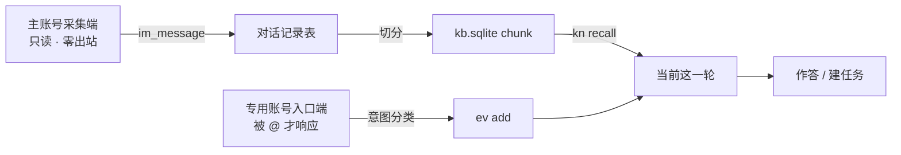
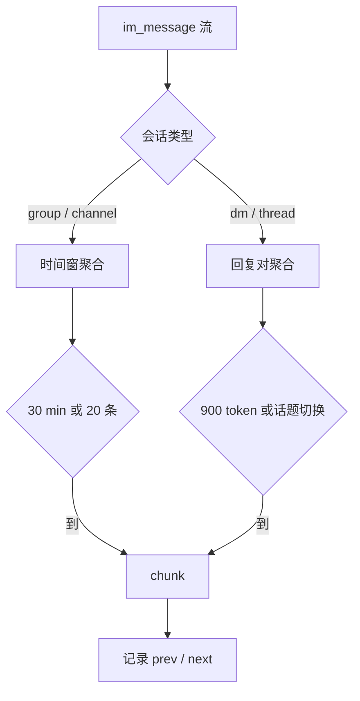

# IM 采集：聊天记录作为数据面

> 状态：设计中 · 上位文档：[输入端口与输出路由](output-routing.md)、[知识库与记忆分层](knowledge-memory.md) · 关联：[DS-Bot 入口](ds-bot-entry.md)、[网络与设备组网](network-fabric.md)
>
> 本文只规定**采集**：IM 消息如何进入系统、如何落库、如何被检索。消息如何触发任务仍由 [输入端口与输出路由 §4](output-routing.md#4-三级分流) 决定；消息如何被投递仍由 [§8](output-routing.md#8-输出端口草案surfacestoml) 决定。

## 0. 定位：IM 是数据面，不是入口

早期的 IM 设计只有一种用法：你发一条指令，助理回一张卡片。那只是一个聊天窗口，读不到任何你不在场时发生的事。

本文把 IM 当成**数据面**处理：把能读到的对话全部读一遍、入库、可检索。这两件事必须拆开——采集端只读，不发言；入口端只在你叫它时发言。合并成一个进程的后果是机器人在群里无端开口。



两个账号之间不共享状态，只共享数据库。采集端挂了不影响入口，入口端掉线不影响历史完整性。

## 1. 两条路径

| | 主账号（本人身份） | 专用账号（助理身份） |
|---|---|---|
| 平台侧身份 | 普通用户 | Bot / App |
| 读取范围 | 你在的每个群、频道、单聊，含加入前的可回溯历史 | 仅加入之后、且被授权的范围 |
| 官方态度 | 无接口，依赖客户端协议或本地数据库 | 官方 API，合规稳定 |
| 稳定性 | 低，掉线与封号是常态 | 高 |
| 发言权 | **无** | 被 @ 或命中指令时 |
| 端口 `direction` | `{ in = true, out = false }` | `{ in = true, out = true }` |

正确的分工是：**主账号负责覆盖，专用账号负责可靠**。主账号那条路按「尽力而为、可能缺一段」设计——缺了不告警重试到死，只在检索结果里标记缺口；专用账号那条路按「必须不丢」设计。

## 2. 平台能力

| 平台 | 历史消息 | 途径 | 群 / 频道 | 卡点 |
|---|---|---|---|---|
| Telegram | 全量 | 用户侧 MTProto（Telethon / GramJS），原生导出功能亦可 | 私群、超级群、频道 | **Bot API 拿不到历史**，只有启动之后的 update |
| Discord | 加入后全量 | Bot + Message Content Intent + Read Message History，按 `before` 分页回溯 | 服务器频道、线程 | 机器人看不见加入之前的；私信仅对方主动发起才可见 |
| QQ | 部分 | 官方 bot 只能看到被 @ 或命中指令的消息；个人号方案可读所在群全量 | 群、频道均需授权 | 个人号方案有封号风险 |
| 微信 | 部分 | 个人号：无官方接口，读本地加密数据库或走客户端协议 | 群聊可读 | 协议与数据格式随版本变化，随时失效；企业微信「会话存档」是唯一合规的全量途径 |
| 飞书 / 钉钉 / 企业微信 | 全量 | 开放平台 API | 群、单聊 | 需组织权限 |

**结论**：只有 Telegram 与 Discord 能承诺「全量历史」。QQ 与微信按尽力而为设计，同一套代码、不同的预期。

微信侧采用个人号逆向路线，开源实现较多（Wechaty、wechatferry、chatlog 等），但版本兼容性、登录态维持与封号概率都以实测为准，本文不承诺任何具体版本。

## 3. 端口声明

每个账号一个文件，与 [输出端口](output-routing.md#8-输出端口草案surfacestoml) 同构：

```toml
# sources/im-wechat-self.toml —— 主账号，只读采集
id        = "im:wechat:self"
kind      = "im"
native_id = "wx:self"
trust     = "untrusted"          # 采集口不产生任务，见下
direction = { in = true, out = false }
account   = "self"               # self | bot

[cursor]
mode     = "timestamp"           # 个人号协议按时间回溯，无稳定 seq
store    = "~/.local/state/aica/cursors/im-wechat-self.json"
max_gap  = "2h"                  # 群聊断线几小时即形成永久缺口
backfill = 5000                  # 首次回溯上限，超出记一条 meta.ingest.gap

[limits]
rate   = "30/h"                  # 逆向协议从严
dedupe = "content_hash"
```

```toml
# sources/im-telegram-bot.toml —— 专用账号，入口 + 采集
id        = "im:telegram:bot"
kind      = "im"
native_id = "tg:@aica_bot"
trust     = "owner"
direction = { in = true, out = true }
account   = "bot"
```

两条约定：

- **`trust = "untrusted"` 是采集口的默认值。** 采集端不产生任务，`trust` 在这里只表示「内容可信度低、不可触发执行」。群消息要变成任务，走专用账号端口或由你在私聊里明确下达。
- **`account` 字段区分两个身份。** 同平台两个端口共用 `conv_id` 命名空间，消息表里记 `account`，避免把「你说的话」和「助理说的话」混成一个作者。

## 4. 采集约束

| 约束 | 做法 | 为什么 |
|---|---|---|
| 零出站 | 采集进程不加载发送模块，不是靠提示词约束 | 主账号替人发言的代价不可逆 |
| 限速按平台方言 | `limits.rate` 每个端口一个值 | 微信严到分钟级，Telegram 可以快很多 |
| 缺口可见 | `max_gap` 触发 `meta.ingest.gap`，写进检索结果的 `coverage` | 「这段没读到」必须能传到模型手上 |
| 原始报文留底 | `raw_ref` 指向落盘原文 | 解析失败可重放，格式变更可回灌 |
| 不忠实则不入 | 解析失败的事件挂待分类队列，不猜 | 一条被猜错的消息会污染整段对话的检索 |

## 5. 落库

两层存储，职责不同：

| 层 | 位置 | 内容 | 用途 |
|---|---|---|---|
| 原始层 | `events.sqlite3` 的 `event` 表 | 不可变原始消息 | 追溯、重放、去重 |
| 规范化层 | `kb.sqlite` 的 `im_message` | 解析后的结构化字段 | 切分与检索 |

```sql
CREATE TABLE im_message (
  id          TEXT PRIMARY KEY,      -- uuid5(port_id, native_id)
  port_id     TEXT NOT NULL,
  account     TEXT NOT NULL,         -- self | bot
  conv_id     TEXT NOT NULL,         -- 会话：群 / 频道 / 单聊
  conv_type   TEXT NOT NULL,         -- group | channel | dm | thread
  native_id   TEXT NOT NULL,
  ts          INTEGER NOT NULL,
  author_id   TEXT,
  author_name TEXT,
  is_self     INTEGER NOT NULL DEFAULT 0,
  reply_to    TEXT,                  -- 被引用消息，保留回复链
  text        TEXT NOT NULL,
  seg         TEXT,                  -- jieba 预分词列
  media_json  TEXT,                  -- 附件与链接引用，不进正文索引
  raw_ref     TEXT,
  UNIQUE (port_id, native_id)
);
CREATE INDEX im_conv_ts ON im_message (conv_id, ts);
CREATE INDEX im_author  ON im_message (author_id, ts);
```

进入 `kb.sqlite` 时映射为 `doc` + `chunk`：

- **一个会话 = 一个 `doc`**，`type='im_thread'`，`ext_id = port_id + ':' + conv_id`；
- **`chunk` 是检索视图**，`span_start` / `span_end` 指向 `im_message.id` 区间；原始消息始终以 `im_message` 为准；
- **`source.weight` 分层**：文档与规则 `0.9`，本人发言 `0.6`，他人群聊 `0.4`，与 [知识库 §7.6](knowledge-memory.md#76-与本地-markdown-记忆文件的协同) 的既有分层一致。

## 6. 切分策略

三种场景，三种切法。**不按条数硬切**——条数上限会让 `span_end` 落在句子中间，模型看到的是半段，且没有任何信号告诉它还有后半段。

| 场景 | 单位 | 边界条件 |
|---|---|---|
| 群聊 / 频道 | 时间窗 | 同会话内 30 分钟 + 20 条，二者取先到 |
| 与助理的对话 | 回复对 | 累计 900 token 或话题切换 |
| 链接消息 | 拆两个 doc | 消息一个 doc，抓取正文另一个 doc |



900 token 的来由：向量模型 `bge-small-zh-v1.5` 的可用上下文为 512 token，但 chunk 不必整体送入向量——取前 512 做向量，全文留给重排与阅读。一条 chunk 因此能容纳一段完整论证。

**chunk 必须自带边界信息**，命中后模型才知道还有上下文：

```json
{"chunk_id": 48211, "doc_id": 3021, "seq": 7,
 "span": ["im:wechat:dm:alice#88f1", "im:wechat:dm:alice#88c3"],
 "continued": {"prev": 6, "next": 8},
 "boundary": "topic_switch"}
```

`kn recall --expand 1` 据此向前后各取一个 chunk。默认只给相关的一小段，需要时自己扩——这才是长对话该有的检索行为。

### 6.1 链接消息

消息本身往往只有一句话，语义全在目标页面。拆两步：

1. 消息入库，chunk 就是那句话，`media_json` 记链接；
2. 另起一个 `doc`（`type='web'`，`ext_id` 用规范化 URL，`content_hash` 去重），异步抓正文或字幕，切成自己的 chunk；
3. 两个 doc 以 `edge(rel='引用')` 建一跳关联。

**抓取不默认开启。** 链接可能是私密的、需要登录的，或者你只是随手一转。触发方式限定为三种：消息带显式标记、在卡片上点一下、或者当天复盘时批量补抓。

## 7. 检索参数

现有 `kn recall` 面向「上一次某件事怎么做的」，缺三项能力：

| 参数 | 解决什么 | 实现 |
|---|---|---|
| `--until` | 「上个月」是闭区间，现在只有下界 | RRF 查询补 `d.ts <= :until` |
| `--author me` | 「我和你说的」= 本人发言 | 按 `is_self` 或 `author_id` 过滤 |
| `--conv` / `--conv-type` | 限定在某段对话里找，排除频道噪音 | 按 `doc.ext_id` 或 `conv_type` 过滤 |
| `--expand N` | 命中后按 `continued` 前后扩展 | 读相邻 `seq` 的 chunk |

时间指代（「上个月」「那次」「前两天」）在入口层用确定性代码解析，不交给模型——这些词都有明确解，让模型猜不如算。

## 8. 隐私边界

采集范围与模型路由是两件事，分开配置：

| 来源 | 入库 | 可送云端模型 | 默认 |
|---|---|---|---|
| 群聊 / 频道 | 是 | 是 | 开 |
| 与本人的单聊 | 是 | 是 | 开 |
| **与他人单聊** | 是（全量） | **按端口开关** | 云端默认**关**，仅本地模型 |
| 朋友圈 / 动态 | 否（见 §9） | — | 关 |

他人单聊全量入库是已定的取舍：数据在本机时无额外风险，检索质量优先。区别在于**送不送出去**——一旦走云端 API 做总结，等于把第三方的话传出本机。因此 `im_message` 的会话级配置留一个开关：

```toml
# 会话级覆盖，缺省继承端口
[conv."dm:alice"]
cloud_llm = false     # 只允许本地模型消费该会话切片
```

开关为 `false` 时，检索结果仍会返回，但标记 `local_only: true`，入口层遇到云端模型选型时直接剔除这些切片，并在结果里说明「有 N 条相关内容仅限本地模型」。这条路径不改变检索，只改变谁能读。

## 9. 明确不做

- **不做朋友圈与动态采集。** 那是他人主动发布给特定圈子的内容，你只是旁观者；且微信侧同样依赖逆向，失效规律与聊天记录不同，需单独评估。
- **不从群聊自动建任务。** 采集口 `trust` 固定为低，群消息只入知识库，不进入派发。
- **不做发言人身份推断。** 昵称重名、多人共号的情况留给 `entity` 的别名表人工处理，不猜。
- **不把会话摘要喂给模型。** 每日摘要用于给人看，模型检索只读原始 chunk。

## 10. 待实测

- 微信个人号方案在目标版本的登录态维持时长与封号概率；协议失效后的降级方式。
- QQ 个人号方案与官方 bot 的消息覆盖率差异。
- Telethon 全量回溯在超大群（>10 万条）下的时间与触发风控的概率。
- `jieba` 中文分词在 IM 文本上的切分质量：短句、表情、缩写、错别字。
- 已读回执与撤回：撤回消息是否标记为删除而非真删，需定策略。

## 11. 参考

- Telethon `get_history` / `messages.search`：<https://docs.telethon.dev/en/stable/modules/client.html>
- Telegram Bot API 限制（无法读取历史消息）：<https://core.telegram.org/bots/api>
- Discord Message Content Intent 与历史消息权限：<https://discord.com/developers/docs/topics/gateway#message-content-intent>
- 企微会话存档：<https://developer.work.weixin.qq.com/document/path/91360>
- Wechaty：<https://github.com/wechaty/wechaty> · wechatferry：<https://github.com/lich0821/WeChatFerry>
- 原始历史检索优于复杂记忆系统的实证：<https://arxiv.org/abs/2610.30755>
