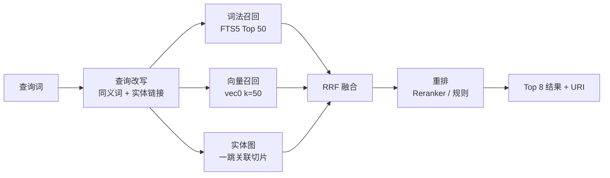
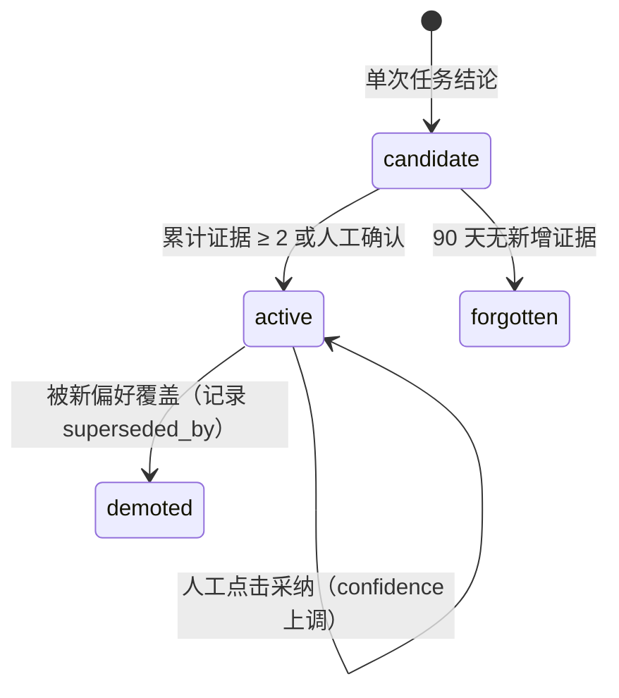

# 知识库与记忆分层

> 状态：设计中 · 上位文档：[总体架构设计 §8 规则与能力的演进闭环](architecture-north-star.md#8-规则与能力的演进闭环)
>
> 本文细化 `info.recall` 与 [Personal Agent §6 记忆分层](personal-agent.md#6-记忆分层) 的具体实现。系统采用**单个 SQLite 文件（`~/knowledge/kb.sqlite`）同时承载词法检索（FTS5）、向量检索（`sqlite-vec`）与实体关系表**，记忆数据作为同一数据库中的一张表维护，不额外运行常驻检索服务。

## 0. 核心选型决策

| 模块 | 选型决定 | 依据说明 |
|---|---|---|
| 底层存储 | 单文件 `~/knowledge/kb.sqlite`（WAL 模式） | 与 Taskwarrior、Orca、Home Assistant 同技术栈，复用同一条 Litestream 备份链路 |
| 词法检索 | SQLite FTS5 + `jieba` 预分词列 | 本机 SQLite 默认 `unicode61` 无法切分中文词，`trigram` 无法匹配双字词（见 §4） |
| 向量检索 | `sqlite-vec`（`vec0` 虚拟表），`bge-small-zh-v1.5`（512 维） | `nixpkgs` 已收录 `sqlite-vec`；20 万条切片约占 400MB（float32）或 100MB（int8） |
| 实体关系图 | 普通关系表 `entity` / `mention` / `edge`，支持一跳扩展 | 单用户规模下实体数量 < 10⁴，无需引入独立图数据库 |
| 多路融合 | RRF（Reciprocal Rank Fusion，k=60）+ 时间衰减 + 数据源权重 | 单条 SQL CTE 查询即可完成三路召回与融合排序（见 §5） |
| 结果重排 | 优先使用 `bge-reranker-base-zh`，模型缺失时回退为规则重排 | 20 条候选在 CPU 上重排耗时约 150ms |
| 记忆存储 | `mem` 表记录事件、偏好、人物设定三层，附带 `evidence` 引用指针 | 记忆仅存储从原始记录中提炼的派生结论，原始任务与文档仍为权威数据源 |
| 意图分类样本 | `label_sample` 表，按样本量从 kNN 平滑过渡至 SetFit，每周增量训练 | 日常确认与修正记录直接转化为有监督训练样本 |

## 1. 数据源清单

| 数据源 | 本机路径（以原生文件为准） | 存储形态 | 索引切分粒度 | 同步方式 | 保留周期 |
|---|---|---|---|---|---|
| 任务库 | `~/.local/share/task/taskchampion.sqlite3`（TW3 默认路径） | SQLite | 单条任务 = 1 个 `doc`，每条注解 = 1 个 `chunk` | `on-modify` Hook 触发 `kn ingest task`（5s 防抖） | 永久 |
| Orca 会话 | `~/.config/orca/ai-vault/session-search.sqlite` | 已有 FTS5 表（约 7.5 万条消息） | 单条消息 | 只读 `ATTACH`，按 `sessions.updated_at` 增量同步 | 热数据 90 天，超期归档 |
| Claude Code 会话 | `~/.claude/projects/*/*.jsonl`（约 751MB） | JSONL | 单轮 `user + assistant` 对话为 1 个 `chunk` | 按文件 `mtime` 增量扫描，跳过大体积 `tool_result` 与 Base64 内容 | 180 天 |
| 规则与设计文档 | `~/.claude/CLAUDE.md`、`~/.agents/**`、各仓 `AGENTS.md` 与 `docs/**` | Markdown | 按二级标题 `##` 切分章节 | `inotify` 监听 + Git `pre-commit` 钩子 | 永久（带版本哈希） |
| 个人技术笔记 | `~/.agents/notes/*.md` | Markdown | 按二级标题 `##` 切分章节 | 同上 | 永久 |
| Calibre 书库 | 书库路径待建（本机暂无 `~/EBook/Calibre`） | SQLite + EPUB | 书籍元数据全量索引；正文按需解包，仅索引前 3 章 | 每小时调用 `calibredb list --for-machine` | 元数据永久保留 |
| B 站账号动态 | `~/.config/biliup/`（仅 Cookie）+ 投稿 API 返回 | JSON | 投稿元数据、本人评论与回复 | 投稿完成后触发 + 每日定时同步 | 90 天 |
| 学习通课程 | `xxt hw\|notice --all-courses --json` | JSON | 单条作业或通知 = 1 个 `doc` | 每日 07:00 定时拉取 | 当前学期 |
| Shell 命令历史 | `~/.bash_history` | 纯文本 | 完整复合命令 | 每日增量同步，过滤裸命令（如单独的 `ls`、`claude`） | 90 天 |
| 邮件 | 端口适配器（IMAP） | 结构化摘要 | 仅索引摘要与关键字段，不索引邮件正文全文 | 每日同步 | 30 天 |
| IM 聊天记录 | `kb.sqlite` 的 `im_message` 表（采集见 [IM 采集](im-ingest.md)） | SQLite | 群聊按时间窗、对话按回复对 | 主账号协议轮询 + 专用账号 Webhook | 原始永久，切分视图可重建 |
| Home Assistant | Recorder 数据库 | 时序数据 | **不纳入知识库** | 按需通过 HA API 实时查询 | - |
| Claude 项目记忆 | `~/.claude/projects/*/memory/*.md` | Markdown + YAML | 单文件 = 1 个 `doc` | 文件变更时触发 | 永久 |

收录标准：仅纳入有助于回答"某件事上次是如何处理的"的文本与元数据；传感器读数、视频播放量等高频时序数据留在各自原生系统中。

Orca 自带的 `session-search.sqlite` 已包含 7.5 万条历史消息的 FTS5 索引，直接通过 SQLite `ATTACH` 挂载读取；Taskwarrior UDA、Orca、学习通（`xxt`）与 `biliup` 的数据接入则通过各自的轻量级 Python 适配器（每个约 50–100 行）完成。

## 2. 目录结构

```
~/knowledge/
├── kb.sqlite              # 知识库主文件（doc / chunk / fts / vec / graph / mem）
├── ingest/                # 各数据源导入适配器（每个 < 100 行）
│   ├── task.py  orca.py  transcript.py  files.py
│   └── calibre.py  bili.py  xxt.py  history.py
├── models/                # bge-small-zh-v1.5、bge-reranker-base-zh、jieba 自定义词典
├── state/                 # 各数据源增量游标与水位线（JSON）
└── export/                # kn mem export 导出的 Markdown 快照
```

统一命令行入口为 `kn`（源码与安装脚本位于 `~/agent-src/tools/knowledge`），包含五个子命令：`ingest`、`search`、`recall`、`mem`、`stats`。

## 3. 数据库 Schema

```sql
PRAGMA journal_mode=WAL;
PRAGMA foreign_keys=ON;

CREATE TABLE source (
  id TEXT PRIMARY KEY, root TEXT, kind TEXT NOT NULL,
  weight REAL NOT NULL DEFAULT 0.5,       -- 数据源排序权重：规则/文档 0.9，会话记录 0.4
  enabled INTEGER NOT NULL DEFAULT 1,
  cursor TEXT, last_run TEXT, note TEXT
);

CREATE TABLE doc (
  id INTEGER PRIMARY KEY,
  source_id TEXT NOT NULL REFERENCES source(id),
  ext_id TEXT NOT NULL,                    -- 任务 uuid / session:msgid / 文件路径
  type TEXT NOT NULL,                      -- task | session | note | book | hw | comment
  title TEXT, uri TEXT, ts TEXT,
  content_hash TEXT NOT NULL,              -- sha1(正文)，用于去重与跳过重复向量化
  meta TEXT,                               -- JSON：kind / source / thread / parent 等
  indexed_at TEXT NOT NULL,
  deleted INTEGER NOT NULL DEFAULT 0,
  UNIQUE(source_id, ext_id)
);

CREATE TABLE chunk (
  id INTEGER PRIMARY KEY,
  doc_id INTEGER NOT NULL REFERENCES doc(id) ON DELETE CASCADE,
  seq INTEGER NOT NULL,
  text TEXT NOT NULL,                      -- 原始文本片段，检索结果直接引用该字段
  seg TEXT NOT NULL,                       -- jieba 空格切分后的分词列，供 FTS5 索引
  span_start INTEGER, span_end INTEGER, ts TEXT,
  prior REAL NOT NULL DEFAULT 0,           -- 先验加权：任务执行摘要行 +0.3，普通正文 0
  UNIQUE(doc_id, seq)
);

CREATE VIRTUAL TABLE chunk_fts USING fts5(
  seg, content='chunk', content_rowid='id', tokenize='unicode61'
);
-- 配套触发器 chunk_ai / chunk_ad / chunk_au 按 FTS5 external-content 标准写法维护

CREATE VIRTUAL TABLE chunk_vec USING vec0(
  chunk_id INTEGER PRIMARY KEY,
  embedding float[512] distance_metric=cosine,
  type TEXT,                               -- 元数据过滤列
  ts   TEXT
);

CREATE TABLE entity (id INTEGER PRIMARY KEY, type TEXT, name TEXT, norm TEXT UNIQUE, note TEXT);
CREATE TABLE alias  (entity_id INTEGER, alias TEXT, PRIMARY KEY(alias, entity_id));
CREATE TABLE mention(chunk_id INTEGER, entity_id INTEGER, PRIMARY KEY(chunk_id, entity_id));
CREATE TABLE edge   (src INTEGER, dst INTEGER, rel TEXT, weight REAL DEFAULT 1,
                     doc_id INTEGER, ts TEXT, PRIMARY KEY(src, dst, rel, doc_id));
```

实体关系仅维护一跳关联：`mention` 表记录文本切片与实体的共现关系，`edge` 表记录实体间的直接关联（如 `使用`、`产出`、`属于`、`提及`）。查询"上次剪辑视频的做法"时，除词法与向量召回外，还会通过实体"视频剪辑"扩展召回一跳关联的文档切片。

## 4. 中文分词方案与实测对比

本机 SQLite 编译时启用了 `ENABLE_FTS5`，未启用 ICU 分词器，内置仅有 `unicode61` 和 `trigram` 两种分词器。实测结果如下：

| 查询词 | `unicode61` | `trigram` |
|---|---|---|
| `"Taskwarrior"` | 命中 | 命中 |
| `"记账"`（双字词） | 未命中 | 未命中（`trigram` 要求至少 3 个字符） |
| `"视频剪辑"`（四字词） | 未命中 | 命中整串 |
| `"视频"`（出现在长句内部） | 未命中 | 未命中 |

`unicode61` 会将连续汉字视为单个长 Token，导致子词无法匹配；`trigram` 虽支持三字以上子串匹配，但无法召回中文里最高频的双字词。

因此采用**入库预分词方案**：写入时通过 `seg = " ".join(jieba.lcut(text))` 生成空格分隔的分词列并交由 FTS5 `unicode61` 索引，`text` 列保留原文用于结果展示。查询侧同样经过 `jieba` 分词，并在自定义词典中注册全仓 `kind` 名称、仓库名与专有工具名（如 `Remotion`、`biliup`、`taskchampion`），避免专有名词被切碎。

## 5. 三路混合召回与 RRF 融合



三路召回与 RRF 融合查询 SQL：

```sql
WITH lex AS (
    SELECT rowid AS id, bm25(chunk_fts) AS s FROM chunk_fts
    WHERE chunk_fts MATCH :q ORDER BY s LIMIT 50
  ), lex_r AS (SELECT id, ROW_NUMBER() OVER (ORDER BY s) AS r FROM lex),
  vec AS (SELECT chunk_id AS id, distance AS d FROM chunk_vec
          WHERE embedding MATCH :qv AND k = 50 ORDER BY distance),
  vec_r AS (SELECT id, ROW_NUMBER() OVER (ORDER BY d) AS r FROM vec),
  graph_hit AS (SELECT m.chunk_id AS id, 1 AS hops FROM mention m
                WHERE m.entity_id IN (SELECT * FROM :linked_entities)),
  score AS (
    SELECT id, SUM(w) AS rrf FROM (
      SELECT id, 1.0/(60+r) FROM lex_r
      UNION ALL SELECT id, 1.0/(60+r) FROM vec_r
      UNION ALL SELECT id, 0.5/(60+hops) FROM graph_hit
    ) GROUP BY id
  )
SELECT s.id, s.rrf * exp(-julianday('now','-90 days')/365.0) * src.weight AS final,
       d.title, d.uri, c.text
FROM score s
JOIN chunk c ON c.id = s.id
JOIN doc   d ON d.id = c.doc_id
JOIN source src ON src.id = d.source_id
WHERE d.deleted = 0 AND (:since IS NULL OR d.ts >= :since)
                  AND (:until IS NULL OR d.ts <= :until)
ORDER BY final DESC LIMIT :k;
```

实现要点：

- SQLite FTS5 的 `bm25()` 函数必须先在独立子查询 `lex` 中物化，再在外层 `lex_r` 中配合 `ROW_NUMBER()` 窗口函数排序；若直接写在同一个窗口函数子句中会触发 `unable to use function bm25 in the requested context` 错误。
- 查询当前状态时默认启用时间衰减；查询早期历史做法时可通过 `--all-time` 关闭时间衰减。
- 重排阶段：默认调用本地 `bge-reranker-base-zh` 对 RRF 融合后的前 20 条候选重新打分；若本地模型文件未就绪，则回退为基于词法命中数、时间戳与 `prior` 先验权重的规则重排。

### 5.1 查询改写流程

| 步骤 | 处理方式 | 是否调用大模型 |
|---|---|---|
| 指代消解 | 查询近期上下文中的活跃 `entity`，将"刚才那个项目"替换为具体实体名 | 否 |
| 同义词扩展 | 基于 `alias` 表与自定义词典扩展（如 `vlog → video`、`投稿 → biliup`） | 否 |
| 实体链接 | 扫描查询串匹配 `entity.norm` 与 `alias`，提取命中实体 ID 传入图召回分支 | 否 |
| 时间表达式解析 | 将"上个月""去年秋天"转换为具体的 `since` / `until` 时间范围 | 否 |
| 多角度改写（Paraphrase） | 生成 3 条改写查询分别召回后合并 | **可选**（仅在 `--mode=deep` 时启用） |

常规检索请求完全在本地通过词典与向量模型完成，无需调用大语言模型。仅在指定 `--mode=deep` 时才经 LiteLLM 生成改写查询，改写结果缓存于 `recall_cache` 表（键为 `sha1(query) + scope`，有效期 1 天）。

### 5.2 检索引擎选型对比

| 候选方案 | 运行形态 | 中文支持 | 多数据源接入 | CLI 友好度 | 运维开销 | 选型结论 |
|---|---|---|---|---|---|---|
| **SQLite FTS5 + sqlite-vec** | 嵌入式单文件 | 配合 `jieba` 预分词效果良好 | 自写轻量适配器 | 纯 CLI 调用 | **零常驻开销** | **主选方案** |
| `qmd` | 嵌入式（Node + GGUF） | 内置中文模型 | 仅支持纯文件目录 | CLI + MCP | 零常驻（依赖 Node 22） | 辅助工具：直接检索本地 Markdown 目录时使用 |
| LanceDB | 嵌入式列存 | 依赖外部 Embedding | 需自行编写 | Python / Rust API | 低（依赖 `pyarrow`） | 备选：切片规模超过 1000 万条时迁移 |
| Meilisearch | 常驻守护进程 | 内置 `charabia` 中文分词 | 需自行同步 | HTTP + CLI | 需维护独立服务 | 仅在需要独立 Web 搜索页时考虑 |
| Qdrant | 常驻容器/服务 | 依赖外部 Embedding | 需自行同步 | HTTP / gRPC | 需维护服务 | 不采用：单机单用户规模无需独立向量库服务 |
| Khoj / Onyx / RAGFlow | 完整应用套件 | 中至良 | 主要面向通用文档 | Web / API 为主 | 高（依赖 PostgreSQL 或多容器） | 不采用：运维重，且无法直接挂载本机私有数据源 |

选择 SQLite + `sqlite-vec` 的核心原因：作为单文件动态库直接加载进现有 SQLite 环境，备份、快照回滚与文件权限管理完全复用现有基础设施。若未来切片规模超过 500 万条或出现高频多进程并发写入需求，可在保持表结构不变的前提下将 `chunk_vec` 替换为 LanceDB。

## 6. 检索接口规范（`kn recall`）

所有 Agent（入口、Worker、写作子任务）统一通过 `kn recall` 调用知识检索：

```bash
kn recall --json <<'EOF'
{
  "query": "上次剪 vlog 是怎么配乐和投 B 站的",
  "k": 8,
  "scope": ["task", "session", "note"],
  "since": "2026-01-01",
  "mode": "auto",              // auto | lex | vec | graph | deep
  "all_time": false,
  "until": "2026-10-31",       // 时间上界，「上个月」这类闭区间必填
  "author": "me",              // me | <author_id>，限定本人或某位发言者
  "conv": null,                // 限定会话 id，见 im-ingest.md §5
  "expand": 0,                 // 命中后按 continued 向前后扩展的 chunk 数

  "include": ["snippets", "entities", "paths"]
}
EOF
```

返回 JSON 结构（进程退出码：`0` 正常返回 · `2` 结果为空 · `3` 降级模式返回 · `4` 索引文件缺失）：

```json
{
  "qid": "r-20261101-7f3a",
  "query": "…",
  "rewritten": ["vlog 配乐 biliup 投稿"],
  "took_ms": 87,
  "degraded": false,
  "coverage": {"lex": 12, "vec": 50, "graph": 3},
  "hits": [{
    "chunk_id": 48211,
    "uri": "task://9f2c…/annotation/1",
    "title": "剪个 vlog 发 B 站",
    "ts": "2026-10-30",
    "source": "taskwarrior",
    "weight": 0.9,
    "score": 0.0407,
    "why": ["lex#1", "vec#4", "graph:entity 视频剪辑"],
    "text": "用 ACE-Step 压了一版 90 秒的曲子，biliup 上传后才追加的封面"
  }],
  "entities": [{"name": "视频剪辑", "type": "capability", "id": 17}],
  "suggest": {"kind": "work.video.make", "confidence": 0.72}
}
```

接口约束：

1. **强制附带 `uri` 来源**：每条命中结果必须包含可追溯的原始 `uri`，禁止在无来源支撑的情况下编造历史结论。
2. **返回原文切片**：`text` 字段返回原始切片文本，由调用方按需总结。
3. **检索反馈回采**：调用方将本次检索的 `qid` 记录到任务注解中。系统通过 `recall_log` 表追踪哪些命中切片最终被采纳，每周按 `hit_utility = used / hits` 动态微调各数据源的 `source.weight`（指数滑动平均，步长 0.05，下限 0.2）。

## 7. 记忆分层与生命周期

### 7.1 五层记忆结构

| 记忆层级 | 权威存储位置 | 写入方式 | 生命周期 | 数据权威性 |
|---|---|---|---|---|
| 全局与系统规则 | `~/.claude/CLAUDE.md`、`~/.agents/SKILLS.md`、各仓 `AGENTS.md` | 人工编写，或由 `meta.capability.propose` 提交 PR | 永久 | 以 Markdown 原文件为准，`kb.sqlite` 仅建索引 |
| 项目级约定 | 各代码仓库的 `AGENTS.md` | 人工或随代码 PR 更新 | 永久 | 以仓库原文件为准 |
| 任务执行历史 | Taskwarrior + Orca 原生存储 | 派发器与 Worker 写回 | 永久 | 以原生数据库为准 |
| 能力偏好（`pref`） | `kb.sqlite` 的 `mem` 表（`layer='pref'`） | 从历史任务选择与返工记录中提炼 | 半衰期 180 天 | 以 `mem` 表为准，可导出快照 |
| 交互设定（`persona`） | `kb.sqlite` 的 `mem` 表（`layer='persona'`） | DS-Bot 入口摘要写入 | 半衰期 365 天 | 以 `mem` 表为准 |

全局规则、项目约定与任务历史三层的权威数据源保留在各自原生文件或数据库中，`kb.sqlite` 仅建立检索索引；只有提炼出的能力偏好（`pref`）与交互设定（`persona`）以 `mem` 表作为主存储。

### 7.2 `mem` 表结构

```sql
CREATE TABLE mem (
  id INTEGER PRIMARY KEY,
  layer TEXT NOT NULL CHECK(layer IN ('event','pref','persona')),
  scope TEXT,                       -- 作用域，如 capability:work.video.make
  key TEXT NOT NULL,                -- 归一化主题键，如 "video.bgm.style"
  value TEXT NOT NULL,              -- 一句话偏好或事实结论
  confidence REAL NOT NULL DEFAULT 0.5,
  salience REAL NOT NULL DEFAULT 0.5,
  evidence TEXT NOT NULL,           -- 支撑证据 JSON 数组：["chunk:48211","task:9f2c"]
  state TEXT NOT NULL DEFAULT 'candidate'
        CHECK(state IN ('candidate','active','demoted','forgotten')),
  superseded_by INTEGER REFERENCES mem(id),
  hits INTEGER NOT NULL DEFAULT 0,
  created_at TEXT NOT NULL, updated_at TEXT NOT NULL, last_hit TEXT
);
CREATE INDEX mem_lookup ON mem(layer, scope, state);

CREATE TABLE mem_event (           -- 追加写变更日志，用于审计与重算权重
  id INTEGER PRIMARY KEY, mem_id INTEGER, op TEXT,  -- create | promote | hit | correct | demote | forget | merge
  detail TEXT, ts TEXT NOT NULL
);

CREATE TABLE recall_log (
  qid TEXT PRIMARY KEY, query TEXT NOT NULL, hit_json TEXT NOT NULL,
  used_json TEXT, followed_kind TEXT, outcome TEXT, ts TEXT NOT NULL
);
```

`key` 采用点分命名空间（如 `video.bgm.style`），以便对同一主题的多次观察进行聚合更新，避免插入重复条目。

### 7.3 偏好提炼与升级路径



| 流转阶段 | 触发条件 | 执行动作 |
|---|---|---|
| 任务结论 → `candidate` | Worker 在 `ev done` 摘要中记录了可复用的参数或做法 | 写入 `mem(layer='event')`，初始 `confidence = 0.4`，`evidence` 指向该任务 |
| `event` → `pref` | 同类结论累计出现 **≥ 2 次**，或用户明确表示"以后都按这个来" | 升级为 `layer='pref'`，`confidence = 0.6`，绑定能力命名空间 `key` |
| `pref` → 稳定偏好 | 累计命中 `hits ≥ 3` 且 60 天内未被人工纠正 | `confidence = 0.8`，作为该能力默认参数或意图分类先验 |
| 任意阶段 → `active` | 用户在交互卡片中直接点击确认采纳 | `confidence = min(1.0, confidence + 0.2)` |
| 偏好冲突更新 | 新结论与同 `key` 旧记录相悖 | 旧记录标记 `state='demoted'` 并设置 `superseded_by` 指向新记录，保留历史可追溯 |

### 7.4 时间衰减与淘汰

记忆显著度（`salience`）按以下公式每周重算：

```
salience' = salience · exp(-Δt / τ) + 0.1 · log(1 + hits) − 0.3 · corrections
```

| 层级 | 半衰期参数 `τ` | 降权条件 | 淘汰条件 |
|---|---|---|---|
| `pref` | 180 天 | `salience < 0.3` | 连续 180 天无命中则标记为 `forgotten` |
| `persona` | 365 天 | `salience < 0.3` | 不自动淘汰，定期合并压缩摘要 |
| `event` | 30 天 | - | 90 天后若未升级为 `pref` 则归档清理 |

每周复盘任务会扫描同一 `(layer, scope, key)` 下向量余弦距离 < 0.15 的相近条目并合并其 `evidence` 集合。

### 7.5 意图分类训练样本回采

用户的日常交互会自动转化为意图分类器的训练样本：

1. **人工修正（负样本 + 正样本）**：入口分类给出的 `kind` 被用户在卡片上修改，生成 `(原始输入, 错误 kind, 正确 kind)`，样本权重设为 `1.5`。
2. **直接确认（正样本）**：用户点击确认执行或采纳检索建议。
3. **多次返工（负样本）**：同一任务累计被 `ev reopen` ≥ 2 次。

```sql
CREATE TABLE label_sample (
  id INTEGER PRIMARY KEY,
  text TEXT NOT NULL,                 -- 用户原始输入文本
  label TEXT NOT NULL,                -- 确认后的正确 kind
  rejected TEXT,                      -- 被人工修正前的错误 kind
  origin TEXT NOT NULL,               -- confirm | correct | rework | implicit
  weight REAL NOT NULL DEFAULT 1.0,
  split TEXT NOT NULL DEFAULT 'train',-- train | holdout
  model_ver TEXT, created_at TEXT NOT NULL
);
```

| 训练环节 | 实施方案 |
|---|---|
| 文本特征 | 复用 `bge-small-zh-v1.5`（512 维向量），与知识库共用同一模型权重 |
| 分类模型 | 样本量 < 200 时使用 kNN（k=5）；样本量 ≥ 200 后切换为 SetFit（对比学习微调 + 逻辑回归分类头） |
| 冷启动种子 | 提取各能力 TOML 中的 `examples` 与 `not` 反例作为初始训练集（约 40 类 × 4 例 = 160 条） |
| 重训触发条件 | 新增样本满 200 条，或每周日定时触发 |
| 验证集划分 | 按时间顺序切分，取最近 20% 样本作为 `holdout` 验证集，防止时间穿越泄漏 |
| 替换上线标准 | 新模型在 `holdout` 集上的准确率较当前线上模型提升 **≥ 2 个百分点**才替换，否则保留原模型 |
| 部署与回滚 | 导出 ONNX 模型至 `~/knowledge/models/intent-<ver>/`，通过 `intent-current` 符号链接原子切换 |

### 7.6 与本地 Markdown 记忆文件的协同

Claude Code 等工具会在 `~/.claude/projects/<proj>/memory/` 下维护带 YAML frontmatter 的 Markdown 记忆文件：

- **权威方向**：人工或 Agent 直接编写的 Markdown 文件以磁盘原文件为准，`kb.sqlite` 仅做单向索引。
- **偏好快照导出**：执行 `kn mem export` 时，将数据库中 `layer='pref'` 的活跃偏好单向导出至 `~/.agents/notes/prefs.md`（文件头标注 `generated: true`），不覆盖人工手写的笔记条目。
- **检索权重**：文档与规则类切片的基础权重设为 `0.9`，高于普通聊天记录的 `0.4`；当两者结论冲突时优先采用文档与规则中的定义。

### 7.7 外部开源记忆方案借鉴

| 项目 | 借鉴设计 | 未直接采用的部分 |
|---|---|---|
| `mem0` | `key` 命名空间归一化与新增/更新/作废三态冲突处理 | 自带的外部向量库与云服务依赖 |
| Letta (MemGPT) | 核心记忆块分层与上下文窗口淘汰策略 | 独立常驻的 Agent Server 架构 |
| Zep / Graphiti | 时序有效区间设计（旧事实标记被替代而非物理删除） | 外部图数据库依赖（本系统简化为 `mem.superseded_by` 自引用列） |
| `basic-memory` / Obsidian | Markdown 文件配合 `[[双向链接]]` 表达显式关联 | 常驻 MCP 服务或桌面 GUI 依赖 |
