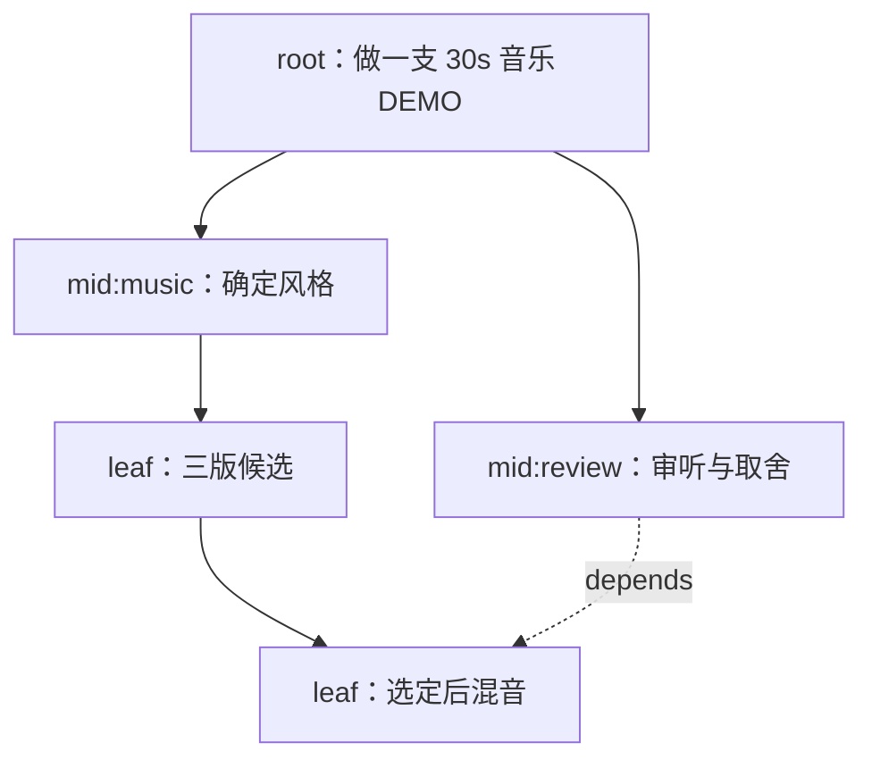
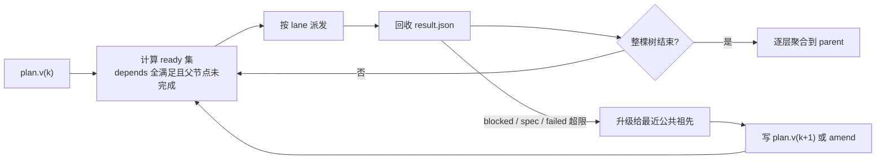

# 多 Agent 运行时：树、信封与程序化约束

> 状态：设计中 · 上位文档：[总体架构设计](architecture-north-star.md) · 关联：[事件运行时与派发器](event-runtime.md)、[任务规格](event-spec.md)、[多 Agent 协作规范](agent-collaboration.md)
>
> 本文规定多个 Agent 之间如何传递工作、如何避免自由对话的上下文成本，以及「让模型决定发散还是收敛」如何在不依赖提示词的情况下落地。协作模式的业务分类见 [多 Agent 协作规范](agent-collaboration.md)，本文只讲机制。本文即 `agent:local` 运行时（`ar` CLI）的实现规格，见 [ADR 0008](adr/0008-local-agent-runtime.md)。

## 1. 为什么不让 Agent 互相聊天

消息模式的成本随轮数累积。设 N 个 Agent、每轮上下文长度 d、总轮数 h，消息模式的上下文总量是 `O(N · d · h)`：每个参与者都要把别人的历史读进来才能继续。更麻烦的是它会引入三种无法消除的故障：

- **重复读**：同一个文件被上下游各读一遍，且读到的可能不是同一版本；
- **漏读**：某个 Worker 没看到上游的补充说明，按旧假设继续；
- **对话漂移**：每个 Agent 都试图对全局负责，局部最优给出互相矛盾的修改。

任务库模式把它变成 `O(N + 实际读取量)`：每个 Agent 只读写自己的那条记录与指定产物，重试只重跑一个节点。这不是效率优化，是正确性问题——**只有单一写入点，才可能判断谁做了什么**。

## 2. 三个面

| 面 | 承载 | 权威性 | 变更方式 |
|---|---|---|---|
| **控制面** | 任务库中的任务与派发记录 | 权威 | 追加，不改写历史 |
| **数据面** | 磁盘产物与 `sha256` | 权威 | 只新增版本 |
| **知识面** | `kb.sqlite`、`ThreadCtx`、偏好 | 派生 | 可从控制面与数据面重建 |

三个面之间只通过引用连接：控制面记录 `art://` 路径与哈希，知识面记录来源引用，数据面不记录任何业务状态。这样任一面的索引损坏都能重建，而不会污染另外两面。

## 3. 两棵树，不要合并

这是最容易出错的地方：**权威关系是树，依赖关系是 DAG，两者必须分开存。**



| 关系 | 字段 | 基数 | 语义 |
|---|---|---|---|
| **归属** | `parent` | 每个节点至多一个父 | 谁对结果负责、汇总到谁、失败时向谁升级 |
| **依赖** | `depends` | 多个 | 什么时候可以开始执行 |

当前 [任务规格](event-spec.md) 把 `parent` 映射到 Taskwarrior 原生的 `depends`，于是子任务会阻塞父任务，方向正好相反。依赖应当是**父依赖子**：父任务等所有子任务完成后才可完成，而子任务不应因为父任务未完成而被阻塞。

同一份图上两条边的含义不同，合并成一个字段后会出现两种错误：把 `parent` 当依赖，则兄弟节点无法并行；把 `depends` 当归属，则汇总关系丢失，无法判断该由谁合并结果。

## 4. 信封：`spec.json` 与 `result.json`

节点是一次派发的单位。派发前写入 `spec.json`，完成后写入 `result.json`，两者都在运行目录里落盘，任务库只存引用。

### 4.1 派发信封

```json
{
  "id": "node:root/03",
  "parent": "node:root",
  "depends": ["node:root/01"],
  "plan_version": 3,
  "type": "assign",
  "mode": { "shape": "diverge", "axis": "bgm.style", "n": 3,
            "stop_when": "覆盖 3 个风格簇", "why": "用户只说要做 demo，风格未定" },
  "spec_ref": "runs/<root>/nodes/03/spec.json",
  "inputs": [
    { "ref": "art://ingest/manifest.json", "sha256": "…", "trust": "user" }
  ],
  "accept": ["三版时长误差均 < 5%", "响度 -14 LUFS ±1"],
  "budget": { "tokens": 120000, "minutes": 40, "depth_left": 2 },
  "already_known": ["art://mem/pref/video.bgm.style"]
}
```

字段约束：

| 字段 | 约束 | 由谁校验 |
|---|---|---|
| `id` | `uuid5(root_id, 路径)`，可重复计算 | 派发器 |
| `parent` | 必填，且必须已存在；不构成环 | 派发器 |
| `depends` | 可空；只允许指向本树内节点 | 派发器 |
| `mode` | `diverge` / `converge` / `execute` 三选一；`diverge` 必须有 `axis` | 派发器 |
| `accept` | 至少一条，且必须是可执行的检查 | 执行器 |
| `budget.depth_left` | 子节点必须严格小于父节点 | 派发器 |

`already_known` 是检索分层的结果：祖先节点已经查过的资料向下传递，子节点不再重复检索同一来源。这一条单独就能砍掉大量重复读取。

### 4.2 结果信封

```json
{
  "id": "node:root/03",
  "type": "result",
  "status": "done",
  "summary": "选定 lo-fi 方向，三版成品在 art://music/demo/",
  "refs": ["art://music/demo/v1.mp3", "art://music/demo/v2.mp3", "art://music/demo/v3.mp3"],
  "checks": [{ "cmd": "ffprobe …", "exit": 0 }],
  "spent": { "tokens": 98000, "minutes": 22 }
}
```

`status` 复用派发器已有的七种返回状态（`done` / `waiting` / `me` / `blocked` / `failed` / `split` / `spec`），不新增枚举。`split` 是唯一允许在 `result.json` 中携带 `children` 的路径，也即数据驱动的派发。

### 4.3 运行目录

```
runs/<root_id>/
  plan.v1.json  plan.v2.json        # 每次重规划新增版本，不覆盖
  nodes/<path>/
    spec.json  result.json
    stdout.log
  artifacts/                        # 数据面，引用按 sha256 去重
```

目录是数据面的边界，也是权限边界：Worker 只能写自己节点的目录与 `artifacts/`，不能写兄弟节点。这比在提示词里写「不要修改别人的文件」可靠。

## 5. 调度循环



调度器本身就是 `evd`，不引入第二套执行引擎。任务 `thread` 作为串行边界，同一 `thread` 内不并行；`lane` 区分交互与批处理。

## 6. 程序化约束：把能力拿走，而不是劝说

提示词能表达规范，但不能保证规范被执行：模型可以在长上下文里忽略它，也可以对局部最优给出「合理的」偏离。真正的约束来自**让错误的行为在结构上无法发生**，分四档：

| 档 | 手段 | 例 |
|---|---|---|
| **档 0** | 提示词描述 | 写清楚规范，但无法验证 |
| **档 1** | 事后检查 | 产物校验、`accept` 检查、CI |
| **档 2** | 事前拦截 | Schema 校验、缺字段直接拒收、越权写目录报错 |
| **档 3** | 不可构造 | 接口里根本不存在该操作 |

多 Agent 编排必须落在档 2 与档 3：

- **编排者没有执行工具。** 顶层 Agent 的工具列表里只有「写 `spec.json`」与「读 `result.json`」，没有 shell、没有文件写、没有网络。它无法「顺手自己做完」，因为能力不存在。
- **派发是数据，不是工具调用。** 编排者输出一条 `expand` 记录，由派发器读取并建子任务。这样派发可审计、可重放、可在派发前校验 `parent` 与 `budget`。
- **子任务必须带 `accept`。** 没有可执行验收条件的节点在派发时被拒，而不是在执行后才发现无法判断好坏。
- **越界写直接报错。** 运行目录按节点隔离，写到兄弟目录会被文件系统权限拦下。

一句话概括：**凡是能判定真假的事实，不要交给提示词；凡是不能被判定的判断，不要假装能程序化。**

## 7. 发散与收敛

「该发散时发散、该收敛时收敛」不能靠提示词叮嘱，但也不能完全交给程序——只有模型能判断**沿哪个轴**值得探索。所以拆成两半：

| 谁决定 | 决定什么 | 载体 |
|---|---|---|
| 模型 | 沿哪个轴发散、为什么 | `mode.axis` + `mode.why` |
| 程序 | 发几个、何时停、如何判定收敛 | `mode.n`、`mode.stop_when`、检查项 |
| 模型 | 判断是否已经收敛 | 节点内决策，写入 `result.json` |

三种节点形状：

| 形状 | 隔离方式 | 停止条件 |
|---|---|---|
| `diverge` | 每个分支独立目录，互不可见 | `n` 达到、覆盖度达标、预算耗尽 |
| `converge` | 所有候选同时可见 | 选出唯一结果并给出理由 |
| `execute` | 单节点，无分支 | `accept` 全部通过 |

**发散失败的主要形态是塌缩**：n 个候选实际是同一个想法的措辞变体。可计算的判据是候选两两的嵌入余弦相似度，超过阈值（初值 0.95）即判定塌缩，补发新分支并要求更换 `axis` 的子维度。这条判据不需要人工看稿就能触发。

**收敛失败的主要形态是伪收敛**：没有可判定的标准，最后靠「看起来不错」选一个。因此收敛节点的 `accept` 必须是三档之一：命令（退出码）、指标（阈值）、人（卡片选择）。三档都写不出来时，这个节点就不该收敛，应该继续发散或升级给人工。

`mode.why` 与 `mode.axis` 一起写进 `spec.json`，重规划时只重判一次，不在执行中途反复摇摆。判断质量靠记录校准：每条记录 `(mode_decision, kind, 是否返工, 成本)`，返工率高说明该类任务的发散轴设错了，与「模型不听话」是两类不同的问题。

## 8. 升级与重规划

节点失败或需要决策时，不向「上级 Agent」发消息，而是升级给**最近公共祖先**：沿 `parent` 向上找第一个可以处理该问题的节点。这样即使某个中间层已经完成或已退出，升级路径仍然成立。

重规划不改写历史：`plan.v(k+1)` 是新增文件，已完成节点的 `spec.json` 保持原样。已完成的工作因此可审计，失败的重规划也可以对照。

## 9. 明确不做

- **不做 Agent 间自由对话。** 需要交换的信息只有三种：产物（走数据面）、进度（走控制面）、事实（走知识面）。
- **不引入独立的编排引擎。** 调度、幂等、重试全部复用 `evd`。
- **不把会话当作状态。** 任何需要跨设备、跨时间存在的上下文都必须能从任务库与产物重建。
- **不在派发链路上叠加人工确认。** 只保留付款、删除、对外发布三类确认点（[ADR 0002](adr/0002-three-confirmation-points.md)）。
