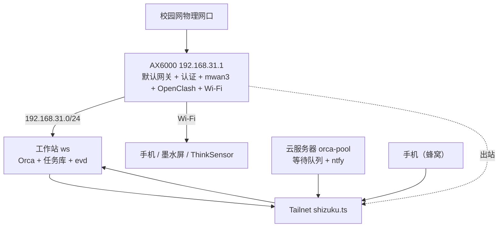

# 网络与设备组网

> 状态：设计中 · 上位文档：[总体架构设计 §6 故障域与降级策略](architecture-north-star.md#6-故障域与降级策略)、[ADR 0007](adr/0007-deferred-resident-node.md)
>
> 本文定义跨设备虚拟局域网（Tailscale）拓扑、路由器多出口状态的感知机制、外设接入规范，以及单机场景下的电源与唤醒策略。常驻节点落地前的组网以工作站与云服务器两个节点为准。

## 1. 局域网与 Tailnet 拓扑



| 节点 | Tailnet 主机名 | 网络角色 | 部署说明 |
|---|---|---|---|
| Redmi AX6000 | `rt`（可选） | 局域网唯一默认网关 | 512MB 内存已运行 OpenClash 与 mwan3，不承担 Tailscale 子网路由转发 |
| 工作站 | `ws` | 核心计算、执行与常驻服务节点 | 接交流电时保持唤醒（见 §6） |
| 云服务器 | `orca-pool` | 外部消息接收与等待队列 | 腾讯云新加坡，Debian 13，公网入口常被拒时走 Tailscale `100.126.52.115` |
| Kindle KPW5 | `kpw` | 只出站客户端 | 运行 Userspace 网络栈，仅能主动向 `ws` 发起拉取请求 |
| 手机 | `phone` | 移动客户端 | 校外蜂窝网络下通过 Tailnet 访问 `ws` |

## 2. 主机命名、MagicDNS 与内网 HTTPS

| 配置项 | 设定值 |
|---|---|
| MagicDNS 域名后缀 | `shizuku.ts` |
| 主机命名规范 | 统一使用简短角色名（`ws`、`orca-pool`、`kpw`、`phone`、`rt`） |
| 服务暴露方式 | 统一使用 `tailscale serve`（自动签发内网 HTTPS 证书），不开公网端口映射 |
| 核心服务端口 | 渲染服务 `7777`、DS-Bot `13080`、LiteLLM `4000`、ntfy `2586`（云服务器） |

工作站侧安装与启动：

```bash
# 工作站：只作为 Tailnet 客户端，接受云服务器宣告的路由（如有）
sudo tailscale up --ssh --accept-routes
```

```toml
# Tailnet ACL：只允许本人账号访问自有节点
[[grants]]
src = ["autogroup:admin"]
dst = ["*"]
ip  = ["*"]

[[ssh]]
action = "check"
src    = ["autogroup:admin"]
dst    = ["tag:infra"]
users  = ["root", "shizuku"]
```

云服务器 `orca-pool` 只运行队列与推送，不向 Tailnet 宣告任何子网路由。由于 Kindle KPW5 运行在 Userspace 网络模式下无法接收入站连接，图像同步采用拉取模式：由 KPW5 定时执行 `wget https://ws.shizuku.ts:8443/render/today.png`。

## 3. 子网路由与 Exit Node

| 候选方案 | 优势 | 局限 | 结论 |
|---|---|---|---|
| 在 AX6000 上运行 Tailscale 子网路由 | 直接位于默认网关，少一跳中转 | 512MB 内存已由 OpenClash + mwan3 占满，易触发内存不足 | 不采用 |
| 在工作站上运行子网路由 | 无需额外设备 | 工作站关机或休眠期间远程无法访问局域网 | 不采用 |
| 在云服务器上宣告 `192.168.31.0/24` | 与工作站生命周期解耦 | 需要反向路由到宿舍网段，跨 NAT 不稳定，且存在把家庭网段暴露到公网推理节点的风险 | 不采用 |
| **不提供子网路由，按主机直达** | 无额外依赖 | 无法远程访问非 Tailnet 的局域网设备 | **暂时采用** |

当前所有需要远程访问的服务都直接跑在 `ws` 上，通过 Tailnet 主机名可直达，不需要子网路由。若日后落常驻节点并需要从校外访问 HA、Zigbee 等局域网服务，再按当时的硬件重新评估，不在本文预设方案。

## 4. 节点失效影响与恢复阶梯

| 故障场景 | 仍可正常工作的模块 | 受影响不可用的模块 | 恢复方式 |
|---|---|---|---|
| **工作站关机** | 云服务器继续接收外部消息并写入等待队列；Tailnet 内其他节点互通 | 全部编排、执行与本地服务；局域网内的渲染与推送 | 开机后由 `ev sync` 拉取积压事件 |
| **云服务器离线** | 工作站本地录入、编排与执行 | 外部消息接收、ntfy 推送 | 恢复后各端口按 `cursor` 回补；超过 `backfill` 上限的部分只入库不建任务 |
| **AX6000 路由器故障** | Tailnet 内 `ws` 与 `orca-pool` 可通过 WireGuard 建立连接 | 局域网 Wi-Fi / LAN 通信及全部外网连接 | 本地网线或串口登录路由器恢复 |
| **Tailscale 控制面不可达** | 宿舍局域网内 `192.168.31.0/24` 直连通信 | 校外远程访问与 `ev sync` | 等待控制面恢复，不在无人值守时自动执行 `--reset` |
| **校园网外网中断** | 局域网通信、任务库流转、本地模型推理 | 云端模型 API、外部订阅源、公网发布 | AX6000 热插拔脚本发出 `system.net.egress` 事件，自动将 `needs = ["net.*"]` 的任务挂起（`parked`） |

## 5. 外部设备接入方式汇总

各类硬件设备接入系统的统一标准是：**状态变化可转化为 `ev add` 任务，或动作可由派发器执行器调用**。下表第 1 至 4 项依赖常驻主机，随 [ADR 0007](adr/0007-deferred-resident-node.md) 一起延后；其余项在工作站上即可运行。

| 设备或协议类型 | 协议栈承载方 | 事件接入链路 | 适用设备 | 状态 |
|---|---|---|---|---|
| **Matter（Wi-Fi / Thread）** | HA Matter Server + OTBR | 设备 → Thread/Wi-Fi → Matter Server → HA | 新购智能插座、灯具、传感器 | 待常驻节点 |
| **BLE 传感器广播** | ESPHome `bluetooth_proxy` | BLE 广播 → ESP32 代理节点 → HA 原生 BTHome 集成 | 小米温湿度计 LYWSD03MMC（ATC/pvvx 固件） | 待常驻节点 |
| **Zigbee 传感器与开关** | Zigbee2MQTT + Mosquitto | Zigbee 协调器 → Z2M → MQTT → HA | 门磁、水浸传感器、计量插座、无线开关 | 待常驻节点 |
| **Home Assistant 自动化** | HA `automation` | 设备状态变化 → HA 自动化 → `ev add` | 全部家居联动 | 待常驻节点 |
| **USB HID / 串口设备** | Linux `udev` + 守护进程 | 插拔或状态事件 → `systemd` 规则 → `ev add` | 数位板、读卡器、UPS 电源 | 工作站可用 |
| **Linux 远端主机** | 目标主机 `sshd` | 执行器通过 Tailscale SSH 调用远端命令 | `orca-pool` | 可用 |
| **局域网新设备发现** | Avahi（mDNS / DNS-SD） | 定时运行 `avahi-browse` 比对已知列表 → `meta.device.discovered` | 检测新入网设备或 IP 变化 | 工作站可用 |
| **网络与热敏打印机** | CUPS / `python-escpos` | 派发器调用 CLI 打印当日清单 | 热敏小票机、常规打印机 | 工作站可用 |
| **自定义物联网节点** | Mosquitto MQTT Broker | 设备向 `ev/ingest` 主题发布 JSON 消息 | ESP32 自制节点、OpenEPaperLink AP | 工作站可用 |
| **本地文件目录监听** | `systemd.path`（基于 `inotify`） | 指定目录新增文件 → 触发服务执行 `ev add` | 扫描件归档、下载目录、新电子书入库 | 工作站可用 |

## 6. 电源、唤醒与夜间批处理

单机方案下没有第二台机器发 WoL，工作站改为**常开**：

- **保持唤醒**：`systemd-inhibit --what=sleep` 仅在交流电供电时生效；电池供电时按正常策略休眠。合盖行为设为 `HandleLidSwitch=ignore`。
- **电池保护**：长期插电使用，充电上限设为 60–80%（BIOS 或 `acpi` 设置）。
- **UPS（可选）**：若接入 UPS，由工作站自身作为 NUT `standalone` 节点，`schedulerRules` 在电量低于阈值时执行 `ev add --kind system.power.low` 并安全关机。
- **夜间批处理防休眠**：批处理窗口为 **01:00–07:00**，与本地推理共用 `~/.local/state/aica/gpu-lease` 显存锁（见 [模型路由与本地推理 §5](model-fleet.md#5-本地推理显存分配16gb-vram)）。队列非空时批处理服务持有 `systemd-inhibit --what=sleep:idle`，锁标识 `/run/aica/batch.active`，队列清空后释放。

## 7. 出口状态感知与任务挂起恢复

为使派发器感知校园网多出口与透明代理状态，采用「路由器上报状态事件 + 能力声明网络依赖 + 规则表自动挂起恢复」三步机制。

### 7.1 路由器侧边沿上报脚本（`/etc/hotplug.d/iface/50-ev-egress`）

```sh
#!/bin/sh
# 仅在接口 up/down 边沿触发上报
[ "$ACTION" = "ifup" ] || [ "$ACTION" = "ifdown" ] || exit 0
STATUS=$(ubus call mwan3 status 2>/dev/null | jsonfilter -e '@.interfaces.*.online' | tr '\n' ' ')
PROXY=$(/etc/init.d/openclash status 2>/dev/null | grep -q running && echo on || echo off)
mosquitto_pub -h 192.168.31.10 -t ev/ingest -q 1 -m "{\"kind\":\"system.net.egress\",
  \"source\":\"rt\",\"subject\":\"网络出口状态变化\",\"severity\":\"info\",
  \"payload\":{\"wan_online\":\"$STATUS\",\"proxy\":\"$PROXY\"}}"
```

### 7.2 能力声明网络依赖

```toml
# capabilities/work.repo.patrol.toml
kind = "work.repo.patrol"
needs = ["net.github"]        # 声明语义依赖名，不硬编码 IP 地址

# maps/net.toml
[net.github]
require = "egress.proxy == \"on\""
on_unmet = "park"             # park | fail | fallback:local
fallback = { egress = "any", model = "ollama:qwen3-8b" }
```

### 7.3 派发器自动挂起与恢复

当某条任务的 `needs` 条件未满足时，派发器将其状态设为 `parked`，并注册监听 `system.net.egress` 事件；待网络恢复后自动解除挂起（`unpark`）并重新派发。Agent 仅读取网络与代理状态，不直接自动重启 AX6000 上的 OpenClash 或修改路由表，以免中断正在进行的网络连接。

## 8. 工作站内存预算

工作站不常驻家居服务与独立网关，内存主要留给推理与创作：

| 常驻服务 | 常驻内存（RSS） | 峰值内存 | 备注 |
|---|---|---|---|
| Arch 基础系统 + `sshd` + `tailscaled` | 400 MB | 600 MB | 系统底座 |
| Taskwarrior + `evd` + `events.sqlite3` | 80 MB | 200 MB | 事件消费 |
| Orca + 编排服务 | 600 MB | 1.5 GB | 编排核心 |
| DS-Bot + DSH | 1.2 GB | 3.0 GB | 常驻对话入口 |
| LiteLLM 网关 | 350 MB | 700 MB | 统一 API 路由与计费 |
| ntfy（本地实例） | 30 MB | 60 MB | 与云服务器实例二选一 |
| `node_exporter` | 25 MB | 40 MB | 主机指标导出 |
| **常驻服务合计** | **≈ 2.7 GB** | - | 剩余约 28 GB |
| 本地推理（vLLM / Ollama） | 按模型加载 | 受 16GB 显存限制 | 由显存锁串行调度 |
| 无头 Chromium（按需拉起） | 0（非常驻） | 2.0–4.0 GB | 任务执行完即释放 |

按需启动的浏览器或工作流异常膨胀时优先影响推理服务，因此仍启用 `systemd-oomd`，并对推理服务设置较低的 `OOMScoreAdjust`：

```ini
# /etc/systemd/system/vllm.service.d/oom.conf
[Service]
OOMScoreAdjust=-200
```

## 9. 云端等待队列的数据面

`orca-pool` 只保存三类数据，且都可以从工作站重建：

| 数据 | 位置 | 保留期 | 说明 |
|---|---|---|---|
| 入站事件 | `events.sqlite3` 的 `event` 表 | 30 天 | 工作站确认消费后可清理 |
| 推送去重记录 | `ntfy` 服务端状态 | 7 天 | 重启即失效，不影响正确性 |
| 端口轮询会话 | 各端口适配器目录 | 长期 | 属凭据类，权限 600 |

任务库副本（Litestream）仅用于恢复，不供云端读取或执行。
