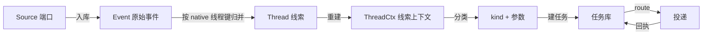
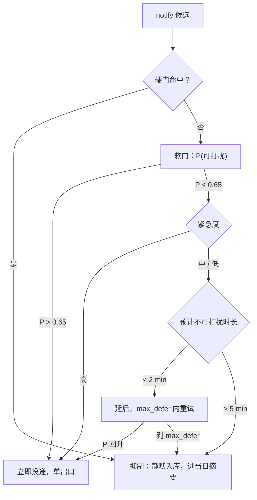

# 输入端口与输出路由

> 状态：概念设计（显示端尚未定义） · 上位文档：[总体架构设计](architecture-north-star.md) · 关联：[多端显示仲裁](surface-arbiter.md)、[网络与设备组网](network-fabric.md)
>
> 显示侧（哪块屏、什么版面、刷新预算）仍是未定项。本文只固定三条与屏幕无关的契约：输入端口的落库方式、效果分类、以及「此刻要不要发」的可打扰性门控；端口表与路由字段属于草案，随显示方案一并调整。
>
> 本文规定外部输入如何进入系统（`sources/`），产物的效果类型与投递目标如何确定（`effect` / `route`），以及投递结果的回执与去重。显示端内部的内容竞争仍由 [显示仲裁器](surface-arbiter.md) 负责，本文不重复。

系统原有一条结构性缺口：**输入端只有一个字符串字段**。任务字段里 `source` 是自由文本，`payload` 是路径或 JSON，没有任何地方记录「这条消息来自哪个群的哪一条、信任级别多高、游标推进到哪」。输出端则完全没有路由概念——产物生成后靠人工去取。本文补齐两端。

## 1. 三个正交轴

设备名（手机、平板、电脑、墨水屏、音箱、灯、门锁）不是路由维度。真正区分端口的是三个互不影响的属性：

| 轴 | 取值 | 决定什么 |
|---|---|---|
| **信任（trust）** | `owner` / `group` / `public` / `machine` / `untrusted` | 该来源产生的任务自治等级上限 |
| **节奏（cadence）** | `push` / `poll` / `idle` | 系统用推、拉还是等心跳来发现问题 |
| **效果（effect）** | `artifact` / `playback` / `notify` / `actuate` | 输出需要什么形态的投递语义 |

信任直接换算成自治上限，避免在每条规则里重复判断来源：

| trust | 典型来源 | 自治上限 | 理由 |
|---|---|---|---|
| `owner` | 本人在任何设备上的输入、本机 CLI | L4 | 身份可确认 |
| `group` | 课程群、项目群、朋友群 | L1 | 发言者可能不是本人；只出建议不回发 |
| `public` | 论坛、公开评论、邮件列表 | L0 | 只观察不出手 |
| `machine` | 传感器、定时器、CI、路由器 | 按能力声明 | 信号本身可信，但可能误报 |
| `untrusted` | 陌生私信、广告、未验证 Webhook | L0 | 内容可进入知识库，不可触发执行 |

群消息里出现需要回复的内容时，系统生成 `meta.reply.propose` 待确认任务，不直接以本人身份发言。

## 2. 输入端口（`sources/*.toml`）

每个输入来源一个文件，与 `surfaces/*.toml` 同构：

```toml
# sources/wechat-course-group.toml
id       = "im:wechat:course-group"
kind     = "im"
native_id = "wx:1234abcd@chatroom"      # 原生平台标识，不解析为内部 ID
trust    = "group"
direction = { in = true, out = false }   # 该端口只能收，不能替本人发言

[cursor]
mode     = "seq"          # seq | timestamp | etag | none
store    = "~/.local/state/aica/cursors/wechat-course-group.json"
max_gap  = "6h"           # 超过该时长未推进即告警，不静默跳过
backfill = 200            # 断线后最多回补的事件数，超出则记一条 meta.ingest.gap

[limits]
rate   = "60/h"
dedupe = "content_hash"   # native_id | content_hash | none

[extract]
kind_hint = ["life.course.*", "life.doc.*"]
```

字段约定：

- **`cursor` 是唯一进度事实源。** 消息先落 `event` 表再解析意图，游标只在事件入库后推进；解析失败不回退游标，而是把该事件挂进待分类队列。这样「读过了但没看懂」与「没读到」可以被区分。
- **`max_gap` 与 `backfill` 是一对。** 前者防静默失效（端口挂了没人知道），后者防一次重连把历史消息全部当成新任务。超出回补上限的部分只入库不建任务。
- **`trust` 写在端口上而不是每条消息上。** 同一端口内的信任差异用 `principal` 白名单处理（见 §3）。
- **`direction.out = false` 是默认值。** 只有本人在该渠道上的身份经过确认，才打开出站。

首批端口：

| 端口 | kind | trust | cadence | 备注 |
|---|---|---|---|---|
| 本机 CLI / KRunner | `cli` | owner | push | |
| 手机分享 / KDE Connect | `share` | owner | push | |
| 微信（私聊 / 群） | `im` | owner / group | poll | 无官方 API，走本地协议适配，限速从严 |
| 微信主账号采集 | `im` | untrusted | poll | 只读全量采集，零出站，见 [IM 采集](im-ingest.md) |
| QQ、飞书、钉钉、Discord | `im` | group | push | 飞书与钉钉走官方机器人或 Webhook |
| X / RSS / 邮件 | `feed` | public | poll | 只读，L0 |
| Home Assistant | `ha` | machine | push | |
| 健康与运动数据 | `health` | owner | poll | 聚合统计入库，原始时序留在原生应用 |
| 路由器 / UPS / 看门狗 | `system` | machine | push | |

## 3. 事件、线索与线索上下文



| 对象 | 含义 | 是否权威 |
|---|---|---|
| **Source** | 一个可轮询或可推送的外部输入端口 | 权威（配置） |
| **Event** | 一条不可变的原始消息，带 `native_id`、时间、作者、内容哈希 | 权威（只追加） |
| **Thread** | 同一主题的事件集合，可跨群、跨渠道 | 权威（仅成员关系） |
| **ThreadCtx** | 由 Thread 重建的摘要：`digest_md`、未决问题、最近事件、证据引用 | **可丢弃缓存** |

`ThreadCtx` 不是会话状态，也不是事实源；删掉可以从 Event 重算。这一条是本文最重要的约束——「虚拟 Session」的直觉问题在于把易碎的会话状态当成真相，一旦跨设备就必然出现两个版本的上下文。

字段：

```sql
CREATE TABLE source (
  id TEXT PRIMARY KEY, kind TEXT NOT NULL, native_id TEXT,
  trust TEXT NOT NULL, cursor TEXT, last_seen_at INTEGER,
  enabled INTEGER NOT NULL DEFAULT 1
);
CREATE TABLE event (
  id TEXT PRIMARY KEY,               -- uuid5(source_id, native_id)
  source_id TEXT NOT NULL, native_id TEXT, ts INTEGER NOT NULL,
  author TEXT, thread_id TEXT, content_hash TEXT NOT NULL,
  raw_ref TEXT,                      -- 原始报文落盘路径
  classified_kind TEXT               -- NULL 表示待分类
);
CREATE TABLE thread (
  id TEXT PRIMARY KEY, title TEXT,
  state TEXT NOT NULL DEFAULT 'open', -- open | waiting | closed
  owner_node TEXT, last_seq INTEGER
);
CREATE TABLE thread_ctx (
  thread_id TEXT NOT NULL, seq INTEGER NOT NULL,
  digest_md TEXT, open_questions TEXT, evidence_json TEXT, built_at INTEGER,
  PRIMARY KEY (thread_id, seq)
);
```

## 4. 三级分流

每条事件在「花多少算力处理它」上做一次分流，判定依据全部是可计算量，不靠模型感觉：

| 级别 | 条件 | 处理 | 成本 |
|---|---|---|---|
| **L0 落库** | `trust` 为 `public`/`untrusted`，或内容哈希命中已知重复 | 只写 `event` 与知识库 | 零模型调用 |
| **L1 轻量判断** | 小模型或规则判断「是否与本人相关、是否值得建任务」 | 命中则生成 `kind` 候选，否则只留在线索里 | 单次小模型 |
| **L2 完整处理** | 命中能力目录、或用户直接 @ 本人 | 建任务并进入派发 | 常规成本 |

群聊默认走 L1：每天几百条消息里真正需要动作的通常不超过个位数，把整段对话塞进上下文既贵又容易误判。

## 5. 输出：效果类型优先于设备

先确定**效果**，再选设备。同一份内容可以同时具有多种效果，但路由只对「执行」那一种做唯一性约束：

| effect | 语义 | 唯一性 | 失效行为 |
|---|---|---|---|
| `artifact` | 产物可被取用，不要求用户此刻在场 | 允许多目标（通常一处主存 + 一处备份） | 补充可达目标列表 |
| `playback` | 在某个设备上播放，**同一时刻只能有一个播放出口** | 必须唯一 | 目标掉线回落到上一次有效出口 |
| `notify` | 提醒，候选端口可以多个，但同一条只响一处；发不发由 [§7](#7-可打扰性什么时候才发) 决定 | 候选多，出口唯一 | 未读留存，进当日摘要，不丢消息 |
| `actuate` | 对真实世界产生副作用，**必须唯一且幂等** | 必须唯一 | 失败即失败，不重试到第二个设备 |

把 `playback` 与 `notify` 分开处理，是调研里最直接的结论：播放类系统（Spotify、AirPlay、Cast）都强制单一出口，而通知类系统真正的难点不在「投哪个」，而在「此刻要不要投」。混用一个「智能选择器」会把两套相反的约束搅在一起。

`notify` 的「候选多、出口唯一」是刻意的不对称：多个端口都记得这条提醒，但同一时刻只让一个真的响，其余静默入库。这样设备掉线不需要回退重放，也不会出现手机和桌面同时响两声。

## 6. 路由决策

任务完成时执行器只声明效果与候选，路由决策是独立的一步：

```json
{
  "kind": "work.music.compose",
  "effect": "playback",
  "produced": "art://music/2026-11-02-demo.mp3",
  "route": {
    "primary": "port:phone",
    "reason": "affinity",
    "alt": ["port:desk", "port:tsv"],
    "revocable_until": 1793590800,
    "idempotency_key": "uuid5(task, route_rev, attempt)"
  }
}
```

`reason` 是封闭枚举，每个取值都对应可复核的证据，而不是「模型觉得」：

| reason | 证据 | 典型场景 |
|---|---|---|
| `source` | 任务来自哪个端口 | 从微信群发起的任务结果回群里；手机发起的任务结果回手机 |
| `affinity` | 该能力最近 N 次被用户接受的目标 | 用户总在桌面听配乐 |
| `recency` | 该端口最近一次活跃时间与位置 | 手机刚从桌面切走 |
| `asked` | 上一次交互中用户明确选择 | 用户点过「投到桌面」 |
| `default` | 端口声明了 `default_for` 且无其他证据 | 无历史的新设备 |

**推断只用于挑选默认值，不用于替用户执行。** 这一点在调研中反复出现：Apple 的 `AVRouteDetector` 只回答「是否存在多个路由」然后弹选择器；Handoff 只决定「是否显示接续入口」，迁移靠用户点一下；Spotify 省略 `device_id` 时才落到 active device，显式指定永远优先。工业界唯一大规模使用推断式目标的 Apple Automatically AirPlay 仍保留 Ask 档。

因此 `alt` 必须渲染成卡片上可见的按钮，而不是埋在 JSON 里的备用路径：

```text
DEMO 已生成（1:12）· 投到 手机
[ 改投 桌面 ] [ 改投 墨水屏 ] [ 直接播放 ]
```

## 7. 可打扰性：什么时候才发

上一节决定「发到哪」，这一节决定「发不发」。两者不能合并成一个打分：设备选错了，用户改一下就行；打扰错了，没有撤销按钮。

### 7.1 两级门控

硬门是规则，不打分，命中直接抑制：手动勿扰 / 睡眠模式、当前日历事件进行中且标记忙碌、正在通话或正在与来访者交谈、屏幕被遮挡且处于静音、最近 30 秒有键鼠输入。这类判断没有争议，交给概率模型只会引入无谓的抖动。唯一例外是 `severity = critical`：它穿透除睡眠模式以外的所有硬门，理由见 §7.3。

硬门之外才打分。软门只用少量可计算特征，输出一个 `P(可打扰)`：



### 7.2 特征集封顶八个

特征越多越容易在小样本上过拟合，这条在实证里很明确：17 个特征只有 68.71%，筛到 7 个反而有 70.6%。目标是 8 个，且全部可程序化提取、不依赖模型理解内容。

| # | 特征 | 来源 | 备注 |
|---|---|---|---|
| 1 | 距上次键鼠 / 触屏交互 | 桌面会话空闲时间；手机侧由端口上报 | 桌面端前几位判别变量 |
| 2 | 屏幕是否亮 / 距上次亮屏 | 端口上报 | 移动端最强单项，去掉即掉 8.8 个百分点 |
| 3 | 距上次查看通知 | **本系统的 `opened` 回执** | 不依赖平台 |
| 4 | 待处理通知数 | **任务库派生**（未完成且 `severity` ≥ `warn`） | 不依赖平台 |
| 5 | 窗口 / 应用切换率（1、5、10 分钟） | KWin 窗口事件 | |
| 6 | 是否在通话 / 与来访者交谈 | PipeWire 麦克风占用；对话检测 | 只靠这一项就能接近人的判断 |
| 7 | 15 分钟内是否有日历事件 | 日历 | 廉价先验，还能预告「会快开完了」 |
| 8 | 小时 + 星期 | 本机时钟 | 稳定节律 |

第 3、4 项值得单独说：这两个最有用的信号由系统自己产生，不必依赖平台的「最后在线」状态。而「最后在线」正是要避开的——单独使用只有 58.8%，接近随机，还会制造社交压力。

另有一条负面证据值得记住：模型精度依赖部署环境。同一套「是否有人在说话」的特征，在独立办公室里有效，换到两人共用办公室就不再是最强特征；桌面麦克风从专用换成笔记本内置，准确率掉六个百分点。所以这八个特征在本机上岗前要先实测一轮，不照搬论文数字。

阈值不是 0.5。两类错误代价不对称：误判「可打扰」（真在忙时弹了）会直接打断人；误判「不可打扰」（其实有空却没发）只会晚到一会儿。前者按后者的 1.5–2 倍计价，因此阈值取 `P > 0.6~0.65` 才主动弹，其余走延后或抑制。

### 7.3 按紧急度的延后上限

延后不能无限等，必须有上限，到点无条件落地。上限按 `severity` 设：

| `severity` | `max_defer` | 到达上限后 |
|---|---|---|
| `info` | 10 min | 抑制，进当日摘要 |
| `warn` | 3 min | 抑制，进当日摘要 |
| `critical` | 0 | 立即投递；穿透勿扰与软门，但不穿透睡眠模式 |

这些数字不是拍脑袋。忙状态的实测分布是均值 43.12 秒、标准差 51.79（113 人、4,803 次会话），**多数** 1–2 分钟内转空闲；50% / 75% 的人在 2 / 5 分钟内恢复可注意。所以首选延后窗口就是 1–2 分钟，超过 5 分钟不再等，视为离场，转「摘要 + 下一个可打扰时段」。

理论上限由延迟损失与打断代价的比值决定：设延迟损失率 `f'(t)`、忙时打断代价 `c`、忙状态退出率 `λ`，最优等待点满足 `f'(t) = λc`。`max_defer` 是这个方程在本机参数下的解，改了紧急度就是改了 `c`。

### 7.4 默认抑制，而不是默认延后

这是本文最容易被直觉带偏的一处。工程上习惯「先压着，等会儿再发」，但一周经验采样（N=35）的结果是：用户更希望系统**抑制**不想要的通知，而不是延后；用户解释自己的偏好时，提到更多的是内容因素而不是上下文因素。

所以默认动作是抑制：不响，进当日摘要，用户想看时自己看。延后只在一种情况使用——预计不可打扰时长很短（2 分钟以内）。判定为「离场」时直接抑制，不排队。

推论有两条：

- **当日摘要是一等投递，不是兜底。** 被抑制的 `notify` 必须出现在摘要里，否则抑制就变成了消息丢失。
- **抑制的数量要可见。** 每天给出「抑制了几条、其中几条被点开」，让默认值可以被质疑；只报「投递成功率」会掩盖抑制过头。

### 7.5 不响必须能解释，也能被推翻

任何一次「没响」都要给出一行原因和一颗覆盖按钮：

```text
08:41 未推送：正在通话中（预计 08:52 结束）
[ 现在推给我 ]
```

同时每周按两类错误分别计数：「该响没响」与「不该响响了」。不要看总准确率——两类代价不对称，总准确率会把昂贵的那类错误稀释掉。

### 7.6 冷启动

主模型用行为标签训练，不用弹窗问。「点开 / 划掉 / 稍后 / 静音 / 直接回复」这些动作本身就是标签，实证结果是与显式标注接近（+39% 对 +42%），且零打扰。显式询问退化为校准手段：每设备每天最多一次，持续一到两周后关闭。

样本量与个性化：

| 个人样本量 | 模型 |
|---|---|
| < 50 | 全局先验 + 个人偏置；他人数据按 1/5 权重注入 |
| 300+ | 全个性化（470 例约 0.71，1500 例以上约 0.85） |
| < 200 条投递记录 | 不训练设备偏好模型，只用 §7.1 的规则 |

## 8. 输出端口（草案，`surfaces/*.toml`）

```toml
# surfaces/desk-speaker.toml
id     = "port:desk"
kind   = "playback"            # 与 effect 同名，便于直接匹配
device = "ws"                  # 承载该端口的主机
transport = "pipewire"
capabilities = ["audio", "tts"]
default_for  = ["playback"]
presence     = "ac"            # ac | always | manual
```

| 端口 | kind | 适用 effect | 备注 |
|---|---|---|---|
| `port:phone` | playback / notify | 两个都接 | 走 ntfy 与系统媒体会话 |
| `port:desk` | playback / notify | 桌面声卡与通知 | 工作站 AC 供电时存在 |
| `port:tsv` | notify / actuate | 语音播报与家庭控制 | ThinkSmart View |
| `port:eink` | notify | 常驻信息 | 不接 playback，不抢注意力 |
| `port:im` | notify / artifact | 卡片与文件 | 与 `sources` 中同一渠道共享身份 |
| `port:ha` | actuate | 家居动作 | 由 HA 脚本执行，系统只发意图 |

端口同时是输入与输出时，在 `sources/` 与 `surfaces/` 各建一个文件并共用 `id`——两者的信任级别与方向可以不同，合并会丢失这个信息。

## 9. 回执、去重与失效

投递不是发出去就算完成，需要三级回执：

| 回执 | 含义 | 用途 |
|---|---|---|
| `delivered` | 目标确认收到 | 推进重试 |
| `opened` | 用户打开或播放 | 更新 `affinity` 证据 |
| `dismissed` | 用户关掉提醒 | 抑制重复提醒 |

去重键固定为 `uuid5(task_id, route_revision, attempt)`，与派发器的 `ev_id` 同构。在云端等待队列与工作站之间重放时，重复投递是常态，必须默认会发生。

失效处理按 effect 分派：

- `playback`：目标不在线时回落到 `alt` 的第一项，并把回落写进执行摘要；
- `notify`：候选端口共享同一条提醒，出口掉线时换到下一个候选，不重复计数、不重复响；`max_defer` 到点仍未落地则抑制并进当日摘要，不无限排队；
- `actuate`：不做跨设备回退。目标不可达即失败，升级给人工，避免同一动作在两台设备上各执行一次；
- `artifact`：只更新可达列表，不重发内容。

**「没落地」与「没送达」必须分开记。** 前者是 [§7.1](#71-两级门控) 的门控决定，属于设计内的正常结果；后者是传输失败。把两者混成一个「投递成功率」，会让门控调得过松——指标好看，人被吵得难受。

## 10. 明确不做

- **不维护「用户在哪个房间」的实时位置推断。** 需要的信号（端口在线、最近活跃、AC 供电）都在端口层可得，位置推断引入的误差大于收益。
- **不做跨设备的会话迁移。** 不搬运上下文，只让每个设备按 `ThreadCtx` 重建自己的视图。
- **不在投递前做逐条人工确认。** 只有 `actuate` 与对外发布进入确认点，其余靠回执与 5 分钟撤销窗口。
- **不把设备 ID 当持久主键。** 设备会重装、换名、掉线，端口配置是唯一的稳定标识。

## 11. 参考

一手来源（调研底稿属运行时数据，不纳入本仓）：

- Apple `AVRouteDetector` / `AVRoutePickerView`：<https://developer.apple.com/documentation/avfoundation/avroutedetector>
- Apple Handoff：<https://support.apple.com/guide/iphone/hand-off-tasks-between-devices-iphcec5d0a9d/ios>
- Spotify Transfer Playback（多目标返回 400）：<https://developer.spotify.com/documentation/web-api/reference/transfer-a-users-playback>
- Google Cast 发送端集成：<https://developers.google.com/cast/docs/android_sender/integrate>
- Home Assistant `notify`（`notify.notify` 的「第一个可用」反例）：<https://www.home-assistant.io/integrations/notify/>
- Slack 通知延迟规则：<https://slack.com/help/articles/201355156-Configure-your-Slack-notifications>
- Telegram updates 与 `pts` 事件序列：<https://core.telegram.org/api/updates>
- Chrome send-tab-to-self 回执字段：<https://chromium.googlesource.com/chromium/src/+/main/components/sync/protocol/send_tab_to_self_specifics.proto>

可打扰性（§7）：

- Horvitz, Jacobs & Hovel, *UAI'99*：期望效用与打断代价的形式化 <https://arxiv.org/abs/1301.6707>
- Horvitz, Koch & Apacible, *CSCW 2004*（BusyBody）：`ECI`、单一阈值滑杆、样本量与精度 <https://erichorvitz.com/busybody_cscw.pdf>
- Achlioptas & Horvitz, MSR-TR-2005-87：有界延后与 `f'(t)=λc`，busy 会话均值 43.12 秒（SD 51.79） <https://erichorvitz.com/bounded_deferral.pdf>
- Fogarty et al., *ToCHI* 2005：社交在场特征达人类水平 <https://homes.cs.washington.edu/~jfogarty/publications/tochi2005.pdf>
- Pielot et al., *CHI 2014*：7 特征 70.6%、17 特征 68.71%、误判代价 1.5 倍 <https://pielot.org/pubs/Pielot2014-CHI-AttPred.pdf>
- Dingler & Pielot, *MobileHCI 2015*：50% / 75% 在 2 / 5 分钟内恢复可注意 <https://pielot.org/pubs/Dingler2015-MobileHCI-Attentiveness.pdf>
- 默认抑制优于默认延后（N=35 经验采样） <https://doi.org/10.1145/3478868>
