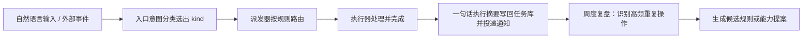

# Personal Agent 设计

> 状态：设计中 · 角色：定义面向用户的交互约定、通知模式、输入入口与记忆分层。底层事件流转见 [架构总览](architecture.md)，支持的具体能力见 [能力目录](capabilities.md)。

Personal Agent 是本系统的用户交互层，负责将多端输入统一转化为结构化任务，并按当前的打扰策略向用户反馈执行结果。

## 1. 交互体验约定

1. **有问必有反馈**：每条请求最终要么返回完成摘要与产物路径，要么明确告知阻塞原因并给出操作选项。
2. **异步跟进免盯屏**：任务派发后由派发器与 `agent:local` 运行时持续跟踪至终态并主动汇报；执行期间用户可随时查询当前进度。
3. **多端状态一致**：手机、工作站桌面、墨水屏与桌面小组件均从同一个 Taskwarrior 任务库读取状态。
4. **从反馈中积累偏好**：用户每次在卡片上的确认、分类修正与返工操作均自动记录为样本，用于优化后续意图分类准确率与能力默认参数。
5. **组件可替换**：DSH 会话、`agent:local` 运行时、具体 Provider 或推理模型均可独立替换，不影响整体交互方式。
6. **数据默认留存本地**：原始素材与长会话保留在工作站本地，远端入口仅传输精简的任务说明与执行摘要。

## 2. 交互入口

| 入口渠道 | 适用场景 | 底层实现 |
|---|---|---|
| IM（DSH IM 插件 / AstrBot） | 手机端随时发送指令、通过交互卡片点击确认 | 见 [DS-Bot 入口](ds-bot-entry.md)（已撤回，保留接入记录） |
| PowerToys Run | 工作站桌面按 `Alt+Space` 一句话快速录入任务 | PowerToys Run 插件 |
| Phone Link / IM 分享 | 手机截图、照片、网页链接、文件一键分享录入任务 | Phone Link、微信文件传输助手 |
| 语音输入 | 桌面 ThinkSmart View 主控台或手机语音指令 | FunASR / SenseVoice + CosyVoice |
| 物理按钮与 NFC 标签 | 出门、回宿、开始工作、入睡等固定场景触发 | Home Assistant + Zigbee 无线开关 / NFC 贴纸 |

**交互卡片按钮**统一为三项：`[执行] [延后] [忽略]`，分别对应确认派发执行、将任务设为 `waiting` 延后处理、以及将任务设为 `dropped` 关闭。

## 3. 通知模式（Mode）

| 模式名称 | 通知过滤规则 | 系统联动动作 |
|---|---|---|
| **工作** | 工作与开发类任务即时推送，生活杂事汇总至晚报 | 切换到工作虚拟桌面，桌面灯光调为专注色温 |
| **生活** | 生活与社交提醒正常推送，非紧急工作通知汇总至早报 | 切换到生活虚拟桌面 |
| **专注** | 仅放行 `critical` 级别紧急事项，其余通知全部暂存 | 开启 Windows 专注助手（Focus Assist） |
| **勿扰 / 睡眠** | 仅放行高危安全告警，按作息时段自动切换 | 联动 Home Assistant 睡眠关灯与墨水屏静默 |
| **外出** | 通知仅推送至手机，门口墨水屏显示出门携物清单 | 联动离宿场景 |
| **出差** | 置顶车票/酒店行程卡片，宿舍设备保持离宿断电状态 | 关联 `life.trip.plan` |

通知模式仅调整**通知发送的时机与渠道**，不改变各项能力本身的执行逻辑。模式可通过语音指令、切换虚拟桌面或由自动化场景在末尾步骤自动切换。

**通知模式与自动化场景的区分**：自动化场景是一组跨设备执行的动作序列（如"离开宿舍"场景包含断电、记录快照、清空屏幕三步操作），而通知模式是一份静态的通知路由策略（如"外出"模式规定通知只发往手机）。场景可以单向切换模式，模式不会反向触发场景（完整边界见 [自动化场景 §5](ritual-scenes.md#5-home-assistant-automation场景与通知模式的边界)）。

## 4. 通知格式与表达约定

- **每日早报**：列出当日亟需处理的 3 项核心任务，附带订阅摘要与当日天气。
- **每日晚报**：汇总今日已完成任务与未完成遗留项。
- **任务完成汇报**：一句话执行摘要 + 产物路径或预览图 + 交互卡片按钮。
- **群聊响应策略**：在群聊环境中仅在被显式 `@` 提及时才回复。
- **语气切换**：支持按场景切换默认助理、文稿编辑、复习教练或家居管理等回复风格，底层调用的能力目录保持一致。

## 5. 任务流转生命周期

- 派发给 Worker 的输入是结构化的**任务说明**（包含目标、输入文件路径与验收条件），而非逐行操作指令。
- 仅在执行器确认达成验收条件后才向用户汇报"已完成"；进程超时或连接中断仅触发看门狗检查与重试，不静默标记完成。
- 任务完成时写入的执行摘要会自动同步至知识库，后续可通过 `info.recall`（`kn recall`）随时检索历史做法。

## 6. 记忆分层

| 记忆层级 | 存储位置 | 承载内容 |
|---|---|---|
| 全局与系统规则 | 本仓 + `%USERPROFILE%\.claude\CLAUDE.md` + `%USERPROFILE%\.agents\` | 跨项目通用工程规范与工具调用约定 |
| 项目级约定 | 各代码仓库下的 `AGENTS.md` | 仓库目录结构、构建与测试命令 |
| 任务执行历史 | Taskwarrior + `agent:local` 运行目录 | 历史任务状态、执行摘要与中间产物 |
| 能力偏好配置 | 能力目录旁 `prefs.toml` | 各能力的默认审美与参数倾向 |
| 结构化检索记忆 | `%LOCALAPPDATA%\aica\data\knowledge\kb.sqlite` 的 `mem` 表（`event` / `pref` / `persona`） | 带原始证据引用、支持时间衰减与升级的结论条目 |
| 入口轻量设定 | DSH profile 与 `AGENTS.md` | 常用称呼、活跃项目列表与近期对话摘要 |

记忆条目的写入、升级与时间衰减机制详见 [知识库与记忆分层 §7](knowledge-memory.md#7-记忆分层与生命周期)。

## 7. 与智能家居环境的衔接

宿舍智能家居是系统的主要物理交互场景：温湿度、门磁、功率等高频设备事件由 Home Assistant 本地自动化处理；需要人工确认或跨工具协同的事件则通过 `ev add` 录入任务库，由派发器调用 Home Assistant 脚本、更新墨水屏画面或派发给 `agent:local` Worker 处理。详见 [宿舍智能家居方案](dorm-smart.md)。
