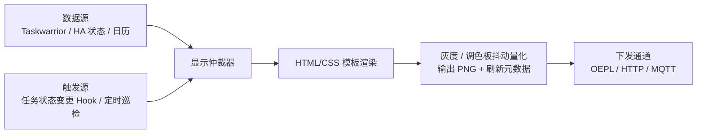

# 统一渲染管线规格

> 状态：设计中 · 角色：墨水屏与信息看板的服务端渲染实现（见 [架构总览 §6](architecture.md#6-显示端分配)）

所有墨水屏标签与桌面信息卡均作为**无状态显示终端**运行：内容查询、版面排版、抖动量化与刷新模式决策全部集中在工作站的渲染服务（`renderd`）中完成，硬件终端仅负责接收并显示最终的 PNG 位图。

渲染服务是 Taskwarrior 任务库与 Home Assistant 状态的**只读派生视图**，不在自身内部维护独立的业务状态源。

## 1. 管线数据流

**单次渲染输出 = 1 帧目标位深 PNG 图像 + 刷新控制元数据（`full` / `partial`、`temp_band`、`event_ids`）**。当网络中断或渲染服务停机时，墨水屏终端物理保持最后一帧画面及底部的数据时间戳。

## 2. 模板与光栅化规范

- **版面模板**：使用标准 HTML + CSS（或 SVG）编写，每个显示端在 `surfaces/*.toml` 中声明 `{resolution, color, bpp}` 参数。
- **光栅化与量化**：由无头 Chromium（Playwright）按目标像素尺寸精确截图，再经 Pillow / `pngquant` 降位深并执行 **Floyd-Steinberg 误差扩散抖动（配合预锐化）**；黑白红（BWR）与黑白红黄（BWRY）多色价签则量化至对应硬件调色板。
- **版面视觉规范**：统一留出 `24px` 外边距，底部固定保留一行数据快照时间戳；CSS 颜色统一使用 `--ink-fg`、`--ink-bg`、`--ink-accent` 变量，4 级灰度固定映射到 `0 / 85 / 170 / 255` 四个色阶，确保不同批次渲染结果逐字节确定一致。

## 3. 各类终端输出格式

| 硬件终端类别 | 输出格式与下发接口 | 像素位深 | 通信通道 |
|---|---|---|---|
| **OpenEPaperLink ESL 电子价签** | Baseline JPEG / PNG → `POST /imgupload` | 1bpp（黑白）/ 2bpp（黑白红/黄调色板） | 工作站推至 OEPL AP，由 AP 在标签唤醒时经 802.15.4 或 BLE 下发 |
| **LilyGo T5 4.7" / ESP32 桌面看板** | PNG 位图 | 4bpp（16 级灰度，实际按 4 灰阶排版） | 终端定时唤醒发起 HTTP `GET /frame/{id}`（带 `ETag` / `If-None-Match`） |
| **ThinkSmart View 主控台** | 实时 HTML 页面 | 24bit 全彩 | Fully Kiosk Browser 直接加载模板 URL，不经过 PNG 光栅化 |
| **Kindle KPW5（可选看板模式）** | 8bpp 灰度 PNG | 8bpp | KPW5 经 Tailscale 定时 `wget` 拉取并通过 `fbink` / KOReader 刷屏 |

帧缓存目录结构：`/var/lib/renderd/frames/{surface_id}/{frame_hash}.png` 及配套 `meta.json`（记录模板版本、数据快照哈希与关联任务 UUID）。

## 4. 墨水屏刷新策略（移植自 KPW5 固件逆向结论）

基于前期对 Kindle Paperwhite 5（KPW5）EPDC 驱动与波形表的逆向分析结论，在服务端渲染管线中落实三条刷新控制规则：

1. **温度自适应波形提示**：支持回传环境温度的终端在拉取图像时附带当前温度，服务端按温度区间（`temp_band`）标记建议波形档位，防止低温环境下灰阶响应不足产生拖影。
2. **局部刷新与周期全刷清除残影**：对支持局部刷新（Partial Refresh）的桌面并口屏（如 LilyGo T5），每连续执行 20 次局部刷新后强制插入 1 次 `GC16` 全屏刷新，清除电泳粒子累积残影；拆机 ESL 价签每次均为全刷（`full_every = 0`）。
3. **不改动硬件 PMIC 电压参数**：成品开发板与电子价签的 VCOM 及高压轨（±15V / +22V / −20V）已在出厂时匹配好，固件侧直接使用默认电源时序，避免损坏玻璃基板。

## 5. 触发机制与容错约束

- **事件驱动为主，定时巡检为辅**：当 Taskwarrior 中关联 `kind` 的任务完成或新增 `+me` 待确认项时，由派发器触发 [显示仲裁器](surface-arbiter.md) 重算；`systemd.timer` 仅作为低频保底检查。
- **所有展示数据必须可追溯**：画面上的每个信息区块必须对应明确的 `event_id` 列表或 Home Assistant 实体 ID。
- **渲染异常不阻塞任务主链路**：若 Chromium 截图或 AP 网络推送失败，仅记录一条 `system.render.failed` 事件，墨水屏继续保留上一帧画面与旧时间戳，绝不阻塞派发器 `evd` 的正常任务流转。

## 6. 最小闭环验收标准

1. 调用渲染接口生成一张 `296×128` 1bpp PNG 图像，字体边缘清晰、底部带数据快照时间戳且连续两次相同输入生成的 PNG `sha256` 完全一致。
2. 通过 `POST /imgupload` 将图像推送至 OEPL AP，电子价签在下个 Check-in 周期正确刷新显示。
3. 断开 OEPL AP 电源 10 分钟后重新上电，标签恢复连接且断连期间屏幕正常保持上一帧内容。
4. 在 LilyGo T5 上连续触发 20 次局部更新后，第 21 次自动切换为全屏刷新并清除残影。
