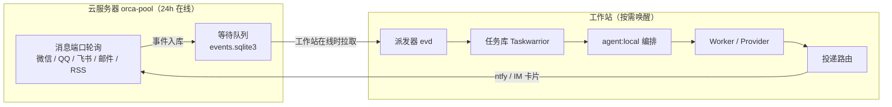

# 系统拓扑：云端等待队列与本地编排

> 状态：部分已部署 · 角色：执行层中 `agent:local` 链路的部署拓扑（见 [架构总览 §5](architecture.md#5-执行器列表)）
>
> 编排层已改用自建 `agent:local` 运行时（`ar` CLI + `runs/` 运行目录），Worker 以成熟 CLI Agent（Pi / Codex / Claude Code）为执行后端，交互层为 DSH 原生会话、`ar` 命令面即控制面契约，见 [ADR 0008](adr/0008-local-agent-runtime.md)、[ADR 0010](adr/0010-retire-dsbot-native-ui.md) 与 [控制面契约](control-plane-api.md)。
>
> 常驻节点因成本原因延后（[ADR 0007](adr/0007-deferred-resident-node.md)），当前拓扑只有一个执行节点：工作站。云服务器 `orca-pool` 只承担消息接收与等待队列，不执行任何任务。

## 1. 两层职责划分

| 层级 | 核心组件 | 职责范围 |
|---|---|---|
| 云端等待队列 | `orca-pool`：端口轮询脚本、`events.sqlite3`、ntfy | 接收外部消息并落库；工作站离线时不丢弃、不解析、不执行 |
| 本地编排 | `agent:local` 运行时（`ar` CLI），运行于工作站 | 管理 Git Worktree、终端会话、Run / 节点 / Dispatch 生命周期与消息队列，运行状态落在 `runs/<root_id>/` 运行目录，作为代码与多步任务执行的权威状态源 |
| 任务执行 | Devin / Codex / Claude Code Worker，以及各能力 Provider | 在隔离的 Worktree 或运行目录内完成具体派发的子任务 |

与 [Super-agent 参考架构](super-agent-architecture.md) 的云端 Router / 端侧守护进程模式相比，本系统仍保持 [ADR 0003](adr/0003-loop-local-entry-remote.md) 的方向：**编排循环与执行留在工作站，远端只做搬运**。差别在于搬运的那一端从 N100 换成了已有的云服务器，且在途消息以事件形式持久化，而不是以会话状态形式存在。

## 2. 能做什么由端口决定

云端队列只做两件事：把外部消息变成 [事件](output-routing.md#3-事件线索与线索上下文)，把工作站产出的提醒转发出去。**它不解析意图，也不判断轻重**。理由：

- 意图解析需要能力目录与上下文，这些是随代码演进的，放在云端会形成第二份需要同步的配置；
- 队列只需要「事件不丢」，用小模型兜底分类反而增加一处失败点；
- 工作站离线期间，唯一有价值的动作是把消息留住，而不是猜它要干什么。

因此不存在「这个任务在云端直接处理还是下发工作站」的判断——所有任务都在工作站处理。工作站休眠时的行为是等待，不是降级。

## 3. 跨机通信通道

- **云端队列拉取**：工作站由任务计划程序每 2 分钟拉起一次 `ev sync`，按端口游标增量拉取事件并推进游标；拉取使用 [输入端口](output-routing.md#2-输入端口sourcestoml) 中声明的 `cursor.mode`。
- **虚拟局域网**：各节点通过 Tailscale 互联。工作站、云服务器与手机在同一个 Tailnet；Kindle KPW5 以 Userspace 网络模式接入，仅支持出站连接。子网路由与 Exit Node 暂不由本机房节点提供（[ADR 0007](adr/0007-deferred-resident-node.md)）。
- **命令调用通道**：云端脚本通过 Tailscale SSH 调用工作站上的受限入口脚本，底层转发至本机 `ar` CLI。
- **受限入口脚本**：在工作站 `%USERPROFILE%\.local\bin\` 下放置封装脚本（PowerShell），仅向远端暴露四项受控操作：创建任务、查询状态、读取输出、发送跟进回复。

云端从不主动向工作站推送执行请求——所有执行请求都由工作站主动拉取。这样工作站休眠、断网、换 IP 都不会造成云端积压出错。

## 4. 任务派发与闭环跟进

- 入口经 `ar orchestration run-create` 创建 Run，调用 `ar worker-start --spec` 派发 Worker，并通过 `ar check --wait` 等待 `worker_done`、`escalation` 或 `question` 事件，将结果整理为简明通知；用户的确认或补充回复再经 `ar orchestration reply` 传回 Worker。
- 每次派发均持续跟踪至任务进入终态；单次轮询超时仅作为进度检查点，不将超时静默标记为完成。
- 渲染成片、构建包、代码分支等大体积产物保留在工作站本地，仅回传执行摘要与本地文件路径；跨机传输只在用户明确索取文件时发生。
- 任务执行完毕后调用 `ev done <id> "<执行摘要>"` 写回任务库；执行过程中总结出的通用做法同步沉淀至对应 Skill 或 `AGENTS.md`。

## 5. 状态展示与交互界面

- **DSH 原生会话（主界面）**：任务进度卡片、中间输出、审批与提问卡片、多候选比选结果由 DSH 的 Web / Desktop 会话呈现；Run 的创建、查询、跟进与读取全部经 [控制面契约](control-plane-api.md) 的命令面完成，会话不持有 Run 状态。
- **生成式 UI 工作台（可选旁路）**：Run 树、diff 预览与 fork 的图形化查看仍在 `C:\Repos\agent-local-runtime\workbench`，按 [ADR 0009](adr/0009-dsbot-as-control-interface.md) 降为可选旁路，不是主界面；需要常驻图形视图时再评估是否恢复扩展。
- **运行目录直读**：`runs/<root_id>/` 与 `events.jsonl` 是任何前端的唯一数据源，兜底路径为直接打开目录或读 `ar events`。
- **即时通讯（IM）**：私聊通过 `@xmanrui/dsh-im` 插件接入；群聊或更多平台通过 AstrBot 接入，将交互卡片渲染为图片发送。
- 前端界面展示的任务状态直接读取自 `runs/` 运行目录与 Taskwarrior，不在前端维护独立的状态副本。

## 6. 会话连续性

- 任务的完整执行状态保存在工作站 `runs/<root_id>/` 运行目录中（派发信封、结果信封与中间产物）。入口仅缓存 `root_id`、节点路径与最新摘要，网络重连后按目录与信封 ID 即可恢复跟踪。
- 跨设备、跨渠道的上下文不依赖会话状态，由 [线索上下文](output-routing.md#3-事件线索与线索上下文)从事件重建。
- 用户回到工作站桌面后，主路径是 DSH 会话按 `root_id` 续读 `events.jsonl`；需要图形化查看 Run 树与 diff 时打开可选工作台；兜底路径为 `ar events` 与直接打开对应运行目录。

## 7. GUI 自动化分级策略

对于必须操作图形界面的软件，按以下优先级依次降级：

1. **结构化接口优先（默认）**：具备原生 CLI 或 `CLI-Anything` 封装的工具直接走命令行；需要登录态或复杂交互的网页操作走 `ego-browser`（ego(lite) 的 Space + Snapshot，见 [本机工具链选型 §2.8](local-toolchain.md#28-浏览器与网页自动化egolite)）；原生桌面应用通过 `agent-desktop` 读取 UI Automation 无障碍树进行操控（snapshot 返回带 ref 的 JSON 树，ref 语义动作默认 headless、不移动指针不抢焦点）。
2. **像素级视觉操作（兜底）**：面对自绘画布、游戏窗口或无障碍树缺失的界面，用 `nircmd` 或 PowerShell `System.Drawing` 截图，配合视觉决策模型（如本地 VL 模型或 Jev）输出坐标动作，通过 AutoHotkey v2 `Send` / `SendInput` 注入键鼠事件（见 [工作站配置 §4.2](workstation-windows.md#42-桌面自动化命令行接口)）。
3. **重规划升级**：仅在连续多次操作失败或任务需要重新拆解时，才升级调用大参数模型重新规划步骤。

视觉操作逻辑封装在 Worker 自身的 Skill 中（`%USERPROFILE%\.agents\skills\`，随技能仓版本管理），不混入运行时内置 Skill。

## 8. 本机系统维护规范

| 操作类别 | 执行方式 | 回滚手段 |
|---|---|---|
| 状态诊断（查磁盘、看日志） | 入口或 Worker 直接执行只读命令并返回结论 | 无需回滚 |
| 配置与软件包变更 | 修改 `%ProgramData%\aica\` 下受管配置或安装包 → 执行 `just check` 冒烟校验 | 系统还原点回滚 + `winget install --version` |
| 系统例行升级 | `meta.system.update`：更新前自动建还原点、执行 `winget upgrade --all` 与各分区更新、检查服务，失败回滚还原点 | 还原点 + `restic` |

系统不向 Agent 暴露管理员凭据（需要提权的操作由 `upctl` 内置的提权入口申请 UAC，不把密码交给模型）。涉及删除用户数据或对外发布的操作严格受确认点约束。快照回滚的具体规则见 [工作站配置 §5](workstation-windows.md#5-更新回滚与故障恢复)。

## 9. 部署进度

- **已就绪**：工作站已切换 Windows 11 原生；`agent-desktop` 已安装至 `%USERPROFILE%\agent-src\tools\agent-desktop\` 并通过 UIA 冒烟验证；ego(lite) 与 `ego-browser` 可用；云服务器 `orca-pool` 已通过 Tailscale 接入；任务库 **Taskwarrior 3.5.0** 已安装（MSYS2 包）并完成 `add / done / annotate / wait / export` 与 `ev` 封装冒烟，配置与字段见 [本机工具链 §2.10](local-toolchain.md#210-任务库taskwarrior)。Orca 暂保留为影子期兜底执行器（[ADR 0008](adr/0008-local-agent-runtime.md)）。
- **待实现**：`agent:local` 运行时的控制面补充（`ar list` / `ar watch`，见 [控制面契约 §2](control-plane-api.md#2-命令面冻结)）；Codex 与 Claude Code 适配器的实测（两家 CLI 本机尚未安装，见 [Worker 适配器](worker-adapters.md)）。
- **已降级**：生成式 UI 工作台按 [ADR 0009](adr/0009-dsbot-as-control-interface.md) 转为可选旁路，不再作为交付目标。
- **待部署**：工作站的 `ev sync` 定时拉取、云端的事件落库脚本与 ntfy 转发、工作站受限入口脚本。
- **推进顺序**：先在工作站本地跑通「创建 Run → 派发 Worker → 回收结果 → 写回任务库」的完整闭环，再接入云端事件拉取。
