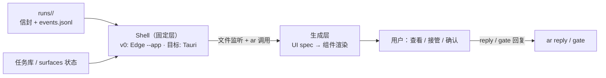

# 生成式 UI 工作台

> 状态：**可选旁路（2026-11-04 起）**。按 [ADR 0009](adr/0009-dsbot-as-control-interface.md) 主控制界面曾改为 [DS-Bot](ds-bot-entry.md) + [控制面契约](control-plane-api.md)；该决定已由 [ADR 0010](adr/0010-retire-dsbot-native-ui.md) 撤回，交互层回到 DSH 原生会话。本文所述工作台保留为需要 Run 树 / diff / fork 图形视图时的旁路，不恢复为主界面，也不作为交付目标继续扩展。v0 已实现（固定组件 + Edge `--app` 壳），生成层（UI spec）不再排期 · 上位文档：[ADR 0008](adr/0008-local-agent-runtime.md)、[ADR 0010](adr/0010-retire-dsbot-native-ui.md)、[agent:local 运行时设计](agent-local-runtime.md) · 关联：[Personal Agent 设计](personal-agent.md)、[多端显示仲裁](surface-arbiter.md)、[统一渲染管线](render-pipeline.md)
>
> 本文定义工作站桌面上的人机交互界面：用户查看与接管 `agent:local` Run 的主要界面。形态参考 T3Code / Grok / Codex Desktop / DSBot 一类对话流工作台——v0 已实现三栏+事件流卡片+composer 直派任务（`C:\Repos\agent-local-runtime\workbench\`），生成层（模型按需产出界面组件）为 v3 目标。

## 1. 两层结构：固定壳 + 生成层



| 层 | 职责 | 变更方式 |
|---|---|---|
| **Shell（固定层）** | 窗口与进程管理、`runs/` 文件监听并推送、`ar` CLI 桥接、产物文件预览（Markdown / PDF / 图片 / diff）、接管操作入口 | 随版本发布演进 |
| **生成层（流动层）** | 模型输出的 UI spec（组件树 JSON）由渲染器即时生成视图：进度卡片、Run 树、比选界面、升级卡片 | 每次任务、每条消息可不同 |

Shell 长期稳定、只提供能力；界面形态跟随模型与任务走。这与系统主干「能力作插件挂载」是同一原则在界面层的投影。

## 2. 技术选型：系统 WebView2，壳体分两期

| 候选 | 取舍 |
|---|---|
| **Tauri（目标壳）** | Windows 上复用系统 WebView2（与 Edge 同源引擎，滚动与字体渲染即原生体感）；二进制 ~10MB；Rust 侧只做文件 IO 与 `ar` 进程桥接，壳体极薄。**前置条件**：Rust + MSVC Build Tools（当前工作站未装，安装约 2–7 GB），工具链到位后切换 |
| **Edge `--app=`（v0 壳，已落地）** | `node workbench/server.ts` 桥接 `runs/` + `msedge --app=<url>` 无铬窗口——同一 WebView2/Chromium 引擎、独立任务栏窗口，**零新增工具链**。桥接与渲染层与 Tauri 方案完全一致，届时只换窗口宿主，前端与 API 原样保留。实现于 `C:\Repos\agent-local-runtime\workbench\` |
| Electron | DS-Bot Desktop 采用此方案（Electron + Vite，壳内显示 DSH 的 Web 前端），证明「壳 + Web UI」模式成立；但需自养一个 Chromium 实例，与本机已有 ego(lite) 功能重复，常驻成本不符合作风 |
| Qt / PySide6 | 原生控件擅长静态表单；生成式界面是模型运行时产出的动态文档流，声明式动态渲染反而别扭 |
| WinUI 3 | 最贴近系统观感，但 XAML 静态结构与「模型说什么就渲染什么」之间存在额外生成层，开发成本高收益低 |

DS-Bot 技术栈对照：DS-Bot Desktop = Electron 壳 + DSH Web 前端（pin `DSH 0.2.1-rc.4` + `ds-bot` 插件，独立 `DSH_HOME`）。本工作台与 DS-Bot Web 同属 WebView2/Chromium 生态，**交互卡片与生成组件的样式模板可共用一套**——消息卡片在 IM、DS-Bot 与工作台三处呈现一致。

## 3. 数据面：只读消费，不落副本

- **唯一数据源是文件**：`runs/<root_id>/` 的信封与 `events.jsonl`、任务库状态、`surfaces` 声明。Shell 用文件系统监听推送增量，不在前端维护任何状态副本（对应 [系统拓扑 §5](system-topology.md#5-状态展示与交互界面)）。
- **渲染的是产物，不是 DAG**：用户看到进度卡片、Run 树、diff 预览、多候选比选、升级卡片；节点图作为执行数据留在信封里，不直接呈现（[agent:local 运行时设计 §6](agent-local-runtime.md#6-演进路径)）。
- **写回只有一条通道**：用户在界面上的所有动作（回复升级、批准 gate、选择候选）统一转为 `ar reply` / `ar orchestration gate-*` 调用，UI 不直接改文件。
- **确认点原样生效**：付款、删除、对外发布在 UI 里同样停在交互卡片（[ADR 0002](adr/0002-three-confirmation-points.md)），生成层不能绕过。

## 4. 渲染契约：UI spec

模型输出的不是 HTML，是**组件树 JSON**（UI spec）：声明组件类型、数据源引用与交互动作，由 Shell 内置渲染器解析为界面。两类来源：

| 来源 | 内容 | 复用 |
|---|---|---|
| 固定组件库 | 进度卡片、Run 树、diff 视图、比选网格、升级卡片、Markdown/PDF 预览 | Shell 内置，渲染器原子件 |
| 生成组件 | 模型按任务内容临时组织的版面（如「本次成片对比三版 + 波形图 + 选稿按钮」） | 模型输出 spec，渲染器实例化 |

模板资产与 [统一渲染管线](render-pipeline.md) 共用：同一套 HTML/CSS 组件定义，墨水屏渲染成位图、工作台渲染成可交互视图——一处维护，多终端输出。

## 5. 与其他界面的分工

| 界面 | 职责 | 关系 |
|---|---|---|
| **本工作台** | 工作站桌面：查看 Run、接管、确认、浏览产物 | v3 主界面 |
| **DS-Bot Web/Desktop** | 对话入口与消息推送（含移动端触达） | 常驻入口，工作台不替代 |
| **IM 卡片** | 三按钮确认、摘要通知 | 轻量触达，重交互回工作台或 DS-Bot |
| **`ev status` / TUI** | 终端面板与调试 | 兜底与排障入口 |

## 6. 明确不做

- **不渲染 DAG**：节点归属与依赖是执行数据，不以图形态呈现给用户。
- **不落状态副本**：UI 层无数据库、无缓存层，全部视图从文件重建。
- **不做多窗口工作台**：单窗口 + 生成层版面切换；Space/多任务并行由内容分区表达。
- **不绕过执行协议**：界面动作一律转成 `ar` 调用，不存在「UI 直接改状态」的路径。

## 7. 界面设计规范（v0 视觉与交互定稿）

> 设计命题：工作台不是聊天工具，是**任务驾驶舱**——核心动作只有三个：看清状态、理解过程、随时接管。高级感来自克制：单一强调色、分层表面、渐进披露（一行 → 预览 → 全文三级）。

### 7.1 布局系统

```text
┌─────────┬────────────────────────────┬────────────┐
│ 左轨     │          主流               │ 上下文层    │
│ Runs    │  消息 + 工具卡 + 标记单流     │ 详情/产物   │
│ 260px   │          弹性               │ 0 | 400px │
│ ─────── │                            │           │
│ 系统态   │  Composer 悬浮底中 ≤720px   │           │
└─────────┴────────────────────────────┴────────────┘
```

- 左轨 260px，可折叠为 56px 图标轨；上下文层 0 或 ~400px，grid 列宽过渡滑入，Esc 关闭。
- 流是**唯一的内容面**：所有节点事件按时间合并成单流，节点 pill 只做过滤，不拆窗格。

### 7.2 设计令牌

| 组 | 令牌 | 值 |
|---|---|---|
| 表面 | `--bg / --s1 / --s2 / --s3 / --overlay` | `#0b0d10 / #111418 / #161b21 / #1c222a / #1f2630f2` |
| 描边 | `--line / --line-hi` | `rgba(255,255,255,.06) / .12` |
| 文字 | `--t1 / --t2 / --t3` | `#e8ecf1 / #9aa4b0 / #5f6b78` |
| 强调 | `--accent` | `#6ee7ff` 冷青，**全界面唯一强调色**（链接、选中态、聚焦辉光、running） |
| 状态 | `--ok / --warn / --err / --run / --info` | `#4ade80 / #fbbf24 / #f87171 / #6ee7ff / #a78bfa` |
| 工具色阶 | file/bash/ps/desktop/browser/kn/ar/ev | 蓝/绿/青/橙/紫/金/粉/灰，仅用于工具卡左缘 3px 色条与 icon |
| 圆角 | `--r-sm/md/lg/pill` | `7 / 10 / 14 / 999` |
| 阴影 | `--sh-card / --sh-pop` | `0 1px 0 rgba(255,255,255,.04) inset, 0 1px 3px rgba(0,0,0,.4)` / `0 8px 32px rgba(0,0,0,.55)` |
| 动效 | `--d-fast/med/slow` | `150 / 220 / 320ms`，统一 `cubic-bezier(.2,.8,.2,1)` |
| 字体 | prose / mono / display | `system-ui` 13.5px/1.68 · `ui-monospace,"Cascadia Code"` 12px · hero 20px/600 |

### 7.3 关键组件规范

| 组件 | 规范 |
|---|---|
| **RunListItem** | 三行制：subject 单行截断 / meta 行（状态点+节点数+相对时间，等宽）/ last-event 斜体片段；选中左缘 2px accent 条；running 用脉冲环 |
| **ToolCard** | 头部单行：工具 icon + 名 + 时长 + 状态 chip + 展开钮，默认折叠；展开出 `args`/`result` 标记块；左缘 3px 工具色条；`isError` 整卡 err 描边 |
| **MessageBubble** | assistant 消息**不用气泡框**，prose 直排 + 左缘细 accent 线（T3/ChatGPT 式）；用户消息浅底小框右对齐 |
| **GateCard** | `--warn` 色系；**付款/删除/对外发布三类升级 `--err` 描边 + 明示后果的按钮文案**（ADR 0002 确认点的界面投影） |
| **Composer** | 悬浮圆角卡、聚焦 accent 辉光、Enter 发送（Shift+Enter 换行）、派发中禁用+脉冲；预留模式切换位（task / 授权工具集 / 编排） |
| **DetailSheet** | Tab 头（详情/产物/spec/result）+ markdown & JSON 渲染区；`sh-pop` 阴影浮起 |
| **JumpBtn** | 离底 >90px 浮出 `↓ 最新`，点击贴底并恢复跟随 |

### 7.4 状态与行为

- **五态必须各有样子**：空态（◈ hero + 建议片）、加载（skeleton shimmer）、失败（流内 err 卡 + 左轨红点）、等待（gate 卡高亮置顶提示）、断开（server/daemon 失联时左下系统区红条 + toast，SSE 自动重连）。
- **增量渲染不闪重排**：已渲染元素标记 `seen`，仅新增项播入场动画；`call_id` 配对 start/end，空消息折叠。
- **键盘**：`/` 聚焦 composer、`Esc` 关 sheet、`Enter` 发送。
- **活着感**：运行中的当前工具卡自动展开 + 呼吸动画；结束后回折叠。

### 7.5 v0 不做

不做 DAG 图、不做主题切换（深色唯一）、不做命令面板（v0.1+）、不堆图表（token 数字即可）、不做 overlay 式 sheet（grid 推挤即可）。

### 7.6 调研吸收（七产品源码/规范结论）

> 调研对象：T3 Code（开源 MIT，`pingdotgg/t3code`）、DS-Bot（Apache-2.0）、Grok（社区逆向）、Meta Muse + Helicon、Cindy（Apache-2.0，公开 token 体系）、Codex Desktop、Claude Code Desktop（社区提取 token）。结论：**收敛模式直接采纳，独特贡献择优吸收**。

**收敛模式（≥4 家一致，直接采纳）**
- 三区骨架（左轨/主流/右详情）——与本设计 §7.1 一致，验证成立。
- **composer 即控制面**：模式/权限/模型/effort 四个拨盘长在输入框上（Codex 四拨盘、Claude mode+effort、T3 三件套）——本设计 §7.3 的模式位扩展为拨盘组。
- **色彩克制**：严肃工具全部近单色 + 单一 accent + 语义状态色（Cindy 明文立法、Codex 中灰、Grok 白即 accent）。暖 vs 冷是分化轴：Claude 暖陶土、T3 品红、Grok/Codex 冷调——本设计保持冷青 `#6ee7ff`，处于冷调阵营但与 Codex 中灰拉开。
- **token 层先行**：Cindy `registerColor`、T3 运行时调色板、DS-Bot 外部换肤——本设计 §7.2 的令牌表即对应物，后续多主题零成本。
- **渐进披露**：Muse 三层状态（梗概→过程→内部）是最佳泛化模型——映射为 ToolCard 三级（单行→预览→全文）。
- **settled 语义**：T3 Sidebar v2（活跃卡片置顶、完结折叠为紧凑行、闲置自动沉降）替代无限时间序列表。

**择优吸收（每家的那一个）**

| 来源 | 吸收 | 落到哪 |
|---|---|---|
| T3 Code | **Sidebar v2**：活跃 Run 渲染为富卡片（subject+实时片段+耗时），完结沉降为紧凑行 | 左轨分组：活跃区 / 沉降区 |
| Cindy | token 治理 + 插件面板标准 `PanelChrome`（右详情层的 tab 头规范化） | DetailSheet tab 条 |
| Codex | composer 拨盘组（环境/权限/模型/effort）；**diff 评审面板**（v0.1+，行内评论回喂 agent） | composer 拨盘排；sheet 预留 diff tab |
| Claude | 权限阶梯为产品脊柱（Manual/AcceptEdits/Plan/Auto/Bypass → 映射本系统的 tools 白名单档位）；**动效规范**：斜向 skeleton 扫光、过弹簧回弹 `cubic-bezier(.34,1.3,.64,1)`、28px 滚动渐隐 | §7.4 动效增补；composer 权限拨盘 |
| Muse | 三层状态披露 + 后台任务「值得通知」门槛 | ToolCard 三级披露；左轨通知徽标 |
| DS-Bot | 侧栏 presence（谁在工作/在等谁）+ `show_view` 代理自绘卡片（v3 生成层直接对接） | 左轨活跃卡实时片段；生成层预留 |
| Grok | 「反 accent」克制——白即强调；无气泡转录感 | assistant 消息 prose 直排（§7.3 已定） |

## 8. v0.1 设计定稿：去 Session 化 + Claude 风格

> 本节为当前有效规范，§7 保留作 v0 历史。两项方向性决策：**会话列表作为组织单元被废除**（调研证实"任务+生命周期状态"是行业收敛解，聊天只存活在任务详情内部）；**视觉全面转向 Claude 设计语言**（明暗双主题同源 token）。

### 8.1 信息架构：收件箱 + 运行带

组织问题的答案从「我在哪个会话里」变成「什么需要我、它在干什么」：

```text
┌──────────┬──────────────────────────────────────────┐
│ 左轨      │  主屏                                     │
│ ─需要你 [n]│  ┌─ 需要你 ──────────────────────────┐  │
│  运行中    │  │ gate 卡（warn/err 双档，内联操作）   │  │
│  任务库    │  │ agent 问询卡 / 待验收产物卡 / 失败卡 │  │
│  项目·场景 │  └──────────────────────────────────┘  │
│  系统态    │  ┌─ 正在运行 ─────────────────────────┐  │
│          │  │ 紧凑实时卡：clay 呼吸点+实时片段+耗时 │  │
│ ──────── │  └──────────────────────────────────┘  │
│ daemon ●  │                                          │
│ server ●  │                                          │
└──────────┴──────────────────────────────────────────┘
```

- **左轨只是入口，不是列表**：`需要你`（角标计数）/ `运行中` / `任务库`（状态过滤的全量列表）/ `项目·场景` / `系统态`。没有任何"会话/Run 列表"。
- **需要你** = 系统的注意力队列：三类确认点 gate（ADR 0002）、agent 问询、待验收交付物、失败项——每张卡片**内联可裁决**（批准/编辑/回复/忽略），裁决即归档。这是 ambient agent 的界面投影：人只在被需要时出现。
- **正在运行** = presence 带（DS-Bot roster 思路）：紧凑卡片显示 clay 呼吸点、subject、实时事件片段、耗时；点击进任务视图。
- **任务视图（钻入层）**：目标卡（subject+状态+统计）→ **产物行**（Manus 式：交付物是一等公民，卡片直接预览）→ 执行流（**Muse 三层披露**：梗概 → 过程 → 内部，逐层展开）→ 回复通道。聊天只在详情里存活。
- **沉降**：done/failed 且无人关注的 Run 自动离开主屏，进任务库紧凑行——收件箱归零心智。

### 8.2 Claude 风格 token（明暗同源）

核心规则：**clay = agent 的存在，blue = 界面的可操作性**——两个角色绝不混用。暖调近单色表面靠明度分层（几乎不用阴影），衬线承载"声音"，无衬线承载界面。

| 令牌 | dark | light |
|---|---|---|
| `--s0/s1/s2/s3/popover` | `#0b0b0b / #151515 / #1a1a19 / #20201f / #2c2c2a` | `#f9f9f7 / #fcfcfb / #fff / #fff / #fff` |
| `--line / --line-hi` | `rgba(255,255,255,.09) / .18` | `rgba(0,0,0,.08) / .16` |
| `--t1 / --t2 / --t3` | `#f0efec / #c3c2b7 / #898781` | `#0b0b0b / #52514e / #898781` |
| `--brand / --brand-active` | `#d97757 / #c6613f`（clay=agent 存在：运行脉冲/思考点/主 CTA/骨架） | 同左 |
| `--accent` | `#86b6ef`（blue=链接/焦点/info） | `#184f95` |
| `--ok / --warn / --err` | `#8fb573 / #d4a27f / #c46686` | `#788c5d / #b07b4f / #b04a6e` |

- 圆角按角色：2/4/6/8（控件）/10（子面板）/12（卡）/16（模态）/14（composer，全屏最圆）/999；控件高 22.6/26/32/38；间距 8/12/16/28/40。
- 字体：chrome=`Inter,system-ui` 14px/1.5；**assistant 正文/标题/交付物预览=衬线**（`Newsreader,Georgia,ui-serif`，300–400 重——"衬线的轻"是 Claude 感的主要来源）；code/ID/标签=`JetBrains Mono,ui-monospace` 12–13px。暗色字重补偿：medium→465/semibold→560/bold→660。
- 动效：60/120/200/300/450ms；easing `ease-out cubic-bezier(.165,.84,.44,1)` / `snap(.32,.72,0,1)` / `overshoot(.34,1.3,.64,1)`；skeleton 105° 扫光 2s；思考点 3×3px 交错 1.9s；滚动渐隐 28px。
- 主题切换即时（`data-theme` 换 CSS 变量组），两主题都必须打磨到位——不是"能看"而是各自成立。

### 8.3 组件增补与变更

- **GateCard**：双档不变（warn→err），但 clay 是 gate 卡的存在色（"agent 在问你"），危险档用 `--err` 描边+后果明示按钮。
- **ToolCard**：三层披露落地——L1 单行（icon+名+时长+状态）→ L2 预览（args/result 各一块）→ L3 完整事件 JSON。
- **产物卡**：收件箱与任务视图的一等公民——缩略预览（md 渲染头几屏/diff +N−N/图片）+ 溯源（哪个 Run/节点）+ 验收按钮。
- **Composer**：仍是悬浮圆角大卡（界面上唯一"响"的元素——Claude 的 input-terminal 手法），拨盘排保留：模式/权限/模型/effort。
- **运行中指示**：clay 呼吸点 + 3 点思考动画（替代原脉冲环），streaming 尾部 `▍`。
- **撤销**：§7 的冷青 `#6ee7ff` accent、三区固定布局、左轨 Run 列表、纯时间流主屏——全部作废。

### 8.4 任务树呈现规范（任务驱动修正）

> 用户定调「表面去 Session 化，任务驱动」：用户看到的是**任务树**（研究 X → 研究某方向 → 对该方向搜索），底层仍是 run/session 信封——树是归属树的界面投影，数据模型零改动（`runs/<root_id>/nodes/<path>` 本身就是树）。调研依据：Anthropic harness 系列 + T3/Devin/Factory/Kimi/Codex/Claude Code 实测（§7.6 同源调研）。

- **渲染的是归属树，不是依赖图**：`parent_uuid` 是包含与问责关系，展示合法；`depends` 只作节点卡上的徽标注记（"等待 fetch"），永不画箭头——「不渲染 DAG」约束不破。
- **两级默认、三级得体、四级聚合**：任务视图头部=根卡（目标+状态+统计+产物行）；子节点在头卡下作**缩进大纲行**（不入左轨——左轨保持 §8.1 收件箱入口）。L2 全行（状态点+subject+实时片段+耗时）、L3 紧凑行、**L4+ 折叠为「N 个后代 · k 完成」聚合片**点击展开。行业实测没有产品把 >3 层展示好；数据侧 `budget.depth_left` 本就限深，`depth_left>2` 视为可告警的异常路径。
- **状态汇总=最差者上卷，不算百分比**：任一后代 failed→err；任一 waiting/gate→需要你；全 done→done；否则 running。表现形式=色点 + `k/n` 计数。**gate 沿祖先链上冒**（T3 `pendingSubagentRequestsByThread` 模式）：叶子节点的等待态必须在每个祖先的徽标上可见，否则深层 gate 埋死、整个模型崩坏——上卷必须对**全部后代**计算，不是直接子代。
- **收件箱保持扁平（承重墙）**：任意深度的 gate 都以扁平卡进「需要你」，卡上带面包屑 `根任务 › 父 › 叶` 供上下文。用户永不通过遍历树找该处理的事——树是卡片引起兴趣之后才去的地方。
- **会话感知的边界**：用户感知=任务树+产物+gate 卡+合并流；留在底层的=pi 进程、`events.jsonl` 内部（仅详情页 L3 可见）、`plan.v(k)`（面呈为「计划修订 ×n」徽标而非版本 diff 器）、worktree 机制。
- **合并流仍是唯一内容面**：树是导航透镜+过滤器（点节点=过滤+开详情页），**不做每节点独立窗格**（行业收敛于合并流+可折叠，per-node 流只在详情页里）。
- **待吸收的机制**（后续版本）：Anthropic 委派 spec 四要素已对应 `goal/accept/budget`，补 `output_format` 指引；Factory 里程碑验证→`accept` 已有可执行检查，可加批量验证节点；plan-as-file→`plan.v(k)` 需 UI 面呈。

### 8.5 内容面再定位：验收/事实节点为中心

> 外部观点输入：工业聚「可观测性从过程指标转向结果指标，围绕关键事实节点」+ dsh-superagent 的 stage 代数（状态=它在等什么，而非它走到哪一步）。结论：**任务视图的内容面从事件流换成「验收清单 + 关键事实节点」，流降级为事实背后的证据**——纯呈现层决定，`spec/result/checks/refs` 数据面零改动。

- **根卡 spec 中心化**：头卡 = `goal` + **`accept` 验收清单作活芯片**——每项条款一芯片，状态 `pending / verified(cmd 退出码+证据 ref) / human-needed / failed`，芯片链到证据（`result.checks` 条目 / `art://` 引用 / gate 卡）。工业聚说的「原始材料输入 ↔ 验收材料输出」对齐落地：左列 `inputs/already_known` 材料、右列验收证据、对齐度=哪项条款有证据哪项没有。
- **关键事实节点**：每个子节点的 `result.summary` + `refs` 渲染为**事实卡**（结论一句话+溯源节点+证据链接），排在产物行旁——用户看的是"已确立的事实"，不是"发生过的动作"。
- **accept 是活数据**：目标/验收中途可被延展（MCDT 视角「一切都是 WIP」）——修订追加 `accept.v(k)`，UI 显示增量徽标「验收标准 +2 项 @14:32」，不做版本 diff 视图。`done` 的诚实定义=「accept 全部满足 + 人接受当前质量」。
- **流再降一级**：任务视图默认=验收/事实状态；合并流只在"这条事实为什么不对"时钻入（点失败条款→该节点 events）。`events.jsonl` 从"内容面"变"证据层"，三层披露保留。
- **收件箱卡带验收负载**：扁平 `person/*` 卡不变（承重墙），但卡上显示**是哪条验收条款需要人**（"待验收：条款 3/5 · 输出格式核对"），不只是"ready"。
- **状态代数补 `waits_on`**（dsh 借鉴）：节点派生状态=等待对象——`person:answer|review|delivery` / `dependency` / `trigger` / `working` / `queued`。收件箱= `person/*` 的投影，这一字段让"需要你"的计算从状态枚举升级为**等待对象查询**（运行时侧对应改动见 [agent:local 运行时设计 §10](agent-local-runtime.md#10-dsh-superagent-对照吸收)）。

### 8.6 生成层产物形态：页即产物（answer-me-with-html 启发）

v3 生成层的务实路径：**代理输出整页自包含 HTML 作交付物**（模型只写 Markdown 稿约 600 token，CLI 负责版面/配色/坐标——`answer-me-with-html` 验证该路线，agent 无关、离线单文件）。工作台详情页直接渲染该页；页内评论/决策回执可汇总为一条消息回流 agent。这比我们原想的"UI spec 组件树→壳内渲染"轻一个量级：v0.1 先把 HTML 页当一等产物类型预览，组件树渲染后移。

### 8.7 v0.1 落地校验清单（更新）

收件箱扁平+面包屑+条款负载 / 运行带 presence / 任务视图=根卡（goal+验收芯片）+产物行+事实卡+缩进树 / 流降级为证据层 / 祖先徽标上卷 / clay-presence·blue-affordance / 明暗双主题 / `waits_on` 派生状态 / HTML 页产物预览。

## 9. v3 修订（P1–P20，2026-11）

> 来源：`C:\Repos\agent-local-runtime\docs\research\ux-synthesis.md`（八家对照矩阵 + C1–C12 共识 + D1–D12 取舍），
> 落地方案：同仓 `docs/prd-workbench-v3.md` §5（实现以该节 + U01–U28 验收为准）。
> 本节只列**对 §7/§8 的改动**，与 8.x 一致的条目不重复。

| 编号 | 修订 | 要点 |
|---|---|---|
| P1 | 右栏定位 | 右栏=决策队列（需要你/产物/子代理），**不是详情区**；详情唯一入口在中栏；宽度锁定、不做 docking（取代 8.4「详情页」的滑出说法） |
| P2 | 主线结构 | 主线只有一条对话；工具/审批/计划是可折叠工作条目，组头给统计标签（`3 命令 · 1 编辑 · 42s`） |
| P3 | 一条信息只出现一次 | goal 只在标题栏；spec/验收降级为一行折叠条「验收 · 3 条」 |
| P4 | 结论优先 | 本轮结束后结论上浮到工具组之前，工具组折叠为统计行 |
| P5 | 状态聚合 | run 行 = max(子节点)，`blocked > failed > working > done`；`blocked` 只来自未答 gate/提问；`done` 不冒泡（强化 8.4 上卷规则的可核对判据） |
| P6 | 状态词表 | 视觉 4 态（blocked/working/failed/done）+ 文字 6 值；run 行不再同时给色点+进度条+徽标 |
| P7 | 间距刻度 | 写死 4/8/12/20；**折叠不改变答复前 12px**；一屏最多 2 个视觉块 |
| P8 | 等待态 | 一行 `正在运行 bash · 12s`（shimmer + 工具名 + 已用时），不显示 step 计数；reduced-motion 退化 |
| P9 | 错误四色 | 红=终结 / 琥珀=预算或输出上限 / 灰=被拒（可换法重试）/ 蓝=重试中；重试中不产生终结行 |
| P10 | 审批卡 | 动作由服务端 `opts[]` 生成；`Enter`=允许一次、`Esc`=拒绝、卡片出现 500ms 内 Enter 不生效；`always` 必须写清记住什么 |
| P11 | 挂起时输入 | 有未答 gate 时 placeholder 变「回复=拒绝并说明原因」，发送文字写 `gate-ans{decision:deny,feedback}` |
| P12 | 结果诚实性 | 截断必须标「共 N 行，已显示前 M 行」；token/耗时四项缺一整行不显示（不得出现 `?`） |
| P13 | diff | 文件级 `+N −M` + 展开 unified 前 40 行；R2 只读，接受/回滚随 checkpoint 一起做 |
| P14 | verbosity | 两档（详细/紧凑），默认详细，localStorage；不做 high（每条 part 不折叠＝事件泄漏） |
| P15 | 键盘 | `Ctrl/Cmd+K` 面板、`J/K`、`A` 批准、`R` 拒绝、`/` 聚焦、`Esc` 关层≠批准；每个快捷键有鼠标等价入口 |
| P16 | 断线态 | 顶部黄条「桥已断开，正在重连」；重连后以 `/api/v1/view` 全量校准，不重放 delta |
| P17 | 通知契约 | 只在「需要你」时发，≤200 字符，区分 blocked 与 proactive；权限在首次派发时申请 |
| P18 | 子代理呈现 | 主线只显示状态句与状态点；过程进右栏「子代理」；子代理 done 不冒泡 |
| P19 | 主题与 token | 双主题 + 单一语义 token 表；等宽只给工具/代码/路径；圆角 8/12/14；动效 60/120/200ms 且 reduced-motion 退化 |
| P20 | 不做清单 | 不做 docking、四档折叠、pane-tab 终端复用、自动滚动抢占 |

**与 §8 的冲突裁决**：8.5「流再降一级（默认验收/事实状态）」保留；但 P2/P4 要求**结论块常驻**——
两者不矛盾：验收芯片是根卡的头部信息，结论块是本轮的过程终点，位置不同。

---

## 10. v3 后续（R3/R4）

> 来源：`prd-workbench-v3.md` §5（P1–P20 的落点）/ §6（S16–S28）/ §9（自进化）。
> P 条目的上游研究稿已随迁到本仓 [research/](research/)（`ux-synthesis.md` §4 是 §9 的直接依据）。
> **§9 是"必须遵守的修订"，本节是"v3 之后又长出来的能力"**：它们不改变 §7/§8/§9 的任何规则，
> 只是把已有的面板与状态装进更多真实场景。每条给 commit 或 PRD 章节号，便于回查。

| 能力 | 一句话 | 证据 |
|---|---|---|
| 提案页签 | 右栏第四个页签列出 `state/proposals/<slug>/`，审阅 / 应用 / 拒绝都在界面上完成，不用记命令行 | `cb34235`；PRD §9.3 |
| inbox 提案卡 | `result.proposal` 落到「需要你」里变成**一张卡**（不是 toast），"agent 提议改自己"与普通审批同一套语义 | `ed072de`；PRD §9.2 |
| 子代理页签 | 主线只留状态句与状态点，子代理的完整过程进右栏「子代理」并可按节点下钻 | `cb34235`；PRD §5.8（P18） |
| 测试分组 | `smoke-*` 与 `kind=test` 的 run 收进左栏「测试」分组（默认折叠），不再混进「已结束」主列表 | `cb34235` + `ed072de`（判据放宽）；PRD §5.1 |
| 计划卡（计划条） | `ev_todo` 投影成中栏一行计划条（当前项 + 进度 `3/7`），展开是清单，勾选即状态 | `b8487f7`；PRD §6 S23 |
| 投递三态 | 回复等待中的节点时分三档：**下一轮生效**（`queue`，默认）/ **打断重来**（`interrupt`）/ **插话**（`steer`，显式置灰并写"需 pi RPC"） | PRD §6 S22、§1.4 M9；`fbf9934` |
| 设置面板 | 贴右侧 sheet（`Ctrl+,`）：并发上限、主题、闸门默认值、"低风险提案自动应用"开关；只影响当前 `STATE` | R4 在途（`src/settings.ts`），PRD 未单列 |

**这三条边界要守住**（R4 同样适用）：

1. **新面板不抢重心**：页签再多，右栏默认仍落在「需要你」；中栏一屏一个重心（R1/R5）不因新页签放宽。
2. **新状态不新增颜色**：投递三态、提案状态一律复用 §9 P6/P9 的四态与四色，不引入第五种语义色。
3. **"在途"要标在界面上**：未支持的能力（如 `steer`）显式置灰 + 写原因，不做假承诺（P20 的同一口径）。
