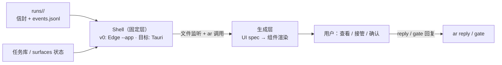

# 生成式 UI 工作台

> 状态：v0 已实现（固定组件 + Edge `--app` 壳），生成层（UI spec）仍属 v3 · 上位文档：[ADR 0008](adr/0008-local-agent-runtime.md)、[agent:local 运行时设计](agent-local-runtime.md) · 关联：[Personal Agent 设计](personal-agent.md)、[多端显示仲裁](surface-arbiter.md)、[统一渲染管线](render-pipeline.md)
>
> 本文定义工作站桌面上的人机交互界面：用户查看与接管 `agent:local` Run 的主要界面。形态参考 T3Code / Grok / Codex Desktop / DSBot 一类对话流工作台——v0 已实现三栏+事件流卡片+composer 直派任务（`C:\Repos\agent-local-runtime\workbench\`），生成层（模型按需产出界面组件）为 v3 目标。

## 1. 两层结构：固定壳 + 生成层

| 层 | 职责 | 变更方式 |
|---|---|---|
| **Shell（固定层）** | 窗口与进程管理、`runs/` 文件监听并推送、`ar` CLI 桥接、产物文件预览（Markdown / PDF / 图片 / diff）、接管操作入口 | 随版本发布演进 |
| **生成层（流动层）** | 模型输出的 UI spec（组件树 JSON）由渲染器即时生成视图：进度卡片、Run 树、比选界面、升级卡片 | 每次任务、每条消息可不同 |

Shell 长期稳定、只提供能力；界面形态跟随模型与任务走。这与系统主干「能力作插件挂载」是同一原则在界面层的投影。

## 2. 技术选型：系统 WebView2，壳体分两期

| 候选 | 取舍 |
|---|---|
| **Tauri（目标壳）** | Windows 上复用系统 WebView2（与 Edge 同源引擎，滚动与字体渲染即原生体感）；二进制 ~10MB；Rust 侧只做文件 IO 与 `ar` 进程桥接，壳体极薄。**前置条件**：Rust + MSVC Build Tools（当前工作站未装，安装约 2–7 GB），工具链到位后切换 |
| **Edge `--app=`（v0 壳，已落地）** | `node workbench/server.ts` 桥接 `runs/` + `msedge --app=<url>` 无铬窗口——同一 WebView2/Chromium 引擎、独立任务栏窗口，**零新增工具链**。桥接与渲染层与 Tauri 方案完全一致，届时只换窗口宿主，前端与 API 原样保留。实现于 `C:\Repos\agent-local-runtime\workbench\` |
| Electron | DS-Bot Desktop 采用此方案（Electron + Vite，壳内显示 DSH 的 Web 前端），证明「壳 + Web UI」模式成立；但需自养一个 Chromium 实例，与本机已有 ego(lite) 功能重复，常驻成本不符合作风 |
| Qt / PySide6 | 原生控件擅长静态表单；生成式界面是模型运行时产出的动态文档流，声明式动态渲染反而别扭 |
| WinUI 3 | 最贴近系统观感，但 XAML 静态结构与「模型说什么就渲染什么」之间存在额外生成层，开发成本高收益低 |

DS-Bot 技术栈对照：DS-Bot Desktop = Electron 壳 + DSH Web 前端（pin `DSH 0.2.1-rc.4` + `ds-bot` 插件，独立 `DSH_HOME`）。本工作台与 DS-Bot Web 同属 WebView2/Chromium 生态，**交互卡片与生成组件的样式模板可共用一套**——消息卡片在 IM、DS-Bot 与工作台三处呈现一致。

## 3. 数据面：只读消费，不落副本

- **唯一数据源是文件**：`runs/<root_id>/` 的信封与 `events.jsonl`、任务库状态、`surfaces` 声明。Shell 用文件系统监听推送增量，不在前端维护任何状态副本（对应 [系统拓扑 §5](system-topology.md#5-状态展示与交互界面)）。
- **渲染的是产物，不是 DAG**：用户看到进度卡片、Run 树、diff 预览、多候选比选、升级卡片；节点图作为执行数据留在信封里，不直接呈现（[agent:local 运行时设计 §6](agent-local-runtime.md#6-演进路径)）。
- **写回只有一条通道**：用户在界面上的所有动作（回复升级、批准 gate、选择候选）统一转为 `ar reply` / `ar orchestration gate-*` 调用，UI 不直接改文件。
- **确认点原样生效**：付款、删除、对外发布在 UI 里同样停在交互卡片（[ADR 0002](adr/0002-three-confirmation-points.md)），生成层不能绕过。

## 4. 渲染契约：UI spec

模型输出的不是 HTML，是**组件树 JSON**（UI spec）：声明组件类型、数据源引用与交互动作，由 Shell 内置渲染器解析为界面。两类来源：

| 来源 | 内容 | 复用 |
|---|---|---|
| 固定组件库 | 进度卡片、Run 树、diff 视图、比选网格、升级卡片、Markdown/PDF 预览 | Shell 内置，渲染器原子件 |
| 生成组件 | 模型按任务内容临时组织的版面（如「本次成片对比三版 + 波形图 + 选稿按钮」） | 模型输出 spec，渲染器实例化 |

模板资产与 [统一渲染管线](render-pipeline.md) 共用：同一套 HTML/CSS 组件定义，墨水屏渲染成位图、工作台渲染成可交互视图——一处维护，多终端输出。

## 5. 与其他界面的分工

| 界面 | 职责 | 关系 |
|---|---|---|
| **本工作台** | 工作站桌面：查看 Run、接管、确认、浏览产物 | v3 主界面 |
| **DS-Bot Web/Desktop** | 对话入口与消息推送（含移动端触达） | 常驻入口，工作台不替代 |
| **IM 卡片** | 三按钮确认、摘要通知 | 轻量触达，重交互回工作台或 DS-Bot |
| **`ev status` / TUI** | 终端面板与调试 | 兜底与排障入口 |

## 6. 明确不做

- **不渲染 DAG**：节点归属与依赖是执行数据，不以图形态呈现给用户。
- **不落状态副本**：UI 层无数据库、无缓存层，全部视图从文件重建。
- **不做多窗口工作台**：单窗口 + 生成层版面切换；Space/多任务并行由内容分区表达。
- **不绕过执行协议**：界面动作一律转成 `ar` 调用，不存在「UI 直接改状态」的路径。
